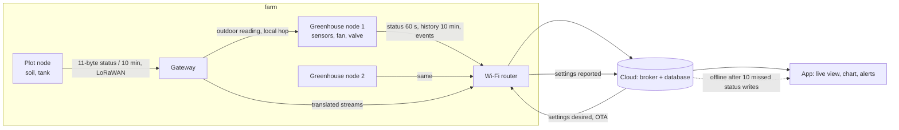

# IoT System Design Handbook

A ten-chapter course for people who can code but have never shipped a device-to-cloud system. One running example throughout: a small-farm environmental monitor (sensors → MCU → gateway → cloud → app). Two real, open-source systems appear as asides: the [queen-bee-incubator](https://github.com/Mariam-zeqred/queen-bee-incubator) and the [smart-poultry-farm](https://github.com/Mariam-zeqred/smart-poultry-farm) controller.

Each chapter is 1 500–3 000 words with one worked example, 3–5 exercises (answers collapsed), Mermaid diagrams where a picture helps, and a "What to read next" list. Code shown in a chapter lives in `examples/chNN/` and runs with `make check`.

## Chapters

| # | Chapter | One line |
|---|---|---|
| 1 | [Requirements and failure modes](ch01-requirements-and-failure-modes.md) | Write the "what must never happen" list first; a checker turns it into testable requirements. |
| 2 | [Choosing the data path](ch02-choosing-the-data-path.md) | List the computations, apply five placement rules in order, read the data path off the table; a traffic tool sizes three candidate paths. |
| 3 | [Data modelling](ch03-data-modelling.md) | One record is the contract; status, history, events and settings get a writer, a key, a mode and a retention; five rules for changing the schema under a live fleet; a validator, a frame codec and a growth table. |
| 4 | [Firmware architecture](ch04-firmware-architecture.md) | Cut the device's computations into tasks by rate, blocking and what they write; one snapshot with one writer per field; one interlock with a generated truth table; a watchdog fed by one task; a simulator measures what one blocking call does to the safety task. |
| 5 | [Safety layers that do not depend on the network](ch05-safety-layers.md) | How the guarding parts fail (a hung MCU, a shorted SSR, a lying sensor, a firmware that is alive and wrong); six layers ordered by what each senses, acts through and shares; pull-downs, the heartbeat gate and a bimetal cutout sized with two bounds; a coverage table and a stuck-heater simulation on the incubator's fitted chamber measure what each layer buys. |
| 6 | [Connectivity: choosing the link](ch06-connectivity.md) | Wi-Fi, LoRaWAN and cellular compared by reach, payload, message budget, downlink and what one message costs a battery; five exclusion rules per node and the cheapest survivor; LoRa airtime against the 1 % duty cycle and the 30 s fair use; MQTT's kept session against HTTPS per request; the comms task's contract (stages, clock before TLS, backoff with jitter, outbox per stream, keep-alive against N3); a selection tool, an energy budget and a 1 000-node reconnect simulation. |
| 7 | Provisioning, identity and secrets | *(not yet written)* what the two real repos got wrong and how to fix it. |
| 8 | Cloud side | *(not yet written)* Firebase RTDB vs AWS IoT Core vs self-hosted MQTT + Timescale; cost at 10 / 1 000 / 100 000 devices. |
| 9 | Observability and OTA | *(not yet written)* |
| 10 | Case study | *(not yet written)* the farm monitor end to end with every artefact. |

## The running example's data path

The farm monitor as chapters 1 to 3 leave it: two greenhouse nodes on Wi-Fi, a plot node 200 m away on LoRaWAN through a gateway, every critical computation on the device, and four streams crossing the link (status, history, events, settings), each with a schema from chapter 3.



Each chapter adds one artefact to this picture; chapter 10 assembles them.

## What the streams look like (chapter 3)

| Stream | Writer | Mode | Key | Kept |
|---|---|---|---|---|
| status | device | overwrite every 60 s | device | latest only |
| history | device | append every 10 min (`min`/`mean`/`max`) | device + `ts` | 2 years |
| events | device (app acknowledges) | append, `id` = `dev-ts-type` | `id` | forever |
| settings desired / reported | app / device | overwrite, `version` echoed | device | latest only |

Every record carries `schema` and `dev`; readers migrate old versions on read and tolerate fields they do not know. `examples/ch03/telemetry.py` validates records, decodes the plot node's 11-byte frame, clamps settings and prints the growth table the chapter quotes.

## What the firmware looks like (chapter 4)

| Task | Period | Blocks | Feeds watchdog | Writes |
|---|---|---|---|---|
| sensor | 15 s | no | no | readings, `sample_ts`, `seq` |
| safety | 100 ms | no | yes | `fan`, `valve`, `fault`; the only caller of the interlock |
| control | 1 s | no | no | `req_fan`, `req_valve` |
| display | 200 ms | no | no | nothing shared |
| datalog | 600 s | SD | no | history outbox |
| comms | 60 s | network, core 0 | no | `link_ok`, `rssi` |

`examples/ch04/firmware_sim.py` runs these six tasks as an RTOS would and as one `loop()` would, through a five-minute router outage; the chapter's table (safety-task gaps of 0.1 s versus 5 s with a watchdog and 90 s without, five resets, one false sensor fault) is its output.

## What the safety layers look like (chapter 5)

| Layer | Senses | Acts through | Catches |
|---|---|---|---|
| control, interlock (chapter 4) | the sensor | firmware → SSR | what the firmware can see and act on |
| watchdog + pull-down | the safety task's silence | a reset, the pin held low | a hung MCU |
| heartbeat gate | silence, or a fault the firmware declared | a second relay in series | a hung MCU, a shorted SSR |
| thermal cutout (bimetal, manual reset) | heat, directly | the heater circuit | a lying sensor, a wrong firmware |
| a person | the buzzer, the cloud's offline detection (N3) | hands | power loss (the heater's safe state) |

`examples/ch05/layers.py coverage` prints which layer survives which failure; `compare` runs four failures against four layer sets on the incubator's fitted chamber model (peak 68.4 °C with firmware alone when the SSR shorts, 41.3 °C with the gate; 62.8 °C after 90 minutes when the sensor sticks, 46.6 °C after 31 minutes with the cutout).

## What the links look like (chapter 6)

| node | link | why the others fell | downlink | energy |
|---|---|---|---|---|
| greenhouse nodes (mains, 25–40 m from the router, path B) | Wi-Fi + MQTT over TLS, kept session | LoRaWAN: 1 594 msg/day is 282 s of airtime against a 30 s fair use; cellular: $2/month for nothing Wi-Fi lacks | subscribed, seconds | mains |
| plot node (2 000 mAh, 200 m, 11-byte frame every 10 min) | LoRaWAN class A at SF8 | Wi-Fi: out of reach; cellular: 64 days of battery against a year | class A: the 10-minute uplink period | 1.16 mAh/day, ~3.3 years |
| pump-house node (mains, 1.8 km, frame every 15 min, command within 60 s) | LoRaWAN class C at SF9 | Wi-Fi: out of reach; cellular feasible, 75 cents more on assumed prices | class C: seconds | receiver on, 289 mAh/day |

`examples/ch06/link.py select nodes.json links.json` prints that table's reasons; `airtime`, `budget`, `protocol` and `backoff` print the numbers behind them (every current, second and price is a labelled assumption in `links.json`).

## Running the examples

```bash
pip install ruff pytest
make check          # lint, tests, and every example script
```

Each `examples/chNN/` folder has its own README with the commands for that chapter.

## Status and limitations

- Chapters 1 to 6 are written; 7 to 10 are planned (see the table above) and will be added one at a time.
- Every number quoted from the two real systems comes from their READMEs, not from measurements made for this handbook; every number produced by an example script is labelled as such in the chapter.
- The traffic figures in chapter 2 count payload, MQTT, TLS-record and LoRaWAN overhead only, not TCP/IP or radio framing, and their cost column is illustrative until chapter 8 cites real price pages.
- The growth figures in chapter 3 count compact JSON bytes only, not database keys or indexes; they are a floor for chapter 8 to price.
- Where chapter 3 reads the two real systems' schemas, it quotes their own `docs/DATA_CONTRACT.md` and `docs/FIREBASE_SCHEMA.md`, not a database inspected for this handbook.
- The examples are standard-library Python; nothing here runs on a microcontroller. Chapter 4's simulator models the task set and the interlock on the host; its greenhouse is a first-order model, so every number it prints is a property of the model and the task design, not a measurement. The firmware-side counterparts are the two real repos' firmware READMEs, which chapter 4 quotes.
- Chapter 4 quotes the two firmware READMEs for task rates, the interlock inputs and the watchdog; where a README gives no value (priorities, stacks, cores, the poultry controller's shared-state structure), the chapter says so rather than reading the code.
- Chapter 6's airtime figures are the SX127x datasheet formula, not measurements; its energy, range and price figures are assumptions listed with their origin in `examples/ch06/links.json`, and the battery lives, costs and the chosen links follow from them. Nothing was measured on a radio, a battery or a broker; the reconnect simulation is a model of a schedule, not a real fleet. Its statements about the two real systems' connectivity are quotations from their READMEs.
- Chapter 5's chamber model is the fit published in incubator-telemetry-analysis (one device, one day, door shut); everything above about 39 °C is an extrapolation of that linear fit, and the SSR, bimetal, gate and firmware in the simulation are models of the chapter's design, not measured parts. Its statements about what the two real systems lack (thermal cutout, fuse, pull-downs, a second series switch) are statements about their READMEs, not inspections of the hardware.

## Licence

MIT, see [LICENSE](LICENSE).
