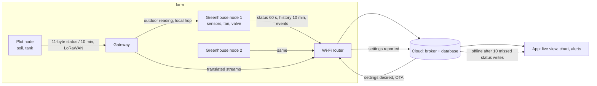

# IoT System Design Handbook

A ten-chapter course for people who can code but have never shipped a device-to-cloud system. One running example throughout: a small-farm environmental monitor (sensors → MCU → gateway → cloud → app). Two real, open-source systems appear as asides: the [queen-bee-incubator](https://github.com/Mariam-zeqred/queen-bee-incubator) and the [smart-poultry-farm](https://github.com/Mariam-zeqred/smart-poultry-farm) controller.

Each chapter is 1 500–3 000 words with one worked example, 3–5 exercises (answers collapsed), Mermaid diagrams where a picture helps, and a "What to read next" list. Code shown in a chapter lives in `examples/chNN/` and runs with `make check`.

## Chapters

| # | Chapter | One line |
|---|---|---|
| 1 | [Requirements and failure modes](ch01-requirements-and-failure-modes.md) | Write the "what must never happen" list first; a checker turns it into testable requirements. |
| 2 | [Choosing the data path](ch02-choosing-the-data-path.md) | List the computations, apply five placement rules in order, read the data path off the table; a traffic tool sizes three candidate paths. |
| 3 | [Data modelling](ch03-data-modelling.md) | One record is the contract; status, history, events and settings get a writer, a key, a mode and a retention; five rules for changing the schema under a live fleet; a validator, a frame codec and a growth table. |
| 4 | Firmware architecture | *(not yet written)* tasks, rates, shared state, the single interlock. |
| 5 | Safety layers that do not depend on the network | *(not yet written)* |
| 6 | Connectivity | *(not yet written)* Wi-Fi, MQTT, HTTPS, LoRaWAN, cellular; a selection table with power and cost. |
| 7 | Provisioning, identity and secrets | *(not yet written)* what the two real repos got wrong and how to fix it. |
| 8 | Cloud side | *(not yet written)* Firebase RTDB vs AWS IoT Core vs self-hosted MQTT + Timescale; cost at 10 / 1 000 / 100 000 devices. |
| 9 | Observability and OTA | *(not yet written)* |
| 10 | Case study | *(not yet written)* the farm monitor end to end with every artefact. |

## The running example's data path

The farm monitor as chapters 1 to 3 leave it: two greenhouse nodes on Wi-Fi, a plot node 200 m away on LoRaWAN through a gateway, every critical computation on the device, and four streams crossing the link (status, history, events, settings), each with a schema from chapter 3.



Each chapter adds one artefact to this picture; chapter 10 assembles them.

## What the streams look like (chapter 3)

| Stream | Writer | Mode | Key | Kept |
|---|---|---|---|---|
| status | device | overwrite every 60 s | device | latest only |
| history | device | append every 10 min (`min`/`mean`/`max`) | device + `ts` | 2 years |
| events | device (app acknowledges) | append, `id` = `dev-ts-type` | `id` | forever |
| settings desired / reported | app / device | overwrite, `version` echoed | device | latest only |

Every record carries `schema` and `dev`; readers migrate old versions on read and tolerate fields they do not know. `examples/ch03/telemetry.py` validates records, decodes the plot node's 11-byte frame, clamps settings and prints the growth table the chapter quotes.

## Running the examples

```bash
pip install ruff pytest
make check          # lint, tests, and every example script
```

Each `examples/chNN/` folder has its own README with the commands for that chapter.

## Status and limitations

- Chapters 1 to 3 are written; 4 to 10 are planned (see the table above).
- Every number quoted from the two real systems comes from their READMEs, not from measurements made for this handbook; every number produced by an example script is labelled as such in the chapter.
- The traffic figures in chapter 2 count payload, MQTT, TLS-record and LoRaWAN overhead only, not TCP/IP or radio framing, and their cost column is illustrative until chapter 8 cites real price pages.
- The growth figures in chapter 3 count compact JSON bytes only, not database keys or indexes; they are a floor for chapter 8 to price.
- Where chapter 3 reads the two real systems' schemas, it quotes their own `docs/DATA_CONTRACT.md` and `docs/FIREBASE_SCHEMA.md`, not a database inspected for this handbook.
- The examples are standard-library Python; nothing here runs on a microcontroller. Chapters 4 and 5 will point to firmware-side counterparts in the two real repos.

## Licence

MIT, see [LICENSE](LICENSE).
