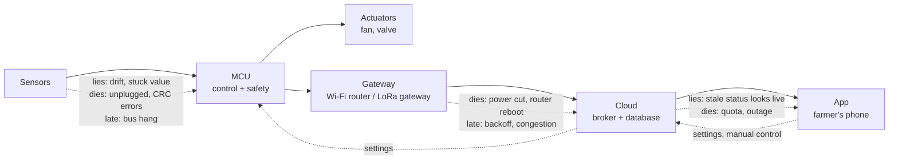
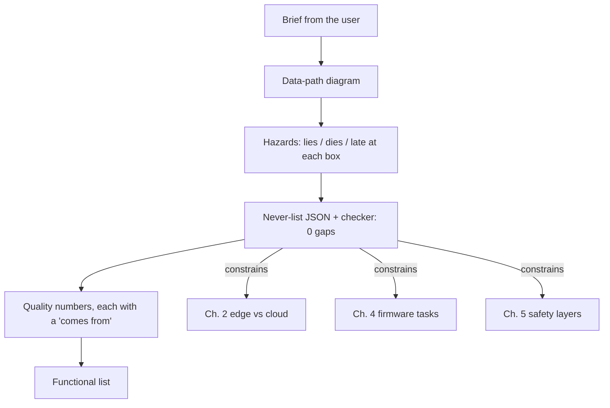

# Chapter 1 - Requirements and failure modes

*Write the "what must never happen" list first.*

Most device-to-cloud projects start with a feature list: read a sensor, send it to the cloud, show it in an app. The project then grows a safety story late, after the first scare in the field. This chapter turns that order around. You will write down what the system must never do, derive requirements from that list, and only then decide what it should do. The result is a short set of artefacts you can show to anyone who asks "is this thing safe to leave running on a farm?".

The running example for the whole handbook is a **small-farm environmental monitor**: a few sensors on a microcontroller, a gateway, a cloud back end and a phone app. Two real systems appear as asides throughout: the [queen-bee-incubator](https://github.com/Mariam-zeqred/queen-bee-incubator) (an ESP32 that holds a brood chamber at 34.5 °C) and the [smart-poultry-farm](https://github.com/Mariam-zeqred/smart-poultry-farm) controller (an ESP32 that drives a fan, cooler, heater and humidifier for a poultry house). Both are open source and were built as working products rather than demos, so their READMEs are a useful record of which failure modes mattered; every figure quoted from them below comes from those READMEs, not from measurements made for this handbook.

## 1. The brief

A farmer with two greenhouses and an outdoor plot wants to know, from a phone, whether the crops are in trouble. After a short conversation the brief looks like this:

- Measure air temperature and humidity in each greenhouse, soil moisture in the plot, and the level of the irrigation water tank.
- Switch one ventilation fan per greenhouse and one irrigation valve, automatically within limits the farmer sets, and manually from the phone.
- Show live values and a week of history in an app. Alert the farmer when something is wrong.
- Mains power is available at the greenhouses but cuts out several times a week. Wi-Fi covers the greenhouses; the plot is 200 m away.
- Budget: under 150 USD of hardware per greenhouse, and no monthly bill that scares a smallholder.

That is a feature list. It says nothing about the night the fan relay sticks on, or the week the router is dead and the farmer assumes silence means "all fine". Those are the cases that decide whether the system is trusted.

## 2. Walk the data path and ask three questions

Every device-to-cloud system is the same five boxes. Draw them before writing any requirement, then stand at each box and ask: *what if this part lies, dies, or is late?*



"Lies" is the question beginners skip. A sensor that returns 25.0 °C for ever is more dangerous than one that returns nothing, because every layer above it sees a plausible number. A cloud dashboard that keeps showing the last value with no timestamp is lying in exactly the same way, one level up.

For each box, the answers go into a list of **hazards**. A hazard is a sentence about the world, not about code: "the fan stays off while the greenhouse overheats", not "the relay task deadlocks". The code-level cause belongs in a later column; the hazard is what the farmer would describe.

## 3. Three kinds of requirement

Once you have hazards, requirements fall into three groups, and the groups are written in this order:

| Kind | Question it answers | Example from the farm monitor |
|---|---|---|
| **Never-list** (safety and trust) | What must never happen, and how do we know it did not? | The valve shall never stay open when the tank reads empty. |
| **Quality** (numbers) | How fast, how accurate, how long, how much? | Temperature within ±0.5 °C; status every 60 s; 7 days of history; under 150 USD per greenhouse. |
| **Functional** (features) | What does it do for the user? | The app shows live readings and lets the farmer set fan thresholds. |

The never-list goes first because it constrains the architecture. If the fan must keep working with the network down, control logic cannot live in the cloud, and chapter 2's "edge vs cloud" decision is already half made. If a stuck sensor must be detected, the firmware needs a second source of truth (a timeout, a range check, a second sensor), which shapes chapter 4's task design. Features never constrain architecture this way; you can add a history chart to almost any design.

## 4. The never-list method

Each row of the never-list carries the same fields. The fields are the method.

1. **Hazard**: the sentence about the world. Keep it to one event.
2. **Severity**: `critical` (harm to animals, crops, people or equipment), `major` (loss of trust or data the user depends on), `minor` (inconvenience).
3. **Caused by**: which parts of the data path can produce it. Parts are `sensor`, `mcu`, `actuator`, `power`, `network`, `cloud`, `app`, `human`.
4. **Detection**: how the system would know. Write the concrete condition: "no valid reading for 3 periods", not "sensor failure".
5. **Guarded by**: which parts the detection and response rely on.
6. **Response**: what the system does, in one sentence.
7. **Response depends on**: which parts must be working for the response to happen.
8. **Test**: how you would prove it on a bench before shipping.

Two rules sit on top of the fields and catch most of the mistakes seen in student and startup projects:

- **Rule A.** A `critical` response must not depend on `network`, `cloud` or `app`. Those three parts fail more often than everything else combined, and they fail together (one router reboot takes out all three from the device's point of view).
- **Rule B.** A hazard must not be guarded only by the parts that can cause it. If the firmware can cause the hazard and only the firmware detects it, one bug removes both. Add an independent check: a second sensor, a hardware watchdog, a pull-down resistor, a person.

These rules are mechanical enough to automate, which is what the chapter's example does.

## 5. Worked example: the farm monitor's never-list

The list below is the first pass for the farm monitor. It lives in [`examples/ch01/never_list.json`](examples/ch01/never_list.json) in exactly this form, so the checker can read it.

| ID | Severity | Must never happen | Caused by | Detection | Response |
|---|---|---|---|---|---|
| N1 | critical | The heater stays on until the room overheats | mcu, actuator | temp above the hard limit for > 30 s, or heater on longer than its max on-time | open the relay, latch the fault until a person clears it, sound the buzzer |
| N2 | critical | A sensor fails and the controller keeps acting on its last value | sensor | no valid reading for 3 periods, CRC error, or value outside the physical range | every actuator to its safe state, error alarm |
| N3 | major | The farmer believes the system is fine while it has been silent for an hour | network, power, mcu | cloud side: no status write for 10 min | mark the device offline in the app, push notification |
| N4 | critical | A reboot after a power cut turns an actuator on before any reading exists | mcu, power | boot sequence, plus pull-downs on every relay driver pin | safe state before sensors or network are initialised |
| N5 | major | A setting typed in the app is applied without limits | app, cloud | setting outside the allowed range or changing too fast | clamp on the device, report the clamped value back |
| N6 | minor | Readings are lost during a network outage | network | publish fails or no acknowledgement | buffer locally, replay in order after reconnecting |
| N7 | critical | Anyone on the internet can change a device's settings | cloud | *(empty)* | *(empty)* |

The farm brief has a fan and a valve rather than a heater, so N1 is written for the general "actuator stuck on" case using the heater as the worst instance; the exercises add the valve-specific rows.

### Running the checker

`examples/ch01/never_list.py` is about 150 lines of standard-library Python. It loads the JSON, derives one "shall" sentence per hazard, and applies the two rules plus the obvious completeness checks. The core of it is one method on the `Hazard` dataclass:

```python
def gaps(self) -> list[str]:
    found: list[str] = []
    if not self.detection:
        found.append("no detection: how would the system know?")
    if not self.response:
        found.append("no response: what does the system do?")
    if not self.test:
        found.append("no test: how would you prove it before shipping?")
    if self.severity == "critical":
        remote = sorted(set(self.response_depends_on) & REMOTE_PARTS)
        if remote:
            found.append(f"critical response depends on {remote}; "
                         "it must work with the network down")          # Rule A
    if self.guarded_by and set(self.guarded_by) <= set(self.caused_by):
        found.append("guarded only by the parts that can cause it; "
                     "add an independent check")                        # Rule B
    return found
```

Run it:

```bash
cd examples/ch01
python never_list.py never_list.json
```

Output (produced by running the file in this repo):

```
7 hazards, 3 gap(s)
N7: no detection: how would the system know?
N7: no response: what does the system do?
N7: no test: how would you prove it before shipping?
```

followed by a Markdown table of derived requirements. The exit code is 1 while gaps remain, so the same command can run in CI and block a release whose never-list has holes.

### What the checker caught on the first draft

The first draft of N4 read: detection "boot sequence itself", guarded by `mcu`, caused by `mcu, power`. Rule B fired: the only thing stopping a relay from switching on during boot was the firmware's boot order, and a firmware bug (or a crash loop that never reaches the "safe state" line) is exactly what causes the hazard. The fix is in hardware, not software: a pull-down resistor on each relay driver pin, so that the relay board's state at reset is "off" before the first instruction runs. In the table that appears as `guarded_by: ["mcu", "actuator"]`, and the detection text names the resistors. This is a cheap fix that is almost never in a first design, and the rule finds it mechanically.

N7 is left empty on purpose. It is the subject of exercise 1 and of chapter 7, and it is the one row that both real systems below had to confront after they were built.

### Derived requirements

The `--markdown` flag prints the "shall" sentences. N1 becomes:

> The system shall detect when the heater stays on until the room overheats (temperature above the hard limit for more than 30 s, or heater commanded on for longer than its maximum on-time) and shall open the heater relay, latch the fault until a person clears it, and sound the local buzzer.

That sentence is testable, names its numbers, and says what happens with the network down. It is a requirement. "The system shall be safe" is not.

## 6. From hazards to numbers

Quality requirements are the numbers that make the never-list and the brief concrete. Every number should trace back to a row above or a line in the brief; if it does not, it is a guess and should be labelled as one.

| Requirement | Number | Comes from |
|---|---|---|
| Sensor period | 15 s | N2: three missed periods gives a 45 s detection delay, short enough for a greenhouse (thermal time constants are tens of minutes) |
| Status write to cloud | every 60 s | N3: ten misses before "offline" keeps false alarms rare during Wi-Fi hiccups |
| Offline threshold | 10 min | N3 and the brief (power cuts "several times a week" must not spam the farmer) |
| Temperature accuracy | ±0.5 °C | fan thresholds are set in whole degrees; anything tighter costs money without changing a decision |
| Local buffer | 2 h at 15 s = 480 readings | N6: the brief's outages are minutes, not days; 480 × ~60 bytes is under 30 kB, fine for an ESP32 |
| History retention | 7 days hot, 1 year cold | brief ("a week of history"); cold storage is cheap, chapter 8 prices it |
| Hardware cost | under 150 USD per greenhouse | brief |

Notice that the 15 s period is set by a detection requirement, not by "how often do we want a chart point". Reporting rate and sensing rate are different numbers; chapter 3 separates them into *status*, *history* and *events*.

## 7. Two real never-lists

Both public repos were built before this handbook existed, and both reached the same shape by trial. Reading their READMEs with the rules above in mind is the best exercise in this chapter.

**queen-bee-incubator.** The firmware runs five FreeRTOS tasks at fixed rates, and the safety task (10 Hz) is separate from the control task (1 Hz). Its README lists: a 40 °C thermal cutoff that stays latched until a person acknowledges it *and* the chamber has cooled; sensor-failure and stale-reading detection; a maximum heater-on time; heat-up anomaly detectors; a door-open actuator cutoff; and a hardware task watchdog. One interlock module decides whether the heater or fan may run at all, the fan relay is the first instruction executed at boot, and the heater is forced off at every start and restart. Maintenance-class faults persist in non-volatile storage across reboots and need a 10-second service reset. Map that onto the table: N1 (max on-time, cutoff, latch), N2 (stale and failed sensor), N4 (fan first, heater off at boot), all with responses that depend only on the MCU and the relays. Rule A is satisfied by construction because none of the safety responses mention Firebase. Rule B is satisfied by the control sensor having its own I2C bus and by the hardware watchdog.

**smart-poultry-farm.** Its README has an explicit priority table: safety first (gas above 450 ppm, temperature below 10 °C or above 42 °C, humidity below 30 % or above 85 % set all four relays explicitly and lock every UI), then the scheduled fan cycle, then auto mode, then manual control. Two interlocks always apply: heater and cooler never run together, and the cooler forces the fan on because an evaporative pad needs airflow. Its answer to N3 is interesting: the app owns control only while it can reach the device, and after 90 s of cloud silence the LCD takes over automatically. That is a response to "the network died" that lives entirely on the device, which is what Rule A demands.

Both READMEs are also honest about N7. The incubator README says the database rules must confine each device to its own path and the apps need real authentication before any unit controls a real heater. The poultry README says the firmware uses a legacy database secret, skips TLS verification, and that the database rules are open and must be tightened before public use. Those are three gap-report lines, written by hand, after the fact. Chapter 7 fixes them properly; the point here is that the row existed in reality whether or not anyone wrote it down first.

## 8. What to hand over at the end of this step

By the end of the requirements step you should have, in the repo and nowhere else:

1. The brief, as written by the user, unedited.
2. The data-path diagram with the "lies / dies / late" annotations.
3. The never-list as a machine-readable file and the checker output with zero gaps.
4. The quality-requirements table with a "comes from" column.
5. The functional list, last and shortest.



Chapters 2 to 10 each consume one of these artefacts. If a later chapter's decision cannot be traced back to a row here, either the row is missing or the decision is unjustified.

## Exercises

1. **Complete N7.** Fill in detection, guarded-by, response, response-depends-on and test for "anyone on the internet can change a device's settings", then run the checker and get `7 hazards, 0 gap(s)`. Be careful with Rule A: the hazard is caused by the cloud, but can the response be?
2. **Add the valve.** Write two new rows for the irrigation valve: "the valve stays open and floods the plot" and "the pump runs with an empty tank". For each, name the independent guard that satisfies Rule B.
3. **Fix a bad proposal.** A team member proposes: "the app will send a push notification if temperature exceeds 40 °C, and the farmer will switch the fan on". Which rule does this break as the only overheat protection, and what is the smallest change that makes it acceptable?
4. **Classify from a real README.** From the smart-poultry-farm README's priority table, write one never-list row and one quality requirement, with severities and "comes from".
5. **Size the buffer.** The device samples every 15 s and the broker is unreachable for 6 h. How many readings must be buffered, and roughly how many bytes at 60 bytes each? Does this change the local-buffer requirement in section 6, and what would you do instead of raising it?

<details>
<summary>Answers</summary>

**1.** Detection: a write to the device's settings path from an identity that is not the farmer's account, or any write while the database rules allow unauthenticated access (the real detection is a rules test, run before deployment). Guarded by: cloud (rules), mcu (range clamp from N5). Response: database rules confine each device to its own path and require an authenticated owner; the device additionally clamps every setting (N5) so that even a malicious write cannot push an actuator past its hard limit. Response depends on: cloud, mcu. Test: with a second, unauthorised account, attempt to write `target=90`; the write must be rejected, and if rules are misconfigured the device must still report the clamped maximum. Rule A: the hazard is critical and the primary response (rules) depends on the cloud, so the checker will flag it. The way out is the N5 clamp on the device: the critical part of the response (never heat past the hard limit) depends only on the MCU; the cloud rules reduce the attack surface but are not what makes the system safe. Write the row so that `response_depends_on` is `["mcu"]` and the rules are described in the detection and test fields.

**2.** *Valve stays open*: caused by mcu, actuator; detection: valve commanded open longer than the maximum watering time, or soil moisture not rising within 10 minutes of opening; independent guard: a hardware maximum-on timer (a 555 or a retriggerable monostable) on the valve driver, or a normally-closed valve with a pull-down so loss of drive closes it. *Pump runs dry*: caused by sensor (level reads full when empty), mcu; detection: float switch (a second, binary level sensor) reads empty, or pump current drops below the no-load threshold; independent guard: wire the float switch in series with the pump contactor coil so the pump cannot run with the tank empty whatever the firmware says.

**3.** It breaks Rule A: a critical response depends on network, cloud, app and human. The smallest acceptable change is to keep the notification (useful for N3-style awareness) and add an on-device response: the MCU switches the fan on itself at the hard limit, with a hardware maximum-on time, and the notification reports what it did.

**4.** Never-list row: "the heater and the evaporative cooler run at the same time" (critical: wastes energy and can trip the supply; caused by mcu, app; detection: both relays commanded on; guarded by mcu interlock; response: the interlock function refuses the second relay; test: command both from the app, verify only one closes). Quality requirement: "safety limits: gas 450 ppm, temperature 10–42 °C, humidity 30–85 %", comes from the README's priority table (and, in a real project, from an agronomist or veterinarian, which is where you should cite from).

**5.** 6 h × 3600 s / 15 s = 1 440 readings, about 86 kB at 60 bytes each. That is a lot of an ESP32's heap to hold in RAM on top of TLS buffers, and it only covers 6 h. Rather than raise the RAM buffer, change the requirement: keep the last 2 h in RAM for fast replay, and append everything to flash (SD card or a LittleFS ring file) as the incubator README describes for its SD-card CSV log. Then the buffer size is bounded by the card, not the heap, and the N6 requirement reads "no reading is lost for outages up to the card's capacity".

</details>

## What to read next

- **Chapter 2** uses the never-list to decide what runs on the device and what runs in the cloud, and gives the decision table.
- Nancy Leveson and John Thomas, *STPA Handbook* (2018, free PDF from MIT). The "lies / dies / late" walk in this chapter is a small, informal version of STPA's unsafe-control-action analysis; the handbook is the full method.
- Michael Nygard, *Release It!* (2nd ed., 2018), chapters on stability patterns. Written for servers, but "timeouts", "circuit breakers" and "fail fast" are exactly N2, N3 and N4 one layer up.
- The "What it does" section of the [queen-bee-incubator README](https://github.com/Mariam-zeqred/queen-bee-incubator) and "How control decisions are made" in the [smart-poultry-farm README](https://github.com/Mariam-zeqred/smart-poultry-farm), read with the two rules in hand.
