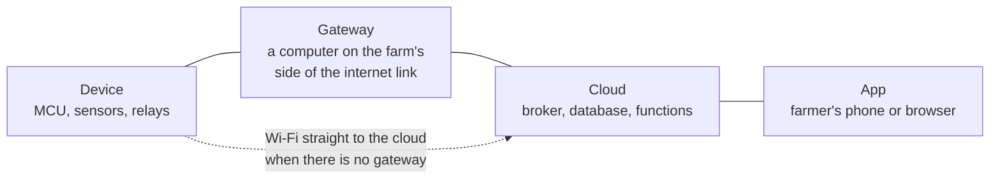
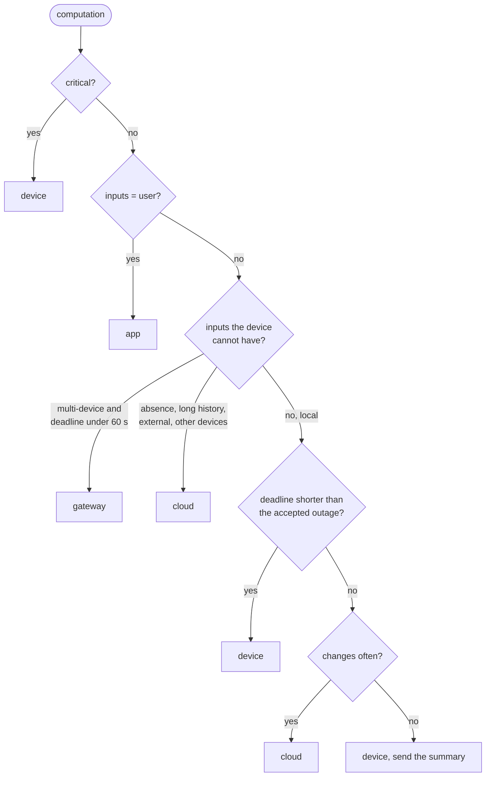
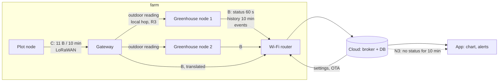

# Chapter 2 - Choosing the data path

*Decide where each computation runs before deciding how the boxes talk.*

Chapter 1 ended with a never-list and a table of numbers. This chapter spends them. Every device-to-cloud system computes a few dozen things: a filtered reading, a control decision, a ten-minute average, an "offline" flag, a chart, a firmware roll-out. Each has to run somewhere, and the choice of *where* is the data path. Beginners choose by habit ("send everything to the cloud, do the logic there" or "the cloud is just storage"), and get systems that are unsafe when the router dies or impossible to change once a hundred units are in the field. The method here is to list the computations, apply five rules in a fixed order, and read the data path off the result.

## 1. The four places a computation can run



| Place | Good at | Bad at |
|---|---|---|
| **Device** | Always present; sub-second response; sees raw readings; works with no network | Small memory; no view of other devices; every bug is a field visit or an OTA |
| **Gateway** | Local-network latency; sees all devices on site; can run a camera model or a local dashboard | One more box to power, secure and update; often skipped on Wi-Fi sites |
| **Cloud** | Unlimited history; sees the whole fleet; cheap to change; push services and weather APIs | Absent during every outage; costs per message and per byte; sees only what the device chose to send |
| **App** | Where the person is; rendering and input | Not running most of the time; nothing the system needs may rely on it |

The gateway deserves a sentence because the farm brief seems not to need one: the greenhouses have Wi-Fi. But the plot 200 m away does not, which forces a LoRa link to *something* at the greenhouse, and that something is a gateway whether or not you call it one. Once it exists, other computations may move onto it. A tier appears for a physical reason, then earns its keep.

## 2. List computations, not features

A feature ("the farmer can set fan thresholds from the phone") spans every tier. A computation is one function with named inputs and one output, small enough to place in one tier. Turn each feature and each never-list row into computations before placing anything. The farm monitor's list, trimmed to fourteen rows, is in [`examples/ch02/computations.json`](examples/ch02/computations.json) with the four attributes the rules need.

- **critical**: does a `critical` never-list response depend on it? (Chapter 1's checker tells you.)
- **deadline_s**: how soon the output is needed after its inputs exist: a fraction of the process time constant for a control decision, what a person will tolerate for a display, `null` when there is none.
- **inputs**: `local` (this device's own readings and settings), `absence` (the fact that something did *not* arrive), `multi-device`, `long-history` (more than the device keeps), `external` (a weather API, a push service), or `user` (a person's eyes and fingers).
- **changes**: `rarely`, `sometimes` or `often`. Control rules tuned once a season change rarely; a model retrained weekly changes often.

Writing the attributes is most of the work. "Fan control" turns out to be two computations: the hysteresis rule (local, critical) and the use of the single outdoor sensor by both greenhouses (multi-device, not critical). Splitting them is what lets each half live where it belongs.

## 3. Five rules, in order

The rules are applied top to bottom; the first match decides.



**R1. Critical runs on the device.** This is chapter 1's Rule A as a placement rule. There is no exception for "the cloud is very reliable": the device's view of the cloud includes the router, the ISP and the mains, and those fail weekly on a farm.

**R2. Presentation and human input run in the app.** Charts, forms, confirmations. Nothing the system needs may live here, because the app is closed most of the time.

**R3. Inputs the device cannot have decide the tier.** A device cannot detect its own silence; that computation runs where the silence is observed, the cloud, as do weeks of history, the weather, the push service and the rest of the fleet. The one carve-out is a multi-device computation with a deadline under a minute: a reading from node 3 used by nodes 1 and 2 within a control period should hop across the local network, not go up to the cloud and back down through two outages. That is the gateway's job.

**R4. A deadline shorter than the accepted outage keeps it on the device.** Chapter 1 set the offline threshold at 10 minutes, so the system has already accepted that the cloud may be absent that long without anyone being told. Any output needed sooner cannot wait for it; the local display's one-second refresh is the obvious case. The rule is about availability, not round-trip time: a cloud round trip takes 200 ms when it works, and the question is what happens during the 10 minutes when it does not.

**R5. Otherwise, let the cost of change decide.** Something that changes often with no tight deadline (an anomaly model, a roll-out plan) belongs in the cloud, where a deploy takes a minute instead of an OTA campaign. Something stable with local inputs (the ten-minute downsample) runs at the source and only the summary crosses the link.

Running [`examples/ch02/data_path.py`](examples/ch02/data_path.py) over the fourteen rows gives the decision table. The output below is what the script prints in this repo:

```
$ cd examples/ch02 && python data_path.py place computations.json
Sample the sensors                                             device   R1 critical: may not depend on the link (ch. 1 Rule A)
Validate a reading (range, CRC, staleness)                     device   R1 critical: may not depend on the link (ch. 1 Rule A)
Safety cutoff (hard limit, max on-time, latch)                 device   R1 critical: may not depend on the link (ch. 1 Rule A)
Fan and valve hysteresis control                               device   R1 critical: may not depend on the link (ch. 1 Rule A)
Clamp a setting to its allowed range                           device   R1 critical: may not depend on the link (ch. 1 Rule A)
Drive the local display                                        device   R4 deadline 1 s is shorter than the accepted outage (600 s)
Downsample 15 s readings to 10-min min/mean/max                device   R5 local inputs, no tight deadline, stable: run it at the source and send the summary
Detect a silent device (N3)                                    cloud    R3 needs inputs the device cannot have (absence)
Share the one outdoor sensor with both greenhouse controllers  gateway  R3 needs other devices' data within 60 s: a local hop
Irrigation plan from the weather forecast                      cloud    R3 needs inputs the device cannot have (external)
Drift and anomaly detection across both greenhouses            cloud    R3 needs inputs the device cannot have (long-history)
Push an alert to the farmer's phone                            cloud    R3 needs inputs the device cannot have (external)
Draw the week's history chart                                  app      R2 presentation and human input run where the person is
Choose which devices get a firmware build                      cloud    R3 needs inputs the device cannot have (multi-device)
14 computations: 7 device, 1 gateway, 5 cloud, 1 app
```

The method is deliberately dumb. Its value is that every placement comes with a reason you can argue with, and that when a never-list row becomes critical the table changes mechanically. The `place` method is the whole decision procedure:

```python
def place(self, accepted_outage_s: float) -> tuple[str, str]:
    """Return (place, rule) for this computation.

    The rules are applied in order; the first that matches wins.
    """
    if self.critical:
        return "device", "R1 critical: may not depend on the link (ch. 1 Rule A)"
    if self.inputs == "user":
        return "app", "R2 presentation and human input run where the person is"
    if self.inputs in REMOTE_INPUTS:
        tight = self.deadline_s is not None and self.deadline_s < 60
        if tight and self.inputs == "multi-device":
            return (
                "gateway",
                "R3 needs other devices' data within 60 s: a local hop",
            )
        return "cloud", f"R3 needs inputs the device cannot have ({self.inputs})"
    if self.deadline_s is not None and self.deadline_s < accepted_outage_s:
        return "device", (
            f"R4 deadline {self.deadline_s:g} s is shorter than the accepted outage "
            f"({accepted_outage_s:g} s)"
        )
    if self.changes == "often":
        return (
            "cloud",
            "R5 changes often and has no tight deadline: keep it where it is cheap to change",
        )
    return (
        "device",
        "R5 local inputs, no tight deadline, stable: run it at the source and send the summary",
    )
```

## 4. Two placements that beginners get backwards

**Control in the cloud.** The tempting design is a device that publishes readings and subscribes to relay commands, with the hysteresis rule in a cloud function. It is easy to write and easy to change, and it fails R1 for the fan and the valve: during an outage the relays freeze in their last state, which for a fan on a hot afternoon is fine and for an open valve is a flooded plot. If a project insists on cloud-side control for non-critical actuators, the device must still own a timeout that returns each actuator to its safe state when commands stop arriving, and that timeout is itself a critical computation on the device.

**Offline detection on the device.** The mirror mistake is a device that sets an "offline" flag in the database when it loses Wi-Fi. It cannot: the write that would carry the flag is the thing that failed. N3 lives in the cloud as "no status write for 10 minutes"; the device's contribution is the regular status write. The second real system below does the correct thing in the other direction: the *device* detects the *app's* silence and takes control back.

## 5. Worked example: three data paths for the same device

Placement says what runs where; the data path also says what crosses each link and how often. The three candidates below all satisfy the decision table and differ in what the greenhouse node sends. [`examples/ch02/paths.json`](examples/ch02/paths.json) describes each as a set of streams with an example payload, and the `traffic` tool measures the payloads rather than trusting a guessed byte count.

- **Path A, every raw reading to the cloud.** One JSON message per 15 s sample, over MQTT with TLS on Wi-Fi. The cloud downsamples, charts and alerts.
- **Path B, status plus history plus events.** A small status record every 60 s (overwritten in the database, so it never grows), a 10-minute min/mean/max record for the history chart, and an event record with 60 s of context whenever the device decides something (fan on, limit hit). This is the shape chapter 3 will give a schema.
- **Path C, binary status over LoRaWAN.** An 11-byte frame every 10 minutes plus the same events, as the plot node would send through the gateway.

```
$ python data_path.py traffic paths.json
Per message, measured from the example payloads:
  A raw reading                body   73 B, on the wire  118 B,  5760.0 msg/day
  B status                     body   84 B, on the wire  132 B,  1440.0 msg/day
  B 10-min aggregate           body  140 B, on the wire  189 B,   144.0 msg/day
  B event with 60 s of context body  104 B, on the wire  152 B,    10.0 msg/day
  C status                     body   11 B, on the wire   24 B,   144.0 msg/day
  C event                      body   11 B, on the wire   24 B,    10.0 msg/day
```

| Path | msg/day per device | kB/day per device | MB/month per device | offline seen after 10 misses | msg/month, 1 000 devices | USD/month, 1 000 devices (illustrative) |
|---|---|---|---|---|---|---|
| A: every raw reading to the cloud | 5 760 | 679.7 | 20.39 | 2 min | 172 800 000 | 172.80 |
| B: status + 10-min history + events | 1 594 | 218.8 | 6.56 | 10 min | 47 820 000 | 47.82 |
| C: 10-min binary status over LoRaWAN | 154 | 3.7 | 0.11 | 100 min | 4 620 000 | 4.62 |

The table is the script's output reformatted. The cost column multiplies message count by the illustrative one US dollar per million messages set in `paths.json`, the order of magnitude of published broker prices but not a quotation; chapter 8 cites the real pages. Four things to read off it:

1. **Bytes are not the problem on Wi-Fi; messages are.** Path A moves 20 MB a month per device, trivial for a router, but 173 million messages a month across a thousand devices, and brokers bill per message. Path B cuts that 3.6 times by downsampling on the device (R5) and sending 144 history records a day instead of 5 760.
2. **The status period is also the detection period.** With N3's "offline after 10 misses", path A sees a dead device in 2 minutes, path B in 10, path C in 100. Path C's period was chosen for LoRaWAN duty-cycle limits (chapter 6), so the plot node needs its own N3 rule: three misses, 30 minutes, tolerable for a soil sensor and not for a heater.
3. **Events carry the interesting bytes.** Ten events a day with 60 s of context cost 1.5 kB, under one per cent of path B, and they are the records a person opens after an incident. Spend bytes there, not on raw samples.
4. **A path is per link, not per system.** The farm monitor ends up with B on the greenhouse nodes and C on the plot node, the gateway translating C into B's streams before they reach the cloud.



## 6. Two real data paths

Both public systems made these choices by iteration, and their READMEs record the result.

**queen-bee-incubator.** The README describes control at 1 Hz and safety at 10 Hz on the ESP32 and every safety response on the device: R1 applied to every row of its never-list. Upstream, a 60-reading ring buffer is drained once a minute to an SD-card CSV and to Firebase, so readings are taken at 1 Hz but the link sees one write per minute, which is path B's batching done on the device. Its alarm log stores ±60 s of readings around each event, the "event with context" stream, shown in the engineering app as "alarm bursts". Downstream, settings, OTA commands and a remote resume come from the database. The ambient sensor is read at 0.1 Hz because ambient temperature changes slowly: the process time constant sets the sampling rate, not one rate for everything.

**smart-poultry-farm.** The README splits by core as well as by tier: Core 1 runs sensors, safety, buttons and the LCD every 10 ms and never blocks; Core 0 does every HTTPS call. Automatic climate control and the scheduled fan cycle run on the device and, the README says, keep running through a network outage. Two details are directly about the data path. First, the downlink is split by latency class: the small `control` node is streamed with Server-Sent Events for sub-500 ms app-to-device response, while rarely changing settings are polled. Two deadlines, two mechanisms. Second, the README states that the history recorder is in the *app*, which appends every new reading to `farm/sensors/history`. By the rules above that is a local-input, no-deadline computation placed in the one tier that is not running most of the time, so history exists only while an app instance is open. The README states the mechanism, not that consequence; the consequence follows from section 1's table, and chapter 3 gives the history stream a home that does not depend on a phone. The vision feature is a clean gateway-tier example: an external desktop tool analyses camera frames on site and writes only its analysis to the database, so frames never cross the internet link, and the app's rule engine turns the analysis into alarms. The 90-second rule from chapter 1 belongs here too: the device watches for the app's silence and hands control to the LCD, "detect absence where it is observed" in the downlink direction.

## 7. What to hand over at the end of this step

1. The computation list with its four attributes, as a machine-readable file.
2. The decision table produced from it, with a rule per row.
3. One data-path diagram per link type, naming each stream, its period and its size.
4. The traffic table for the candidate paths, with the status period cross-checked against N3's detection delay.

Chapter 3 gives the streams named here (status, history, events, settings) their schemas; chapter 4 turns the device column of the decision table into tasks and rates; chapter 6 uses the per-link traffic numbers to choose the radio.

## Exercises

1. **Re-place one row.** The farmer asks for the irrigation valve to open automatically when the forecast says no rain for three days. Which computations does this add, with what attributes, and where do the rules put them? What must stay on the device to satisfy chapter 1's "valve stays open and floods the plot" row?
2. **Break R4 on purpose.** Suppose the accepted outage were changed from 10 minutes to 24 hours (a remote site visited weekly). Rerun `place` with `accepted_outage_s` set to 86400 and explain which rows move and why the farmer should be told before you make that change.
3. **Price the chart differently.** Firebase Realtime Database bills by gigabytes downloaded rather than per message, and every open app listening to a node downloads every write to it. With path A and the beekeeper's app open 2 hours a day, estimate how many bytes the app downloads per day from one device's raw stream, and say which path and which placement would cut that by an order of magnitude.
4. **Find the hidden gateway.** The smart-poultry-farm README mentions a desktop vision analyser outside the repo. Name two other computations from that README that would move to that machine if it were a permanent gateway, and one that must not.
5. **Set N3 for the plot node.** Path C sends status every 10 minutes. Propose an offline rule for the plot node (misses and minutes), justify it from the brief, and compute how much shortening the period to 5 minutes would cost in messages per month for one node.

<details>
<summary>Answers</summary>

**1.** Two computations: "fetch the forecast and decide whether to water" (inputs `external`, changes `often` as the agronomy rule is tuned, deadline about an hour) goes to the cloud by R3; "open the valve for the planned duration" is `local` and, because the flooding row is critical, goes to the device by R1. The device keeps the maximum-watering-time limit, the tank-level check and the normally-closed valve from chapter 1's exercise 2; the cloud sends a *plan* (duration, start time), never a raw "open" command, so that a lost "close" cannot flood anything.

**2.** No row moves: the only R4 row, the local display, still has a 1 s deadline under 24 h, and the critical rows are placed by R1 regardless. What changes is the *meaning*: with a 24 h accepted outage, N3's detection delay becomes a day, so the farmer could lose a day of history and alerts without being told. The accepted-outage number is a promise to the user, not a tuning knob, and must be agreed with them.

**3.** Path A writes 5 760 raw records a day at 73 bytes of body; the app sees the 2/24 written while it is open, about 480 records or 35 kB, plus whatever history it loads when opened. Under path B the app listens to the status node (84 bytes a minute, 10 kB over two hours) and loads 144 aggregate records a day for the chart instead of 5 760 raw ones: roughly ten times fewer bytes. The placement that matters is the downsample on the device (R5); chapter 8 compares per-message and per-byte billing properly.

**4.** Would move: the sensor-history recorder (local inputs, no deadline, needs a tier that is always on) and the scheduled fan-cycle *planning* for several houses if the farm grew to more than one controller (multi-device). Must not move: the safety layer (gas, critical temperature and humidity limits), which is critical and stays on the ESP32 whatever other machines exist.

**5.** Three misses, 30 minutes: soil moisture and tank level change over hours, and the plot's only critical response, the valve's, is on the device. A 5-minute period doubles the status stream from 144 to 288 messages a day, 4 320 more a month for one node (about 4 620 to 8 940 including events), and halves the LoRaWAN airtime left for events; chapter 6 checks it against the duty-cycle limit.

</details>

## What to read next

- **Chapter 3** gives the four streams named here (status, history, events, settings) their schemas and separates the sensing rate from the reporting rate.
- Mahadev Satyanarayanan, "The Emergence of Edge Computing", *IEEE Computer* 50(1), 2017. The clearest short statement of why latency, bandwidth and availability, not raw compute, decide what moves out of the cloud.
- Weisong Shi et al., "Edge Computing: Vision and Challenges", *IEEE Internet of Things Journal* 3(5), 2016. A survey; read section II for the same placement questions asked at city scale.
- The "What it does" section of the [queen-bee-incubator README](https://github.com/Mariam-zeqred/queen-bee-incubator) for the ring-buffer and alarm-log paths, and the "Features" section of the [smart-poultry-farm README](https://github.com/Mariam-zeqred/smart-poultry-farm) for the SSE-versus-polling split and the control-ownership rule.
