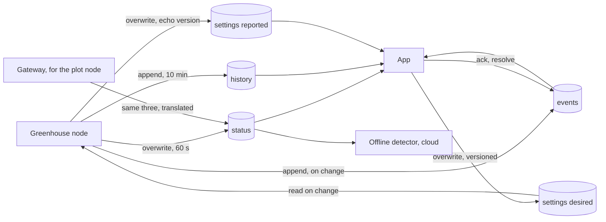

# Chapter 3 - Data modelling

*Give each stream a shape, a writer and a key before anyone writes a line of firmware.*

Chapter 2 ended with four streams named on a diagram: status, history, events, settings. Naming them is not modelling them. For each one this chapter decides what a record contains, who writes it, what it is keyed by, whether it is overwritten or appended, how long it is kept, and what happens when the field list changes while a hundred devices run three firmware versions. The beginner's model, one JSON blob per reading pushed to one path and read by everything, works on a desk and fails three ways on a farm: the database grows without bound, the app and the device overwrite each other's settings, and a chart changes meaning after a firmware update.

## 1. Anatomy of one record

A status record of the farm monitor, the shape the rest of the chapter uses:

```json
{"schema": 2, "dev": "gh1", "ts": 1760400060, "t": 27.6, "h": 60.9,
 "soil": 34, "tank": 78, "fan": 1, "valve": 0, "rssi": -66, "fw": "1.4.0"}
```

| Part | Fields | Rule |
|---|---|---|
| Identity | `dev` | The record must survive being copied out of its container. The topic and the database path carry the id too, but records end up in CSV exports, log lines and support e-mails. |
| Time | `ts` | Integer seconds, UTC, one representation. Section 4 says whose clock. |
| Values | `t`, `h`, `soil`, `tank` | Unit and physical range are part of the schema, not of the reader's assumptions. Temperature is degrees Celsius in [-40, 85] because that is what the sensor can report. |
| Validity | `null` | "Could not read" is `null`, never a sentinel such as 0, -1 or 999 that is also a legal reading. Chapter 1's N2 is the device-side face of this rule; the data-side face is a chart with a spike to 0 °C at every reboot. |
| Actuator state | `fan`, `valve` | 0 or 1, the shape chapter 2's payloads used, and kept so (section 5 explains why a change to `true`/`false` is not free). |
| Provenance | `schema`, `fw` | Which contract the writer followed and which build wrote it. The second is the first thing a support call needs. |
| Link health | `rssi`, `vbat_mv`, `seq` | Nobody asks for these and everybody needs them the first time a node goes quiet. Ten bytes. |

In one sentence: the record is the contract, and a reader may not need the topic, the path, the firmware version or the firmware author to interpret it.

## 2. Four streams, four shapes



| Stream | Writer | Readers | Key | Mode | Growth | Retention |
|---|---|---|---|---|---|---|
| status | device (gateway for the plot node) | app, offline detector | device | overwrite | none: one row per device | the latest row only |
| history | device | app chart, analytics | device + `ts` | append, immutable | 144 rows per device per day | 2 years, then a coarser aggregate |
| events | device; the app may set two lifecycle fields | app, people after an incident | `id` = `dev-ts-type` | append; two mutable fields | about 10 per day | keep |
| settings desired | app | device | device | overwrite, `version` increments | none | latest |
| settings reported | device | app | device | overwrite, echoes `version` | none | latest |

**Status** exists to be overwritten. Its period is also N3's heartbeat, and the one field it may not carry is `online: true`: the device cannot write the `false`, so the field says nothing (chapter 2, section 4), and the cloud derives "online" from the age of the last write.

**History** is immutable once written. A wrong value is corrected by an event that says so, not by editing the row, or every chart that already read the row disagrees with the database. `period_s` is in every row so that, when the farmer asks for one-minute history next spring, a reader can tell the two kinds of row apart without knowing which firmware wrote them. And the aggregate is `min`/`mean`/`max`, not a mean alone: a two-minute excursion to 35.4 °C that trips the hard limit vanishes into a ten-minute mean of 28.1.

**Events** are appended with an `id` the device derives from its own fields, `gh1-1760403600-limit_hit`, so that a replay after an outage (chapter 1, N6) that delivers an event twice writes the same key twice and the database keeps one. `type` and `severity` are enumerations, so a misspelt `fan_started` fails validation instead of silently matching nothing. `ctx` holds the 60 s of readings before the event. The two fields the app may write, `ack_ts` and `resolved_ts`, are the only mutable ones and are `null` until a person acts: absence would mean "unknown", `null` means "not yet".

## 3. Settings: desired and reported

The tempting design is one `settings` document that the app writes and the device reads. It has three holes. The app cannot tell whether the device has seen the write. The device, which must clamp every value to the hardware's limits (chapter 1, N5), has nowhere to say what it applied. And when the farmer presses a button on the local panel while the app writes, two writers meet in one document and one loses.

The fix is two records. The app writes *desired* with a `version` it increments on every write. The device clamps each field, applies the result and writes *reported*, echoing the version and listing what it changed. It writes reported even when nothing changed, because the version coming back is the app's only proof of delivery.

```mermaid
sequenceDiagram
    participant App
    participant DB as Cloud DB
    participant Dev as Device
    App->>DB: desired {version 7, t_on 45.0, valve_max_s 3600}
    DB-->>Dev: desired changed
    Dev->>Dev: clamp to LIMITS, enforce hysteresis band
    Dev->>DB: reported {version 7, t_on 40.0, valve_max_s 1800, clamped [t_on, valve_max_s]}
    DB-->>App: reported changed
    App->>App: version 7 == desired: applied; show the clamped badge
```

The device's half is `apply_settings` in [`examples/ch03/telemetry.py`](examples/ch03/telemetry.py). Run on the sample request:

```
$ cd examples/ch03 && python telemetry.py settings samples/settings_desired.json
{
  "schema": 2, "version": 7, "ts": 1760400060, "src": "app",
  "t_on": 40.0, "t_off": 26.0, "h_max": 85.0, "valve_max_s": 1800,
  "clamped": ["t_on", "valve_max_s"]
}
```

Three details carry the design. The limits live on the device; the app shows the same numbers, but the device decides. Fields the app did not send keep their current value, so a partial write cannot reset a threshold the farmer set at the panel. And `src` records who made the change (`app`, `local`, `default`), so the app can show "set at the panel" instead of silently losing an argument. Cloud platforms sell this as a *device shadow* (AWS IoT) or *device twin* (Azure); chapter 8 looks at them.

## 4. Whose clock

There are two clocks in the system and each stream must say which it uses.

- **History is ordered by the device's clock.** N6 asks that readings buffered through a two-hour outage be replayed with their original timestamps. Only the device knows when it sampled.
- **Offline detection uses the server's clock.** N3 is "no status write for ten minutes" measured where the silence is observed, so a device with a wrong clock cannot report itself alive.
- **A device without a clock gets stamped on receipt.** The plot node's 11-byte frame carries no timestamp: it would be four of the eleven bytes, and the clock would be wrong after a cold boot anyway. The gateway stamps the record with its receive time and keeps the frame's sequence counter, so a lost frame shows as a gap in `seq`. The layout in [`examples/ch03/telemetry.py`](examples/ch03/telemetry.py) is `version, t (0.01 °C), h (0.01 %), soil, tank, flags, battery mV, seq`, with four "valid" bits in the flags byte that become `null`.
- **Before the clock is set, do not send.** An ESP32 that publishes before NTP has answered stamps the record 1970. The validator's lower bound on `ts` (1.6 × 10⁹, the year 2020) rejects such records; the firmware's job (chapter 4) is to buffer until the clock is valid.
- **One representation.** Epoch seconds, UTC; the app renders local time. Two representations of one instant can disagree.

## 5. Schema evolution

The schema will change: the plot node arrives, a buyer asks for an ammonia sensor, a bug makes `fw` suddenly important. The constraint is that the fleet never changes all at once: an OTA campaign takes weeks, one node sits behind a flaky router for a month, and the database holds two years of rows written by firmware that no longer exists. Several schema versions are always in flight and all must be readable. Five rules keep that true.

1. **Add fields; never rename or remove one.** A renamed field is a removed field plus a new one, and every reader of the old name breaks the day the first device upgrades.
2. **Never change the meaning, unit or type of a field in place.** If temperature must become an integer in hundredths, it becomes `t_c100`, a new field, and `t` keeps being written until rule 5 retires it. This is why `fan` stays `0`/`1`: `true`/`false` is a type change that breaks every existing reader for no gain.
3. **Every record carries `schema`; readers migrate on read and never rewrite stored rows.** Version 1 of the farm monitor is chapter 2's payload; version 2 added `dev`, `fw`, `vbat_mv`, `seq` and, on history rows, `period_s`. The number was bumped not because a v1 reader would misread a v2 row (rule 1 guarantees it would not) but because a v2 reader must *know* a row is v1 to fill in `period_s = 600` and take `dev` from the topic. Bump it when readers must treat old rows differently, not whenever a field is added.
4. **Readers tolerate unknown fields and refuse unknown versions.** An unknown field means the writer is newer; keep going and list it. An unknown `schema` number means the writer may have changed something the reader relies on; stop and say so. Guessing is not allowed.
5. **Retire in two steps.** Stop writing a field only after every reader has stopped needing it; stop reading it only after the oldest retained row and the oldest firmware in the field no longer carry it.

The validator in the example applies the rules to the records in [`examples/ch03/samples/`](examples/ch03/samples/). This is what it prints in this repo (exit status 1, because two samples are meant to fail):

```
$ python telemetry.py validate samples/*.json
ok  event_v1.json              event              migrated v1->v2
ok  event_v2.json              event
BAD history_bad_order.json     history
      - t: min <= mean <= max violated: {'min': 27.9, 'mean': 27.4, 'max': 27.0}
ok  history_v1.json            history            migrated v1->v2
ok  history_v2.json            history
ok  settings_desired.json      settings_desired
BAD status_bad_units.json      status
      - t: 274 outside [-40, 85] degC
      - h: 612 outside [0, 100] %RH
      - fan: expected bool01, got bool True
ok  status_v1.json             status             migrated v1->v2
ok  status_v2.json             status
ok  status_v2_sensor_fault.json status
ok  status_v3_from_future.json status             unknown fields tolerated: ['nh3_ok', 'nh3_ppm']
```

Three lines are the point. The v1 rows migrate and pass: an old device is still welcome. `status_bad_units.json` is a release candidate that broke rule 2 twice, sending tenths of a degree and a real boolean; the physical range catches the first and the type check the second. `status_v3_from_future.json` is a newer device with two ammonia fields; the v2 reader accepts the row and names what it did not understand.

## 6. Worked example: what each stream costs

The difference between "overwritten" and "appended" is a number. [`examples/ch03/streams.json`](examples/ch03/streams.json) gives each stream one example record, a period or a count per day, a mode and a retention; the `growth` tool measures the record as compact JSON and multiplies out. The table is its output reformatted: the bytes are measured, the periods are chapter 2's, the retention is a design choice made here.

| Stream | Mode | Rows/day | B/row | MB/yr per device | Retention | Steady MB per device | Steady GB, 1 000 devices |
|---|---|---|---|---|---|---|---|
| status | overwrite | 1 440 | 120 | 0 | latest | 1 row | 1 row each |
| history, 10-min | append | 144 | 178 | 9.36 | 730 d | 18.71 | 18.71 |
| history, 1-min (if asked) | append | 1 440 | 176 | 92.51 | 730 d | 185.01 | 185.01 |
| raw 15-s samples (path A) | append | 5 760 | 96 | 201.83 | none | unbounded | unbounded |
| events | append | 10 | 254 | 0.93 | none | unbounded | unbounded |
| settings reported | overwrite | 1 | 142 | 0 | latest | 1 row | 1 row each |

To read off it:

1. **Status costs nothing to keep, however often it is written.** Its 1 440 writes a day are a messaging cost (chapter 2) and a zero storage cost, which is the reason to have a status stream at all.
2. **History is where retention is decided.** Ten-minute aggregates kept two years settle at 19 GB for a thousand devices, a number chapter 8 can price. Without a retention rule the raw stream of path A grows 200 GB a year for the same fleet and never stops.
3. **Events are cheap enough to keep forever.** Under a megabyte a year per device, and they are the rows a person opens after an incident. "Unbounded" is the right answer here and the wrong one for raw samples.
4. **A period change is a tenfold step.** One-minute history costs ten times more. The answer is a second, short-retention stream (exercise 4), not a change to the existing one (rule 2).

The numbers count JSON bytes only, so they are a floor; a database adds keys, indexes and per-row overhead, and chapter 8 multiplies by each platform's price.

## 7. Two real schemas

Both public systems document their database layout: [`docs/DATA_CONTRACT.md`](https://github.com/Mariam-zeqred/queen-bee-incubator/blob/main/docs/DATA_CONTRACT.md) in queen-bee-incubator and [`docs/FIREBASE_SCHEMA.md`](https://github.com/Mariam-zeqred/smart-poultry-farm/blob/main/docs/FIREBASE_SCHEMA.md) in smart-poultry-farm. Both say who writes each node, an artefact most prototypes never write down.

**queen-bee-incubator.** Everything lives under `/devices/<name>/`, the name derived from the MAC. `status` is a snapshot overwritten about every 15 s with fourteen fields, among them both `ts` (UTC epoch) and `iso` (Egypt local time as text): the two-representation case of section 4, and the document itself warns to chart in one zone. It also carries `online`, "device reports itself online"; the app's indicator combines it with the age of `ts`, and the age is the half that works. `history` is one push per minute of nine fields keyed by push id: raw rows rather than aggregates, affordable at that rate. `alarms/<CODE>_<epoch>` stores each alarm with the 60 readings before it: a dedupe key of the `dev-ts-type` kind, and `ctx` by another name. `settings` is written by the app and read by the firmware every 15 s, which clamps `targetTemp` to 30–40 °C; the app confirms by watching `status.targetTemp`. That is desired and reported in all but name, with the reported half inside status. What it lacks is a version: the app cannot distinguish "clamped" from "not yet applied", and the document's mitigation is to show the same limits in the app.

**smart-poultry-farm.** One flat tree under `farm/`, with millisecond timestamps written through the server's timestamp sentinel. `meta/lastSeen` is a heartbeat the firmware patches every 10 s and the app uses as its online test: section 4's server clock, done right. `sensors/latest`, overwritten every 10 s, is a status stream; `sensors/history/{YYYY-MM-DD-HH}/{pushId}` is appended by the app (chapter 2's tier problem), but its hour-bucketed key is a good choice, since range queries and deletion then work on whole buckets. `control/state` holds the actuator states, the mode and `appControlEnabled` (written only by the app) in one node that the firmware fully replaces after each local change and the app partially updates: desired and reported in one document with two writers. The "who writes what" table is the first defence against a collision; splitting the node is the second. `alerts/{pushId}` is the events stream done carefully: an enumerated `type` with its own table, a `severity` enumeration, the `value` and `threshold` that tripped it, `acknowledgedAt` and `resolvedAt` set by the app, and a five-minute cooldown per type. Two sentinels remain: `gas` is "0 during MQ135 warm-up", a legal reading standing in for "not yet valid", and `deviceId` is `""` for the controller. And the advice to rename a field "in both places at once" is right for one controller and one app, and exactly what rule 1 forbids once there are fifty.

## 8. What to hand over at the end of this step

1. A field table per stream: name, type, unit, range, nullable, writer.
2. Section 2's writer / reader / key / mode / retention table.
3. The settings contract: desired and reported, the version rule, the limits and where they live.
4. The growth table with the retention decisions written in.
5. The migration code and one sample record per version, with tests that the current reader accepts them all.

Chapter 4 turns the device column of chapter 2's decision table into tasks and rates; this chapter's status record becomes the snapshot those tasks share, and its event record what the safety task writes.

## Exercises

1. **Add a sensor.** The buyer wants an ammonia sensor in the greenhouse nodes. Add it to the status record by the rules of section 5: name the field, say whether `schema` changes and why, and explain what today's app does with the new rows. Check against `status_v3_from_future.json`.
2. **Grow the frame.** The plot node gains a soil-temperature sensor and its 11 bytes are full. Design the change so old plot nodes keep working through the same gateway, and say what the gateway must do with a version byte it does not know.
3. **Two writers, one setting.** The app writes desired `version 8, t_on 32` while the node is offline; before it reconnects, the farmer sets `t_on 29` at the panel. Decide who wins, what reported says and what the app shows. Justify it from the never-list.
4. **Decide retention.** The farmer wants one-minute history "for the last month" as well as the long-term chart. Using `growth`, propose tiered retention and compute the steady-state storage per device.
5. **Find the sentinels.** From section 7, list every place where the two real schemas use a legal value to mean "not valid" or carry one fact twice, and write the replacement for each.

<details>
<summary>Answers</summary>

**1.** One field, `nh3_ppm` (number, nullable, 0–500 ppm), `null` until the sensor's warm-up is over. `schema` stays at 2: the change is additive and a v2 reader needs no special handling of old rows (rule 3). Today's app meets a field it does not know, keeps going and lists it (rule 4), which is what the validator prints for `status_v3_from_future.json`. A `schema: 3` would be needed only if an existing field changed meaning, which rule 2 forbids anyway.

**2.** Frame version 2 is the 11 bytes of version 1 plus `t_soil` as an int16 in 0.01 °C. New nodes send version 2, old nodes keep sending version 1, and the gateway dispatches on byte 0, producing the same status record from either, with `t_soil` absent (not `null`) for version-1 frames because the field does not exist for them. For an unknown version byte the gateway refuses to decode, counts the refusal and raises an event (`type: sensor_fault`, `reason: unknown frame version 3`) so a mis-flashed node is noticed, rather than decoding with the nearest known layout, which produces plausible wrong temperatures.

**3.** The person at the panel wins: N5 says the device owns its limits, and the person next to the animals knows things the app does not. The device records local edits with `src: local` and their time; when desired `version 8` arrives with a `ts` older than that edit, the device marks it applied without using its values and writes `reported {version 8, t_on 29, src: local}`. The app sees the version come back with a different value and shows "set at the panel to 29 °C" instead of a pending spinner or a silent overwrite. An app write newer than the panel edit would apply.

**4.** Three tiers, each a history stream with its own `period_s`: one-minute aggregates kept 30 days, ten-minute kept two years, daily kept forever. With the example's byte counts: 1 440 × 30 × 176 B ≈ 7.6 MB, 144 × 730 × 178 B ≈ 18.7 MB, and about 65 kB a year for the daily tier. Steady state is about 26 MB per device plus 65 kB a year, against 185 MB for one-minute rows kept two years. The device writes the one- and ten-minute rows; the daily row is a cloud computation over the ten-minute ones (chapter 2, R5).

**5.** queen-bee-incubator: `ts` and `iso` carry one instant twice (keep `ts`, format in the app); `online: true` written by the device cannot mean "online" (derive it from the age of the last write). smart-poultry-farm: `gas: 0` during warm-up (send `null`, or a `gas_valid` flag beside it); `deviceId: ""` for the controller (write its id; a second controller would also be `""`). Every fix is additive, a new field beside the old one, with the old one retired by rule 5.

</details>

## What to read next

- **Chapter 4** builds the firmware around the status record: which task owns each field, at what rate, and the one module allowed to turn an actuator on.
- Martin Kleppmann, *Designing Data-Intensive Applications*, O'Reilly 2017, chapter 4, "Encoding and Evolution": forward and backward compatibility, rolling upgrades, and why "the schema never changes all at once" is the normal case.
- The "Updating a message type" section of the Protocol Buffers language guide (protobuf.dev): section 5's rules for a binary format, down to "never reuse a field number".
- The AWS IoT Core developer guide, "Device Shadow service": the hosted form of section 3's desired and reported documents, with its `version` field and its handling of conflicting writes.
- [`docs/DATA_CONTRACT.md`](https://github.com/Mariam-zeqred/queen-bee-incubator/blob/main/docs/DATA_CONTRACT.md) and [`docs/FIREBASE_SCHEMA.md`](https://github.com/Mariam-zeqred/smart-poultry-farm/blob/main/docs/FIREBASE_SCHEMA.md), the two real contracts of section 7; the second's "who writes what" table is a model for the one you hand over.
