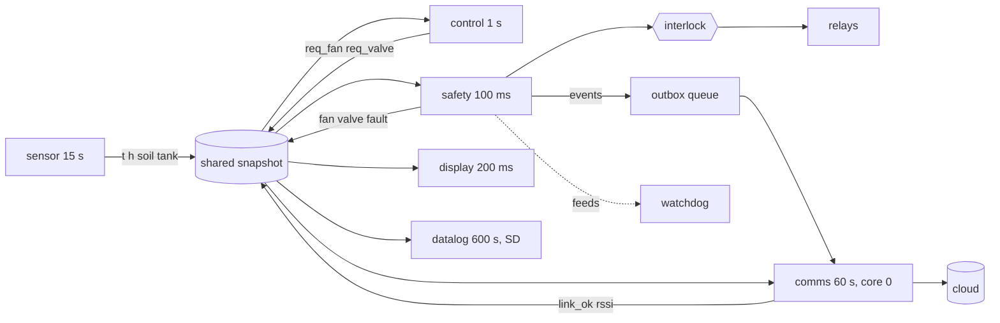

# Chapter 4 - Firmware architecture

*Tasks, rates, shared state, and the one place that may switch a relay.*

Chapter 2 put seven computations on the device; chapter 3 wrote the record they share; this chapter arranges them into firmware. The beginner's firmware is one `loop()`: read the sensor, decide, write the relay, send to the cloud, delay. It works on a desk and fails three ways on a farm: a cloud call that waits thirty seconds for a dead router stops the safety check for thirty seconds; two places in the code write the relay pin, and on the day they disagree the relay follows whichever ran last; a reading overwritten while being read is a temperature made of two halves. The design below answers each, and the worked example measures the first.

## 1. From computations to tasks

A task is a loop with a fixed period and one job. Three rules cut the device column of chapter 2 into tasks:

1. **Cut by rate.** Two computations with different periods are different tasks; in one loop they both run at the slower one's pace.
2. **Cut by blocking.** Anything that can wait (network, SD card, NTP) gets its own task at the lowest priority, and nothing a critical task does may wait on it.
3. **Cut by what it writes.** Each field of the shared record has exactly one writing task. Two computations that must write the same field are one task.

[`examples/ch04/firmware_sim.py`](examples/ch04/firmware_sim.py) keeps the result as `TASK_TABLE`; `python firmware_sim.py table` prints it:

| Task | Period | Prio | Core | Blocks | Feeds WDT | Writes | Why this rate |
|---|---|---|---|---|---|---|---|
| sensor | 15 s | 3 | 1 | no | no | `t h soil tank sample_ts seq` | N2 sets the period: three misses = 45 s |
| safety | 100 ms | 4 | 1 | no | yes | `fan valve fault forced` | N1's 30 s hold needs a timer finer than the sensor period; the only actuator writer |
| control | 1 s | 3 | 1 | no | no | `req_fan req_valve` | hysteresis on a 240 s plant; faster buys nothing |
| display | 200 ms | 2 | 1 | no | no | `(nothing shared)` | a 1 s deadline for a human; chapter 2 placed it on the device |
| datalog | 600 s | 1 | 1 | yes | no | `(history outbox)` | chapter 3's 10-min aggregate; SD writes block |
| comms | 60 s | 1 | 0 | yes | no | `link_ok rssi` | N3's 60 s status; TLS connects block for up to 30 s |

Every period traces to a number from chapter 1 or 3. The one that looks arbitrary, the safety task's 100 ms against a sensor that reports every 15 s, is not: the safety task does not check the sensor, it runs timers. "Above the hard limit for 30 s", "no reading for 45 s", "valve open for 600 s" are questions about elapsed time; a 10 Hz task answers them within 100 ms, costs microseconds because it only reads a copy of the record, and gives the watchdog something frequent to watch.

Priority has the operating-system meaning: of two tasks due at once, the higher number runs first and may interrupt the lower. Safety is highest, the two that can block are lowest, and it matters in the second when comms is inside a TLS handshake and the hard-limit timer expires. The core column is an ESP32 detail: under Arduino-ESP32 the Wi-Fi stack runs on core 0, so the one task that talks to it goes there too.



## 2. Shared state: one snapshot, one writer per field

The six tasks share one record: chapter 3's status record plus the control task's *requests*, the safety task's *decisions*, the fault latch and link health. In the example it is the `Snapshot` dataclass and the `OWNER` table that names each field's one writer.

**Copy in, copy out, under one lock.** A reader takes the mutex, copies the whole record, releases it and works on the copy; a writer prepares its fields, takes the mutex, writes, releases. The lock is held for a `memcpy`, microseconds, and never while reading a sensor, writing a relay or waiting for the network, so the highest-priority task is never stuck behind the lowest for longer. `volatile` is not a substitute: it stops the compiler caching a value and does nothing about a struct overwritten halfway through a read.

```python
    def read(self) -> Snapshot:
        return copy.copy(self._snap)  # lock; memcpy; unlock

    def update(self, writer: str, **values: Any) -> None:
        for name in values:
            if OWNER[name] != writer:
                raise OwnershipError(
                    f"{writer} may not write {name} (owner: {OWNER[name]})"
                )
        self._snap = Snapshot(**{**self._snap.__dict__, **values})  # lock; swap; unlock
```

**One writer per field.** Sensor owns the readings, control the requests, safety the actuator states and the fault, comms the link health, so any field can be understood by reading one task. In the example a write from a non-owner raises; in C it is a convention, kept by putting each field group's setter in the owning module only. The field this protects most is the actuator state: control may ask for the fan and never write the pin.

**Events go through a queue, not the record.** When the safety task raises a fault it appends an event to an outbox and carries on. Comms drains the outbox when the link is up; when it is down the events wait in order (N6). The queue is what keeps the safety task from ever calling the network.

## 3. The single interlock

Three jobs are easy to merge and must stay apart: *detecting* a condition, *deciding* whether an actuator may run, and *driving* the pin. The safety task detects, by running the timers over its copy of the record; one function decides; the safety task drives the relays with the decision, and no other task does. The poultry controller's README puts it in one line, "every relay change funnels through one function on the device".

The decision function takes six booleans and the control task's request, and returns a permit per actuator with a reason:

```python
def decide(c: Conditions, req_fan: int, req_valve: int) -> Permit:
    if not c.ready:
        return Permit(SAFE_FAN, SAFE_VALVE, "boot: no reading yet, safe states (N4)")
    if c.latched:
        return Permit(SAFE_FAN, SAFE_VALVE, "latched fault, waiting for a person (N1)")
    if not c.fresh or not c.in_range:
        return Permit(SAFE_FAN, SAFE_VALVE, "sensor invalid: safe states (N2)")
    if c.valve_overtime:
        return Permit(req_fan, SAFE_VALVE, "valve max on-time: closed and latched (N1)")
    if c.over_limit:
        return Permit(1, req_valve, "hard limit: fan forced on (N1)")
    return Permit(req_fan, req_valve, "")
```

*The inputs are booleans.* Thresholds, hold times and ranges are applied by the safety task before the call, so the function has no numbers in it and its whole behaviour is a table a reviewer can read without the code. `python firmware_sim.py interlock` enumerates every reachable combination:

| ready | fresh+in range | latched | valve overtime | over limit | fan | valve | reason |
|---|---|---|---|---|---|---|---|
| no | no | no | no | no | 1 | 0 | boot: no reading yet, safe states (N4) |
| yes | no | no | no | no | 1 | 0 | sensor invalid: safe states (N2) |
| yes | yes | no | no | no | 0 | 1 | request passes (fan 0, valve 1 here) |
| yes | yes | no | no | yes | 1 | 1 | hard limit: fan forced on (N1) |
| yes | yes | no | yes | no | 0 | 0 | valve max on-time: closed and latched (N1) |
| yes | yes | no | yes | yes | 0 | 0 | valve max on-time: closed and latched (N1) |
| yes | no | yes | no | no | 1 | 0 | latched fault, waiting for a person (N1) |
| yes | yes | yes | no | no | 1 | 0 | latched fault, waiting for a person (N1) |
| yes | yes | yes | no | yes | 1 | 0 | latched fault, waiting for a person (N1) |
| yes | yes | yes | yes | no | 1 | 0 | latched fault, waiting for a person (N1) |
| yes | yes | yes | yes | yes | 1 | 0 | latched fault, waiting for a person (N1) |

Eleven rows, one of which lets the request through; that ratio is normal.

*Safe states are chosen by the cost of being wrong, per actuator.* When the node knows nothing, the fan runs and the valve closes: a fan running for no reason costs electricity, a valve open for no reason floods a plot. The same rule gives the incubator's heater the opposite answer, off. Write the safe state beside each actuator before the interlock, and expect to argue about it (exercise 1).

*Order is precedence.* The first matching line wins, from "know nothing" to "know everything": a latched fault beats a valid sensor, a valid sensor is needed before any timer means anything, and the max on-time beats the hard limit because the valve's hazard is irreversible and the fan's is not.

*The latch is state the function does not own.* `latched` is an input, set by the safety task when the valve overruns and cleared only by a person. It must survive a reset, because a reboot is the most likely thing to happen during a fault; the incubator keeps maintenance-class faults in non-volatile storage behind a ten-second service reset, and section 5 shows why in numbers.

Boot is the first row of the table, and N4 says what it looks like: a pull-down on every relay driver pin, so the hardware answers "off" before the first instruction; the safe states driven as the first instruction, before any sensor or radio is initialised; the record empty, so `ready` is false until a real reading arrives; the network last.

## 4. Deadlines, priorities and the watchdog

A period says how often a task runs; a deadline says how late it may be. For the safety task the deadline is 30 s from the hazard, written down in chapter 1, and that number sets everything downstream: the 100 ms period, the top priority, the rule against blocking, and the watchdog.

The hardware watchdog resets the chip unless some code feeds it before it expires, and which code feeds it is the whole design. If every task feeds it, or an interrupt does, it measures nothing: the chip stays up while the one task that matters is stuck. Only the task whose silence is the hazard feeds it, here safety, with a timeout that fits inside the deadline with room for the reboot: 5 s, plus 2 s to boot, plus one sensor period before `ready`, is 22 s of 30.

Two smaller rules: run each task at a fixed *rate*, not a fixed *delay* after its work (`vTaskDelayUntil`, not `vTaskDelay`), or the period drifts; and treat every timer in RAM as one that restarts with the chip, which is where the example goes next.

## 5. Worked example: what one blocking call does

The scenario is one a farm produces weekly: the router dies for five minutes, 120 s to 420 s, while the comms task keeps trying to write status with the naive "try three times" loop and a 30 s timeout, so each attempt blocks 90 s. The tool runs the same six functions under two schedulers: `tasks` is an RTOS, where a blocking task blocks itself; `superloop` is one `loop()`, where a blocking call blocks everything. The third column is the superloop with the watchdog disabled, the beginner's firmware exactly. `python firmware_sim.py compare --outage 120:420` prints:

| Metric | tasks | superloop | superloop (no WDT) |
|---|---|---|---|
| safety-task runs | 8980 | 8599 | 5351 |
| longest gap between safety runs | 0.1 s | 5.0 s | 90.0 s |
| watchdog resets | 0 | 5 | 0 |
| false sensor faults | 0 | 0 | 1 |
| max temperature | 28.4 degC | 28.5 degC | 28.4 degC |
| seconds in a forced state | 17 s | 102 s | 288 s |
| events buffered (peak) / replayed | 0 / 0 | 0 / 0 | 1 / 1 |
| latched fault at the end | none | none | none |

The plant is a first-order model; the numbers are properties of the model and the task design, not of any greenhouse.

**Column one.** The safety task ran every 100 ms through the outage; the only forced seconds are the seventeen after boot. Comms blocked five times for 90 s and nobody noticed.

**Column three.** Every 90 s block stopped the sensor task too, so when the loop came back the newest reading was 90 s old, past N2's 45 s, and the safety task did what it is built to do:

```
t=  122.0  comms     connect failed, blocked 90 s (3 x 30 s timeout); 0 events buffered
t=  212.0  safety    sensor_fault raised: reading age 90 s > 45 s (N2)
t=  212.0  actuator  valve 1->0 [sensor invalid: safe states (N2)]
...
t=  482.0  comms     link up, status written, 1 buffered events replayed in order (N6)
t=  482.5  safety    sensor_fault cleared: fresh reading
```

The fault is false: the sensor was fine, the loop was stuck. The node spent 288 s forced, valve closed and fan on, and the farmer gets a sensor alarm for a router outage. Every line of control logic is on the device, and the device still stopped controlling for the length of the outage: chapter 1's Rule A, broken by the architecture rather than the data path, which is the most common way it is broken.

**Column two** is what most people do about it: add the watchdog, keep the loop. The watchdog does its job five times. Each reset puts the relays in their safe states, empties the record and waits a sensor period, 102 forced seconds in all, and restarts every timer in RAM. Add `--hose-burst`, so the valve opens and the soil never rises, and run for 1 500 s: under `tasks` the max on-time latch trips at 617.1 s, under `superloop` at 1 012.1 s, because the counter restarted at every reset and only reached 600 s after the outage ended. A latch meant to stop a flood came seven minutes late, because the router recovered.

The temperature column barely moves in any run, and the reason should be said: the fan's safe state is "on" and the plant is slow, so this hazard is covered by the fallback. On the incubator the same stall is a heater question, with the safe state "off" and the brood cooling.

## 6. Two real firmwares

Everything below is quoted from the two READMEs; what they do not say is marked as unsaid.

**queen-bee-incubator.** Five FreeRTOS tasks at fixed rates, control 1 Hz, safety 10 Hz, a second sensor 0.1 Hz, comms 1 Hz, display/buttons/buzzer 5 Hz, and "`loop()` is empty". The firmware README's file map is this chapter in code: `SharedState.*` is "mutex-guarded global state shared across tasks"; `RingBuffer.*` a 60-slot reading buffer that `Datalog.*` drains to SD and cloud once a minute, the blocking work in its own task; `Interlock.*` is "the ONE place that decides whether the heater / fan may run", with its inputs listed as door open or settling, any maintenance fault, any critical error, sensor failure, and cycle not running (heater only): section 3's booleans with the incubator's hazards in them. The heater is forced off at boot and may follow the fan only after 2 s, and has a 90 min maximum on-time that raises a maintenance fault; control and safety both kick the hardware task watchdog, so "a stalled task reboots the chip". `Config.h` is said to hold every task timing, priority, stack and core, but the README gives no values for the last three and nothing on how the ring buffer is shared between sensor and datalog; those are the two things to read in the code.

**smart-poultry-farm.** A "dual-core FreeRTOS design": core 1 runs "sensors, safety, buttons and the LCD every 10 ms and never blocks", with sensor reads every 2 s and auto-control every 3 s inside that loop; core 0 runs `firebaseTask`, "every HTTPS call": readings every 10 s, thresholds every 30 s, a deferred push queue so local changes made during an outage are "retried until they land", the event stream and OTA. That is rule 2 done with cores instead of priorities, and section 2's queue under its own name. `applyStates()` is "the only function that touches relays", applying the order safety → fan cycle → auto → manual with two interlocks, heater/cooler exclusion and cooler-forces-fan. One input is new here: `appOwnsControl()` is true only while app control is enabled and the device has heard from the cloud within 90 s, so "who may request" is itself an interlock condition. The README calls `firebase_client` mutex-guarded but does not describe the shared state between the cores, and does not mention a watchdog: the first two questions to ask of it.

## 7. What to hand over at the end of this step

1. The task table: period, priority, core, blocks, feeds the watchdog, fields written, the chapter-1 number behind each period.
2. The ownership table: every shared field and its one writer.
3. The safe-state table: each actuator, its safe state, the cost argument.
4. The interlock truth table, generated from the code, with the order of precedence.
5. The boot order, from the pull-downs to the network.
6. The watchdog policy: who feeds it, the timeout, and the arithmetic that fits it inside the deadline.

## Exercises

1. **Add a heater.** The farmer wants a frost heater in the greenhouse node. Give its safe state with the cost argument, write its lines of `decide` with their position in the order, and say which row of the truth table changes meaning.
2. **The frozen sensor.** A sensor returns the same value forever with a valid CRC. Which of the six conditions catches it? Design the check that would, name the task that computes it and the field it writes, and say how it spares a sensor that is genuinely steady at night.
3. **A shortcut.** A colleague makes the comms task read the sensor directly, "to send the freshest value and save a copy". List what breaks, by rule.
4. **The convenient watchdog.** Another colleague feeds the watchdog from a hardware timer interrupt so it "never resets spuriously". What does it measure now? Predict section 5's three columns, then check with the tool.
5. **A latch that survives.** Using the hose-burst run of section 5, design the persistence of the valve timer and the latch: what is stored, when it is written, what boot does with it, and the new latch time under the superloop with the watchdog.

<details>
<summary>Answers</summary>

**1.** Safe state off: an unneeded heater in a closed greenhouse is the irreversible case. The lines go after the sensor-validity line and before the request: a heater max on-time (N1 as written) that forces it off and latches; the hard limit forcing it off beside forcing the fan on; an exclusion that refuses heater and fan together, resolved in the heater's disfavour. The row that changes meaning is "hard limit: fan forced on": its permit now has three actuators and the heater's column is 0 whatever the request.

**2.** None: `fresh` watches `sample_ts`, which the sensor task keeps updating, and a frozen 27.4 °C is in range. The check is a slew or variance test, "the last 20 readings identical to the sensor's resolution" or, better, "no temperature response within N minutes of the fan switching", computed by the sensor task because it owns the readings and written as a new owned field such as `sensor_ok`, which the safety task folds into `in_range`. Tying it to an actuator change spares the still night; the incubator's SHT31 driver has sanity and slew checks for the same reason.

**3.** Rule 3: the readings get a second writer, or a second copy nobody owns. Rule 2: the sensor is read from a task that may be inside a 30 s wait, and two tasks on one I2C bus need a bus lock, the lock the design refuses to hold across I/O. N2: the "freshest value" never reaches the record, so the staleness timer and the cloud disagree. The fix is one line: comms reads the snapshot.

**4.** Nothing. An interrupt runs whether or not any task does, so the watchdog is fed while the loop is stuck in the connect call. The `superloop` column becomes the `superloop (no WDT)` column: a 90 s gap, 288 forced seconds, one false sensor fault, no resets.

**5.** Store the latch and the valve's open-since timestamp, written once when the valve opens and once at the latch, not every tick (flash wears and NVS writes block, so through the datalog task's queue). At boot the safety task loads both before `ready` becomes true: a stored latch is honoured as uncleared, a stored open-since makes the counter continue. The counter then survives the five resets, so the latch comes at 617.1 s plus the seconds the valve was forced closed during resets, roughly 700 s rather than 1 012 s; the rest is the resets' own lateness, which only the task architecture removes.

</details>

## What to read next

- **Chapter 5**: what still protects the animals when the MCU is the part that failed: hardware limits, a second sensor, an independent timer, and what the interlock cannot do.
- Richard Barry, *Mastering the FreeRTOS Real Time Kernel* (free from freertos.org), the chapters on task, queue and resource management: `vTaskDelayUntil`, priorities, and why a mutex is held briefly.
- The ESP-IDF programming guide, "Task Watchdog Timer": how tasks subscribe and what a missed feed does.
- C. L. Liu and J. W. Layland, "Scheduling Algorithms for Multiprogramming in a Hard-Real-Time Environment", *Journal of the ACM* 20(1), 1973: the result behind "highest rate, highest priority".
- The [queen-bee-incubator firmware README](https://github.com/Mariam-zeqred/queen-bee-incubator/blob/main/firmware/QueenBeeIncubator_V2/README.md) file map, one module per idea in this chapter, and the [smart-poultry-farm firmware README](https://github.com/Mariam-zeqred/smart-poultry-farm/blob/main/firmware/README.md) for the two-core split.
