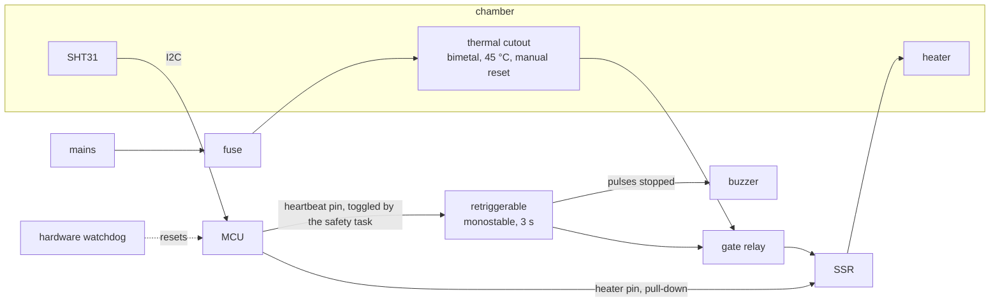

# Chapter 5 - Safety layers that do not depend on the network

*Or on the microcontroller, for the hazards that can kill.*

Chapter 4 ended with one interlock: six booleans in, a permit out, the only code that drives a relay. All of it firmware. Look at N1 in chapter 1's never-list: caused by `mcu, actuator`, guarded by `sensor, mcu`, response depends on `mcu, actuator`. Rule B says a hazard must not be guarded only by the parts that can cause it, and the row breaks it twice: the firmware guards against the firmware, and the response that opens the relay depends on the relay. Three things the interlock cannot catch: the firmware stops running; the actuator ignores the command; the sensor lies in range. This chapter adds layers below the firmware for those three, sizes them with the fitted thermal model of a real incubator, and measures what each buys. Independence from the network is the easy half, and Rule A already gave it; the hard half is independence from the microcontroller.

## 1. How the guarding parts fail

Chapter 4 assumed the parts do what the code tells them. Each has a way of not doing that:

| Part | Common failure | What the heater does | What the firmware sees |
|---|---|---|---|
| MCU | hang: an I2C bus lock-up, a stack overflow, a library loop with interrupts off | a GPIO keeps its last level; a heater pin that was high stays high | nothing; it is not running |
| firmware, alive and wrong | an unclamped setting, a cutoff computed from the setting, a unit mistake | heats to whatever the bug asks | normal numbers; it feeds the watchdog and writes status every 60 s |
| SSR | fails shorted: a triac or thyristor usually fails as a conductor; relay contacts weld | on, whatever the pin says | the temperature rising and its own command ignored |
| sensor | sticks at an in-range value with a valid CRC, or sits in the cool corner | heats, because the sensor says it is cold | a steady, plausible reading |
| power | mains fails | off, the heater's safe state | nothing; and the cloud sees silence |

Read chapter 4 against each row. The watchdog catches row 1 and nothing else. The interlock *knows* about row 3 and has no second switch to open. Rows 2 and 4 are invisible from inside the firmware, whose view of the world is the sensor and its own variables, one of which is wrong. Row 5 is the heater's safe state arriving by accident; for the greenhouse fan, whose safe state is on, nothing on the device can answer it. Rule B, made mechanical, is "for each row, which layer still works?".

## 2. The layer stack

A layer is defined by what it *senses*, what it *acts through*, and what it *shares* with the layers above. Two layers that share a part fail together and count as one. From the top:

1. **Control**: hysteresis on the sensor, through the firmware and the SSR.
2. **Interlock and safety task** (chapter 4): the 40 °C cutoff, the maximum on-time, the latch. Same sensor, firmware and SSR: a second *opinion*, not a second *part*.
3. **Watchdog and pull-down**: senses the safety task's silence; acts by resetting the chip, which helps only because a resistor holds the driver pin low from the reset edge.
4. **Heartbeat gate**: a second switch in series with the SSR, held closed only while pulses arrive from the safety task. Senses silence, like the watchdog, but acts in the energy path; and senses a declared fault, because the firmware stops the pulses when it latches.
5. **Thermal cutout**: a bimetal thermostat in series with the heater, in the chamber air. Senses heat with no sensor, no code, no supply.
6. **A person**: told by the buzzer or by the cloud's offline detection (N3). The only layer for the power row.



Four rules fall out of the picture. A layer acts *in the energy path*, a switch in series, not a request to the processor. It senses the *physical quantity or the absence of life*, never a field in the record. Adjacent layers *share no part*. And the layers that re-close (watchdog, gate) sit above the one that latches (the cutout), so a transient fault recovers by itself and a real one stays off until a person looks.

## 3. The hardware layers, with their numbers

**Pull-downs and the reset state (N4).** The resistor goes on the MCU side of the driver, so the pin reads low in reset, in the bootloader, and in a crash loop that never reaches `setup()`. It means "off" only if the driver is active-high; many relay boards are active-low, and a pull-down turns those *on*: check the board, not the code. Second check: strapping pins. The ESP32 reads GPIO 0, 2, 5, 12 and 15 at reset to choose boot mode and flash voltage, and a pull resistor on one of them changes how the chip starts. The incubator's heater SSR is on GPIO12 according to its pin table, and its README does not say what resistor the pin carries; a pull-down there is both the heater's safe default and the level the chip expects, so it is worth confirming on the board.

**The watchdog** (chapter 4) catches silence and nothing else, and acts only through the reset and the pull-down: five seconds of no feed, two seconds to boot, and the firmware is back with its RAM empty. If the hang recurs the chip reboots forever, which is still "heater off". It does nothing for a shorted SSR or a wrong firmware, which feeds it perfectly.

**The heartbeat gate.** An electromechanical relay in series with the SSR, driven by a retriggerable monostable (a 555 or a supervisor IC) that holds the relay closed only while the safety task keeps *toggling* a pin. A hung MCU holds its pins at a level, so the input is edges, and the pulses come from the safety task, never from a timer interrupt (chapter 4, exercise 4). Three seconds without an edge and the relay drops out: longer than the safety task's longest legitimate gap (its period is 100 ms), shorter than the watchdog's 5 s, so the gate acts first and the reset follows. Retriggerable means the relay re-closes when the pulses return, so a transient hang ends with the chamber warm, not cold; the latch for real faults stays the firmware's, in non-volatile storage. And the firmware uses the gate as its second switch by stopping the heartbeat whenever it latches a critical fault, which covers the welded SSR: the interlock cannot open it, but it can go quiet. The same monostable output drives the buzzer, so a dead controller is audible on the farm without the cloud.

**The thermal cutout.** A bimetal thermostat (the KSD301 family, normally closed, opens at a fixed temperature) in series with everything, mounted in the chamber air near the brood, not on the heater body. It senses heat directly, so it alone survives a lying sensor and a wrong firmware. Its number comes from two bounds. It must never trip in normal use:

> nominal − tolerance > highest allowed setpoint + sensor error + gradient between its position and the control sensor

and must trip before harm:

> nominal + tolerance + the rise after power is removed < the harm temperature

With the incubator's numbers (setpoint clamped to 40 °C, an SHT31 at ±0.3 °C, 1 °C of gradient assumed) the floor is 41.3 °C. A 45 °C part with a ±2 °C tolerance clears it at 43; the cheap ±5 °C part does not and would have to be the 50 °C stock value. The rise after power is removed is 0.8 °C in the model, so the 45 °C part guarantees power off by 47.8 °C. Whether that is below harm is the biologist's number, not the engineer's. Choose the manual-reset version: an auto-reset cutout turns a failure into a regulator, the chamber cycling at 45 °C for days while the app shows a healthy device. Wire its state to a spare input and to the buzzer, so tripping it is an event and not a mystery. A fuse upstream covers the case the model does not: a heater that fails by drawing more current.

## 4. Worked example: one failing part, four layer sets

[`examples/ch05/layers.py`](examples/ch05/layers.py) does two things. `coverage layers.json` is Rule B as a table: each layer lists what it senses and the parts it senses and acts through; each failure lists the parts it breaks and the signals it produces; a layer catches a failure if it senses one of its signals and none of its parts is broken:

| failure | control | interlock | watchdog | gate | cutout | human | first device layer |
|---|---|---|---|---|---|---|---|
| network-down | - | - | - | - | - | - | nothing to catch |
| mcu-hang | broken | broken | yes | yes | yes | yes | gate (3 s) |
| ssr-short | broken | broken | broken | yes | yes | yes | gate (3 s) |
| sensor-stuck | broken | broken | blind | blind | yes | blind | cutout (31 min) |
| bad-setpoint | broken | broken | blind | blind | yes | blind | cutout (31 min) |
| power-loss | broken | broken | broken | broken | blind | yes | NONE on the device |

`broken` means the layer shares a part with the failure; `blind` means it does not sense what the failure produces. The power row is caught by nobody on the device and marked `accepted`, because what it produces is cold, the heater's safe state.

`run` and `compare` put numbers on it. They drive a heater on the queen-bee incubator's chamber as fitted in [incubator-telemetry-analysis](https://github.com/Mariam-zeqred/incubator-telemetry-analysis) (`figures/model_params.json`, second-order physical branch: heater gain 0.5908 °C/min, heater lag 4.92 min, loss coefficient 0.0111 /min; one device, one day, door shut, ambient 27.2–28.3 °C). The chamber is fitted to real data; the firmware, SSR, watchdog, gate and bimetal are models of section 3's design, every number in one `Design` dataclass. One part fails at the first heater-on of steady cycling; the tool reports the peak and which layer removed power, how long after. `python layers.py compare`, 180 minutes per cell:

| failure | firmware | + watchdog | + gate | + cutout |
|---|---|---|---|---|
| mcu-hang | peak 68.4 degC; no layer acted, 68.4 degC at 180 min | peak 36.8 degC; watchdog after 5 s | peak 36.8 degC; gate after 3 s | peak 36.8 degC; gate after 3 s |
| ssr-short | peak 68.4 degC; no layer acted, 68.4 degC at 180 min | peak 68.4 degC; no layer acted, 68.4 degC at 180 min | peak 41.3 degC; gate after 17 min | peak 41.3 degC; gate after 17 min |
| sensor-stuck | peak 62.8 degC; interlock after 90 min | peak 62.8 degC; interlock after 90 min | peak 62.8 degC; interlock after 90 min | peak 46.6 degC; cutout after 31 min |
| bad-setpoint | peak 60.5 degC; no layer acted, 59.8 degC at 180 min | peak 60.5 degC; no layer acted, 59.8 degC at 180 min | peak 60.5 degC; no layer acted, 59.8 degC at 180 min | peak 46.6 degC; cutout after 31 min |

Every number is a property of the fitted model and the design, not a measurement; the data never went above about 39 °C, so everything higher extrapolates a linear fit whose equilibrium with the heater stuck on is 81 °C.

**Column one** is chapter 4's firmware alone. The hang and the shorted SSR run away. The stuck sensor is caught by the 90-minute maximum on-time at 62.8 °C: a real layer against a lying sensor, ninety minutes late. The bad setpoint is the quiet one: the firmware regulates at 60 °C, feeds the watchdog, sends status, and nothing it owns will object.

**Column two** adds the watchdog and fixes one row in five seconds; the pull-down is half of it, holding the pin low until control resumes. The 36.8 °C peak is the heater lag, not the failure.

**Column three** adds the gate. The hang row improves by two seconds; the shorted SSR row is the point. `python layers.py run --fail ssr-short --layers interlock,gate`:

```
t=   55.8 min  FAILURE   SSR fails shorted: heater on whatever the pin says
t=   72.8 min  interlock latched: cutoff 40 degC held 30 s; heater commanded off, heartbeat stopped
t=   72.9 min  gate      no heartbeat for 3 s: series switch opened
t=   72.9 min  heater    power removed by gate
```

Seventeen minutes from failure to latch is the chamber's own pace: ten minutes from 35 to 40 °C, the 30 s hold, the element's lag. The gate opens three seconds after the firmware goes quiet; the peak is 41.3 °C.

**Column four** adds the bimetal and fixes the two rows nothing else could, at 46.6 °C after 31 minutes: 10 minutes to the firmware's limit, 12 more to 45 °C, the strip's own lag; the datasheet tolerance comes on top of that peak.

`python layers.py sizing` prints the minutes the design arguments used:

```
chamber with the heater stuck on, equilibrium              81 degC (t_out + a/b; an extrapolation of a linear fit)
cold start 27.5 -> 35 degC, full power                     19 min
stuck on at the setpoint: 35 -> 40 degC                    10 min
stuck on: 40 -> 45 degC (cutout)                           12 min
power removed at 45 degC: how far the lag carries it       +0.8 degC
power lost at 35 degC: minutes to 30 degC (the cold side)  99 min at 27.5 degC ambient
```

The last line is the power row given a number: at that day's ambient the chamber takes an hour and a half to lose five degrees, so N3's ten-minute offline detection and a person are a reasonable answer. In a winter shed they may not be.

## 5. The two real systems

Everything below is quoted from the two READMEs; what they do not say is marked.

**queen-bee-incubator.** The software layers are all present and named: a 40 °C cutoff (E02) that "latches until acknowledged + cooled 0.5 °C"; `HEATER_MAX_ON_MS` of 90 minutes raising a maintenance fault (M04, "unconditional"); stale and failed sensor detection (M05 cuts heater and fan); control and safety both kicking the hardware task watchdog; the fan relay driven as the first action in `setup()` and the heater "forced OFF at boot"; maintenance faults persisted in NVS so that "a reboot, brownout or OTA does not clear it", released by a ten-second service reset; a control sensor on its own I2C bus. That is the firmware and watchdog columns. The README does not mention a thermal cutout, a fuse, pull-downs, a second switch in series with the SSR, or what its SSR does when it fails; on the README's evidence the shorted-SSR row and the two alive-and-wrong rows are uncovered on the device, which chapter 1's N1 row already said with `guarded_by: sensor, mcu`. Section 4 shows what its 90-minute maximum on-time is worth against a stuck sensor: the right layer, arriving at 62.8 °C. The GPIO12 note in section 3 is the other thing to check.

**smart-poultry-farm.** Its safety layer "sets all four relays explicitly" when gas, temperature or humidity leave their limits, and `applyStates()` is the only function touching the relays: chapter 4's interlock. The README does not state a watchdog, the relays' state at reset, pull-downs, fuses, or what happens when the AM2302 or MQ135 returns an invalid reading; it does record that the MQ135's output is 0–5 V against a 3.3 V ADC pin and asks the builder to check for a divider. Its 90-second handover from app to LCD is a good layer against the network, but it runs on the one chip: in this chapter's table it sits in the firmware column.

## 6. What to hand over at the end of this step

1. The layer table: what each layer senses, acts through and shares with the layers above, and its response time.
2. The energy-path diagram, every series switch drawn, with who controls each.
3. The sizing sheet: the two cutout bounds with the datasheet tolerance, the gate timeout, the harm temperature marked as a question for the domain expert.
4. One bench test per layer, in chapter 1's field 8 (exercise 5).
5. The accepted rows: failures no device layer covers, with the number that makes that acceptable (99 minutes to lose five degrees).

## Exercises

1. **The fan's opposite.** The greenhouse fan's safe state is *on*. Redesign layers 3 to 5 for it: which relay contact, what the gate does on silence, what the passive last layer is, what the power row says.
2. **The cheap part.** Redo the two cutout bounds for a ±5 °C bimetal, and for a thermistor-and-comparator circuit trimmed to ±1 °C. Which one lets you keep a 45 °C trip, and what does it cost in parts you now have to trust?
3. **A gate that latches.** Suppose the gate were latching instead of retriggerable. Predict the `mcu-hang` row of the comparison with the watchdog present, using `sizing`'s cool-down line, and say who finds out and how.
4. **Ninety minutes.** Run `python layers.py run --fail sensor-stuck --layers interlock`. Propose a firmware check that catches a stuck sensor sooner (chapter 4, exercise 2, is a start), estimate its detection time, and say why it still does not replace the cutout.
5. **Bench tests.** Write chapter 1's `test` field for each of the four hardware layers, including how each failure is produced on the bench without a real heater runaway.

<details>
<summary>Answers</summary>

**1.** Drive the fan through a normally-closed contact, so the relay must be *energised to stop the fan*: a dead MCU, a dropped-out gate and a blown coil all leave it running, at the cost of a powered coil whenever the fan is off. The gate becomes a relay that *closes* the fan circuit on silence. The passive layer is a wax-motor vent opener, which lifts a window above about 25 °C with no electricity. The power row stays uncovered: a fan needs mains, so power loss is the greenhouse's irreducible hazard, answered by N3 and the vent.

**2.** With ±5 °C the lower bound needs nominal > 46.3 °C, so the stock 50 °C part, whose upper bound becomes 50 + 5 + 0.8 = 55.8 °C, further from 40 °C than most would accept without the biologist's number. A thermistor, a comparator with hysteresis and a trimmer gives ±1 °C at 44 °C: bounds 43 > 41.3 and 45.8. The price is a supply rail, a reference and a thermistor you must now trust, and a trimmer someone can turn; keep the bimetal below it as the last layer.

**3.** The gate opens 3 s after the hang and stays open; the watchdog resets the chip at 5 s and control resumes, but its command meets an open gate, so the heater stays off: from 35 °C the chamber passes 30 °C after about 99 minutes at 27.5 °C ambient, sooner in winter. The firmware finds out only if the gate's state is wired to an input; then it raises a critical event and sounds the buzzer; otherwise the first sign is a cold chamber in the morning. Retriggerable, with the firmware's NVS latch for real faults, is the better split.

**4.** Peak 62.8 °C, power removed 90 minutes after the failure. A check: the heater has been on for N minutes and the control reading has not moved by the sensor's resolution; or the control and ambient sensors have diverged by more than their combined error for M minutes. The first catches a frozen sensor within the few minutes in which a heating chamber must visibly rise; the second needs the ambient sensor in the chamber air. Both run in the same firmware and act through the same SSR: they shorten the firmware column, they do not add one.

**5.** *Pull-down:* chip held in reset, twenty power cycles, a logic analyser on the SSR input; it never goes high. *Watchdog:* a debug command enters an infinite loop with interrupts disabled while the heater is commanded on; the SSR input goes low within 7 s and the device reboots. *Gate:* the same command with an LED in place of the SSR; the relay opens within 3 s and the buzzer sounds; a second command stops the heartbeat with the firmware running, for the declared-fault path. *Cutout:* heater disconnected, a hot-air gun on the bimetal with a thermocouple beside it; the circuit opens between 43 and 47 °C and stays open until reset by hand.

</details>

## What to read next

- **Chapter 6**: the link itself, Wi-Fi, MQTT, HTTPS, LoRaWAN and cellular in one selection table with power and cost, now that nothing critical depends on it.
- IEC 60730-1, Annex H, "Requirements for electronic controls": the appliance standard behind "a single fault in the controller must not create a hazard".
- Nancy Leveson, *Engineering a Safer World* (MIT Press, 2011), chapter 8 on STPA: the full method chapter 1 cut down, including the causal factors for a control action the actuator does not execute, which is the shorted SSR.
- The Espressif *ESP32 Series Datasheet*, "Strapping pins": which pins must not be pulled at reset and why.
- A KSD301-class thermostat datasheet: tolerance, differential and reset type, checked against section 3's two bounds.
