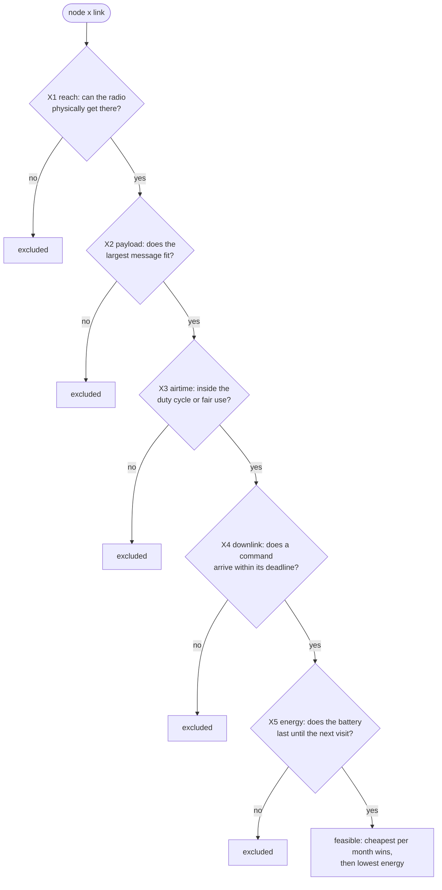
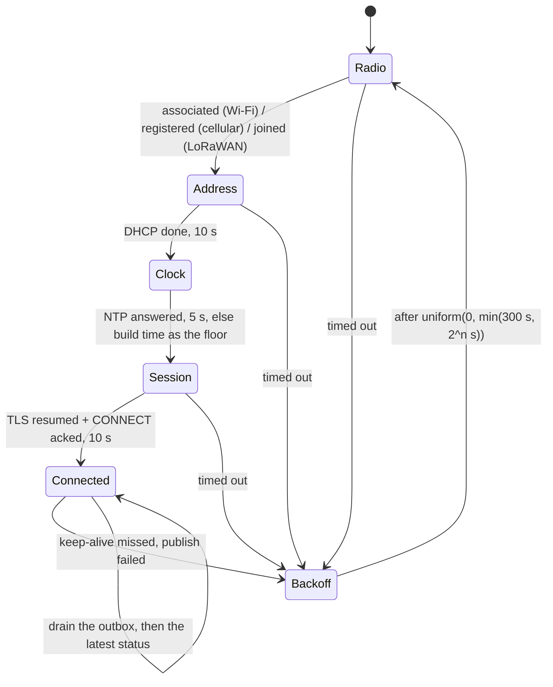

# Chapter 6 - Connectivity: choosing the link

*The traffic table, the site and the power source choose the radio; the protocol on top is a second decision; what the comms task does while the link is gone is a third.*

Chapters 2 and 3 fixed what crosses each link, in bytes and periods, and chapter 5 made sure nothing that can hurt anyone depends on it. Only now is the link worth choosing, the reverse of most projects, where "it is an ESP32, so Wi-Fi" is settled before the first requirement and the plot 200 m from the router is discovered on installation day. Three decisions are usually made as one: the *link* (Wi-Fi, LoRaWAN, cellular), chosen per node by five exclusion rules and a cost; the *protocol* over an IP link (MQTT or HTTPS), chosen by what a message costs and how a command gets back down; and the contract chapter 4's comms task needs for the hours the link is absent, which on a farm is most weeks.

## 1. Three links, two protocols

Wi-Fi and cellular carry IP, so any protocol runs on them and the node talks to the broker itself. LoRaWAN carries bytes: the node's frame reaches a gateway by radio, the gateway forwards it to a *network server*, and the application sees a decoded payload there. No IP on the node, no TLS, no broker; chapter 3's 11-byte frame exists because of this.

| | Wi-Fi + MQTT/TLS | LoRaWAN | LTE-M / NB-IoT + MQTT/TLS |
|---|---|---|---|
| reach | tens of metres to a domestic router | kilometres to a gateway you install | wherever the operator has coverage |
| bytes per message | unlimited | 51 B at SF10–12, 115 at SF9, 222 at SF7–8 (EU868) | unlimited in practice; NB-IoT is slow |
| messages | unlimited | regulated: 1 % duty cycle; on a community network, 30 s of airtime a day | the SIM's data plan |
| downlink | a subscribed client hears it within a second | class A: only in two windows after an uplink; class C: always listening, mains only | seconds while registered; a node in power-saving mode waits until it wakes |
| what one message costs a battery | the connect sequence: seconds at 100 mA | the airtime: tens of ms at tens of mA | leaving power-saving mode: seconds at 100 mA |
| infrastructure | the farm's router and internet | your gateway plus a network server (community or self-hosted) | the operator's |
| per device, per month | nothing | nothing, or the gateway amortised | a SIM, a few dollars |
| what fails | the router, the farmer's ISP | the gateway's power and backhaul, which is one of the other two links | a tower outage takes every node at once |

The numbers are the parameters in [`examples/ch06/links.json`](examples/ch06/links.json), each with a `source` field naming its origin; prices are orders of magnitude, not quotations. The last row matters most: a LoRaWAN node depends on a gateway that is itself on Wi-Fi or cellular, so its availability is the product of two links, and the gateway's power supply joins the never-list.

## 2. Five rules, in order

Chapter 2 placed computations with ordered rules so that every placement came with a reason. The link is chosen the same way, per node: the first rule that excludes it wins.



**X1 reach** is a site fact, not a datasheet one: the distance to the router or gateway against a conservative range (50 m for Wi-Fi across a yard, 2 km for LoRaWAN with some trees), confirmed by standing at the node's position with a test unit.

**X2 payload** is the largest frame against the link's maximum. LoRaWAN's limit falls with the spreading factor: 51 bytes at SF10.

**X3 airtime** is regulation and etiquette. On the EU868 plan a node may transmit 1 % of the time on a sub-band, 36 s an hour, the only limit on a network server you run yourself. The Things Network's community server adds 30 s of uplink airtime per device per day, stricter at every spreading factor and the rule that bites below.

**X4 downlink** is the promise behind chapter 3's settings stream: how long a changed threshold or an irrigation plan may take to reach the node. The link's own latency is seconds, but a sleeping node hears nothing until it wakes, so a battery node's latency is its uplink period; so is a class A LoRaWAN node's unless it runs class C. A 10-minute status period is a 10-minute command latency; chapter 2's rule that the cloud sends plans, not relay commands, makes that acceptable.

**X5 energy** is the battery against the visit interval. Cost comes last, the only term anyone can negotiate.

## 3. The numbers behind the rules

**Airtime.** A LoRa symbol lasts 2^SF / bandwidth, so each spreading-factor step doubles the time on air and buys about 2.5 dB of margin. `python link.py airtime` evaluates the SX127x datasheet's time-on-air formula for the plot node's frame (24 bytes on air with the 13-byte LoRaWAN header) and turns both budgets into messages:

| SF | max app bytes | airtime ms | msg/h under 1 % duty cycle | msg/day under 30 s fair use |
|---|---|---|---|---|
| SF7 | 222 | 61.7 | 584 | 486 |
| SF8 | 222 | 113.2 | 318 | 265 |
| SF9 | 115 | 205.8 | 175 | 146 |
| SF10 | 51 | 370.7 | 97 | 81 |
| SF11 | 51 | 823.3 | 44 | 36 |
| SF12 | 51 | 1482.8 | 24 | 20 |

Read the last column against chapter 2's path C: 144 status frames and 10 events a day is 154 messages, which fits SF8 and not SF9. For the greenhouse's 84-byte JSON status (`--bytes 84`) SF7 allows 177 a day, so path B's 1 594 messages cannot go over LoRaWAN at any spreading factor. The binary frame and the 10-minute period are what the link permits, not optimisations.

**Energy.** On a battery the question is not bytes but what one message costs in milliamp-seconds, and the three links spend it differently. A Wi-Fi node pays to *connect*: association, DHCP, time sync, TLS resumption, then the publish, about three seconds near 120 mA on an ESP32, whatever it then sends. A LoRaWAN node pays airtime: 113 ms at 45 mA at SF8, plus two mostly empty receive windows. A cellular node pays to leave power-saving mode: seconds near 100 mA. `python link.py budget nodes.json links.json` multiplies these by the message counts and adds the sleep current:

| node | wifi mAh/day | lorawan mAh/day | cellular mAh/day | wifi days | lorawan days | cellular days |
|---|---|---|---|---|---|---|
| Plot node (2 000 mAh, 154 msg/day) | 17.63 | 1.16 | 21.87 | 79 | 1 207 | 64 |
| Pump-house node (mains, 106 msg/day) | 12.51 | 289.03 | 15.20 | - | - | - |

Days use 70 % of the nameplate capacity. The plot node's three years on LoRaWAN against eleven weeks on Wi-Fi is the whole case for a second radio on the farm, and it holds if every assumed current is off by half: the ratio is three seconds of connecting against a tenth of a second of transmitting. The pump-house row is the other side: a mains LoRaWAN node that must hear a command within a minute runs class C, and a receiver at 12 mA all day costs more than connecting over Wi-Fi. Measure the connect sequence before quoting a battery life to anyone.

**Protocol.** On an IP link the body is the smallest part of a message. `python link.py protocol` counts chapter 2's 84-byte status record under three transports, with typical header sizes named in its output:

| transport | bytes per status | kB/day at 1 per minute |
|---|---|---|
| MQTT, kept TLS session | 132 | 190.1 |
| + keep-alive every 60 s | 62 | 89.3 |
| HTTPS, kept connection | 542 | 780.5 |
| HTTPS, new TLS handshake per request | 5 042 | 7 260.5 |

MQTT's advantage is not its 4-byte header but the *kept session*: one TLS handshake at boot, then 132 bytes a message. HTTPS on a kept connection costs four times that and is fine. HTTPS that opens a connection per request costs forty times, and the 4.5 kB certificate chain is also about a second of CPU on an ESP32, which is what a one-line "post JSON" helper called every 15 s does. The keep-alive row says a kept session is not free either: at 60 s the pings cost half as much as the status records, so make the keep-alive as long as the router's NAT table tolerates, minutes rather than the library default. Downlink is where the two differ in kind: an MQTT client subscribes and hears a setting within the round trip; an HTTPS client must poll, or hold open a server-sent-events stream, a kept connection used backwards, which is what Firebase's Realtime Database offers both real systems.

## 4. Worked example: four nodes, three links

[`examples/ch06/nodes.json`](examples/ch06/nodes.json) holds the farm monitor's nodes with what chapters 2 and 3 say each sends: two greenhouse nodes on mains, 25 and 40 m from the router, sending path B, settings promised within 5 s; the plot node on a 2 000 mAh battery, 200 m out, sending the frame every 10 minutes, an hour allowed for an irrigation plan, a year between visits; and a pump house added here, 1.8 km away on mains, sending the frame every 15 minutes and needing a start-or-stop command within a minute. `python link.py select nodes.json links.json`:

| node | wifi | lorawan | cellular | chosen |
|---|---|---|---|---|
| Greenhouse node 1 | ok: 0.00 USD/month, 171.23 mAh/day | X3 airtime: 281.8 s/day at SF7 > 30 s/day | ok: 2.00 USD/month, 221.87 mAh/day | wifi |
| Greenhouse node 2 | ok: 0.00 USD/month, 171.23 mAh/day | X3 airtime: 281.8 s/day at SF7 > 30 s/day | ok: 2.00 USD/month, 221.87 mAh/day | wifi |
| Plot node (soil, tank) | X1 reach: 200 m to the router > 50 m | ok: 1.25 USD/month, 1.16 mAh/day | X5 energy: 64 days < 365 required | lorawan |
| Pump-house node | X1 reach: 1800 m to the router > 50 m | ok: 1.25 USD/month, 289.03 mAh/day | ok: 2.00 USD/month, 15.20 mAh/day | lorawan |

The table is the tool's output; costs are `links.json`'s illustrative figures (a $150 gateway over five years shared by two nodes; a $2 SIM). Four readings:

1. **The greenhouse nodes lose LoRaWAN on airtime, not on bytes.** Their 140-byte history record fits SF7's 222, but 1 594 messages a day is 282 s of airtime against 30. Cellular would carry them for $2 a month each; Wi-Fi is there and free.
2. **The plot node loses Wi-Fi on reach and cellular on the battery.** A cellular modem reporting every 10 minutes lasts 64 days on this model against a year in the brief; LoRaWAN at SF8 lasts three years for the gateway's share.
3. **The spreading factor is an input the tool checks, not a choice it makes.** At SF9 the plot node fails X3 by 1.7 s a day; at 200 m with a clear path SF8 has margin. The pump house at 1.8 km is given SF9 for the trees, which is why its period is 15 minutes: at 10 it would fail the same way. Signal strength measured on site decides whether these guesses hold.
4. **The pump house is the close call.** LoRaWAN wins by 75 cents on assumed prices and needs class C, a gateway within 1.8 km and a backhaul; cellular needs nothing on site. If the site test gives SF10, or the gateway's backhaul is the ISP that fails weekly, the 75 cents do not decide.

## 5. What every link needs from the comms task

Chapter 4 gave the comms task a period, a core and two fields to write. The link gives it a contract, the same for all three, because all three go absent for hours on a farm.



**Connect in stages, each with a timeout, and report which one failed.** "No Wi-Fi" is five faults: no association, no address, no time, no TLS (clock wrong, certificate expired, root missing), no broker. A `link_stage` field beside chapter 3's `rssi` is the cheapest diagnostic a fleet can have, written before the stage that fails and read after the next success.

**Get the time before the session.** TLS checks certificate dates, so a cold clock cannot validate the broker, and the time comes from the network being validated. Plain NTP first, with the firmware's build time as a floor when NTP fails: a clock at the build date accepts a valid certificate and still rejects one that expired before the build.

**Back off with jitter, and cap it.** The retry delay doubles per failure up to a cap, and each delay is drawn uniformly between zero and that ceiling. Without jitter every node that lost the broker at the same moment, which is all of them when the broker failed, retries in step forever. `python link.py backoff` simulates 1 000 nodes losing a broker that returns after two minutes and accepts 50 connections a second:

```
  no jitter    peak  1000 attempts/s,   9500 rejected; 50 % back after 2,491 s, 99 % after 5,491 s, all after 5,491 s
  full jitter  peak    17 attempts/s,      0 rejected; 50 % back after 51 s, 99 % after 242 s, all after 283 s
```

In lockstep the fleet arrives as one wave: 50 get in, 950 are refused and return together 300 s later, and the broker spends an hour and a half admitting them in rounds. With jitter it never sees more than 17 attempts in a second and the last node is back inside five minutes. The cap matters as much: without one the twentieth retry waits twelve days, and a node that lost its link overnight is silent until lunch.

**Queue what is appended, overwrite what is overwritten.** Chapter 3's modes decide what happens to a message that could not be sent:

| stream | mode | while the link is down | on reconnect |
|---|---|---|---|
| status | overwrite | drop; it is stale when the next sample arrives | send the latest, once |
| history, events | append | outbox in flash or on the SD card, in order, bounded | drain oldest first, then resume live |
| settings reported | overwrite, versioned | keep the latest; the version says which desired it answers | send it first, so the app's "pending" clears |

Queuing status is the common mistake: a node replaying 480 stale status records after a night's outage takes eight minutes to say what it is doing now, while showing "online" with last night's values. The outbox is bounded because flash is; when it fills, the oldest history goes and the events stay.

**Presence is the broker's or the server's, never the device's.** Chapter 2's N3 is "no status write for 10 minutes", judged where the silence is observed. MQTT adds the *last will*, published by the broker on the device's behalf when 1.5 keep-alive intervals pass in silence. Set the keep-alive so that 1.5 times it falls just inside N3's window, and treat the will as the faster detector of the same silence, not a different truth.

## 6. The two real systems

Both are Wi-Fi nodes talking HTTPS to Firebase's Realtime Database, with mains and a router within reach, so this chapter's selection is no criticism of either. What their READMEs say about the comms contract:

**queen-bee-incubator.** A tuning note in its firmware README puts the comms period at 15 s, and the 60-reading ring buffer is drained once a minute to the SD card and the cloud: chapter 2's batching, with the SD card as the history outbox. Every HTTPS request is verified against a root bundle in `Secrets.h`, so section 5's clock-before-session order applies. Wi-Fi credentials come from a provisioning hotspot and the device is "2.4 GHz only". The README does not state the reconnect schedule, whether the HTTPS session is kept between requests, or what happens to the minute's batch when a cloud write fails, so this handbook does not say.

**smart-poultry-farm.** Every HTTPS call runs on core 0 in one task; the README describes the Firebase client as "a REST client over a persistent TLS session, mutex-guarded", section 3's kept connection, and the `control` node arrives over a server-sent-events stream for "sub-500 ms app-to-device latency" while thresholds, which rarely change, are polled every 30 s. "Local changes made during an outage are retried until they land, so the cloud cannot overwrite them with stale state on reconnect" is the settings-reported row of section 5's table. At boot the device gives the saved network 20 s, then retries every 30 s from the setup portal: a fixed interval, fine for one controller and the no-jitter row for a thousand. The firmware "skips TLS certificate verification (`setInsecure()`)", which the README calls acceptable for a private prototype only; chapter 7 picks that up.

## 7. What to hand over at the end of this step

1. The link table per node: the rule that excluded each alternative, the chosen link and spreading factor, the site measurement that must confirm it.
2. The airtime sheet for every LoRaWAN node, against both budgets.
3. The energy sheet for every battery node, with a measured connect sequence in place of the assumptions.
4. The comms contract: stages and timeouts, backoff parameters, outbox policy per stream, keep-alive against N3.
5. The gateway's own row in all of the above, and its power supply on the never-list.

## Exercises

1. **Chapter 2's promise.** Exercise 5 there halved the plot node's period to 5 minutes and deferred the duty-cycle check to this chapter. At which spreading factors do 298 messages a day pass the 1 % rule, and at which fair use? Then change `per_day` in `nodes.json` and run `select`.
2. **Chapter 3's frame v2.** The 13-byte frame with `t_soil` (chapter 3, exercise 2) goes to a node that needs SF11. Does it fit, what is its airtime, how many a day does fair use allow, and what do the period and chapter 2's N3 rule become?
3. **A bigger broker.** Run `backoff --capacity 200`. Why does quadrupling the broker's capacity help the no-jitter fleet so much less than jitter did, and what would a 60 s cap change?
4. **The gateway's backhaul.** The LoRaWAN gateway sits in greenhouse 1 on the farm's Wi-Fi. Write its row for `nodes.json`, choose its backhaul if the farmer's ISP fails for an evening every week, and say what the pump-house node must do by itself that evening.
5. **A battery node on Wi-Fi.** With `links.json`'s Wi-Fi parameters, find the status period at which the plot node's 2 000 mAh pack lasts 365 days, and say why it is still the worse design.

<details>
<summary>Answers</summary>

**1.** 298 a day is 12.4 an hour: under the 1 % rule every row passes. Under fair use only SF7 passes (SF8 allows 265). With the status frame at 288 a day the plot node at SF8 is excluded by X3 (33.7 s) and no link survives; it survives at SF7, on a self-hosted network server where only the 1 % rule applies, or at the original period.

**2.** SF11 allows 51 bytes, so 13 fit. `airtime --bytes 13` gives 823.3 ms at SF11 (26 bytes on air take the same symbols as 24), and 30 s a day allows 36 messages: 26 status frames after the 10 events, one every 55 minutes, so an hourly period. "Three misses" becomes three hours, acceptable for a soil sensor and not for the pump house.

**3.** The no-jitter fleet arrives as one wave whatever the capacity, so the broker admits 200 instead of 50 per round and needs five rounds instead of twenty: 991 s, still four times the jittered fleet's 242 s, because the rounds stay 300 s apart. With a 60 s cap (`herd(..., cap_s=60)`) the no-jitter rounds come every minute, all back after 1 143 s with the same 9 500 rejections; the jittered fleet is back in 59 s at a peak of 36 attempts a second.

**4.** The gateway sends its own status (backhaul stage, frames forwarded, last frame per node) every minute, with a command deadline of minutes. If a weekly evening outage is unacceptable its backhaul should not be the same ISP: a cellular backhaul at a few dollars a month makes the plot and pump data independent of it; otherwise keep Wi-Fi, accept the outage, and judge N3 for the LoRaWAN nodes from the gateway's own silence. That evening the pump-house node runs chapter 5's device layers: the pump's maximum run time and the tank level are on the node, and a plan that does not arrive leaves the pump as it was.

**5.** One message costs 3.2 s × 120 mA = 0.107 mAh; 1 400 usable mAh over 365 days is 3.84 mAh a day, 1.2 of it sleep at 50 µA, leaving 2.64 mAh: 25 messages a day, 15 status frames after the 10 events, one every 96 minutes. At that period the command latency and N3's window are an hour and a half. LoRaWAN at 10 minutes sends six times as often for a third of the energy.

</details>

## What to read next

- **Chapter 7**: provisioning, identity and secrets: how a node gets its credentials, what both real repos got wrong (open database rules, a baked-in database secret, `setInsecure()`) and how to fix each.
- LoRa Alliance, *LoRaWAN L2 1.0.4 Specification* and *RP002 Regional Parameters*: the class A receive windows and the EU863-870 payload sizes.
- Semtech, *SX1276/77/78/79 Datasheet*, section 4.1.1.6 "Time on air": the formula `airtime` implements.
- The Things Network documentation, "Fair Use Policy" and "Duty Cycle": the 30 s a day and the 1 % rule.
- OASIS, *MQTT Version 3.1.1*, sections 3.1.2.10 (Keep Alive) and 3.1.3.2 (Will Topic): the 1.5× rule and the will.
- Marc Brooker, "Exponential Backoff And Jitter", AWS Architecture Blog, 2015: the simulation behind section 5's backoff table.
