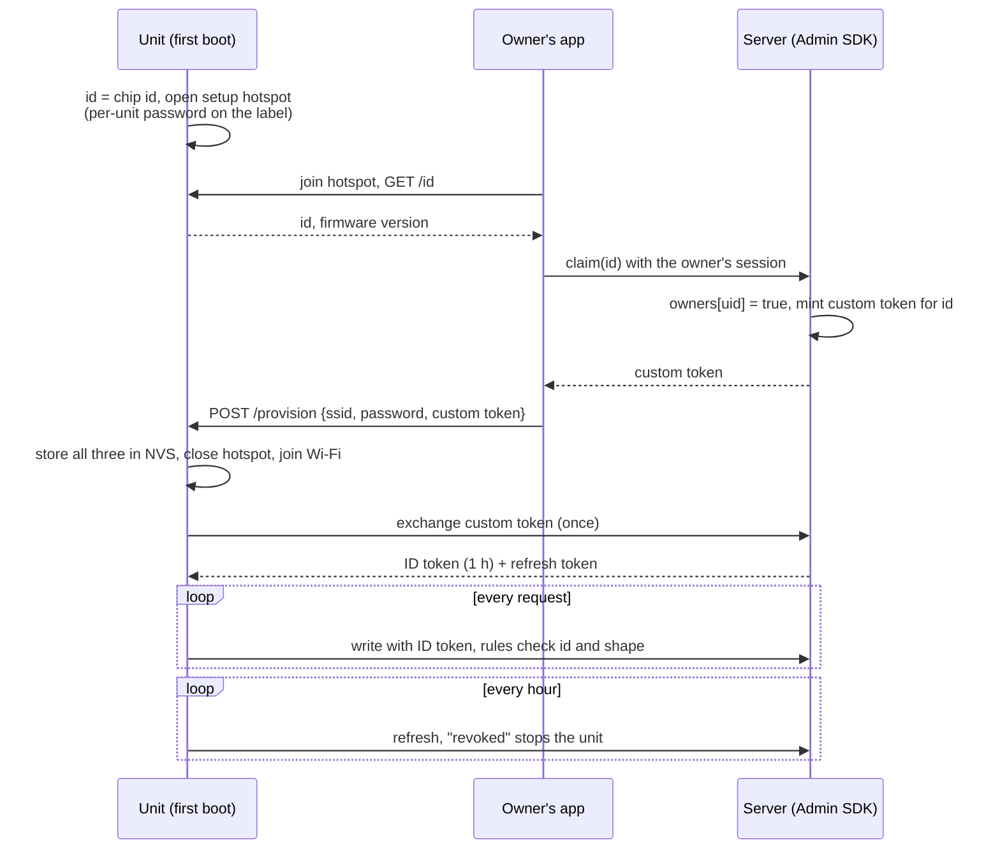

# Chapter 7 - Provisioning, identity and secrets

*Every request a device makes must answer four questions; a secret answers them only while nobody else holds it, and anything in a repository or a firmware image is held by everyone.*

Chapter 6 chose the link and gave the comms task its contract. Every message that now crosses it carries, besides the record, an implicit claim: *this is greenhouse node 1, it may write this path, and the server it talks to is ours.* The two real systems in this handbook answer that claim with one string shared by every unit, compiled into the firmware, checked by nobody, as both READMEs say in their own words. This chapter is the design that replaces it, in small steps: an inventory of values, a credential per device, rules that spend that identity, a claim flow that gets the credential onto the unit, and a plan for the day one leaks.

## 1. Four questions, one per layer

| question | answered by | wrong answer looks like |
|---|---|---|
| who is this device? | a credential only that unit holds | one string every unit holds, so the server cannot tell them apart |
| what may it do? | rules evaluated on the server for that identity | `.read: true, .write: true` |
| is the server real? | the device verifying the server's certificate against pinned roots | `setInsecure()` |
| who told the device to do this? | a signature on the command or image, or an owner's session the rules can see | an OTA image anyone with the database URL can place |

The four are independent: pinned roots do not help if the credential is shared, closed rules do not help if the credential bypasses them, and a per-device token does not help if the device hands it to any server that answers the DNS name.

## 2. The inventory: what each value is and where it may live

Before choosing a credential scheme, list every value the system needs and classify it. Two kinds: an **identifier** names a thing (a device id, a database URL, a project id, a public certificate, a web API key) and may live anywhere, because it protects nothing; a **secret** is anything whose possession grants access. Four scopes: a secret unlocks the **fleet**, one **site** (the farm's Wi-Fi), one **device** or one **user**. Seven homes, each with an audience:

| home | who can read it |
|---|---|
| source, firmware image | everyone: a repository leaks once and forever, and an image is downloadable from any OTA server or readable from any unit's flash |
| NVS, label | whoever holds that unit |
| secure element | whoever holds that unit may *use* the key while it is powered, but cannot copy it |
| phone | that user |
| server | the operators |

Five rules follow, and [`examples/ch07/identity.py inventory`](examples/ch07/identity.py) applies them to a JSON list:

- **H1** An identifier may live anywhere.
- **H2** A secret never lives in source or in an image. Both are public; the incubator's own secrets template says of its database secret "treat it as PUBLIC", which is the right conclusion.
- **H3** A secret held by a device is scoped to that device, never to the fleet: a unit is the easiest place in the whole system to read a secret out of, so whatever is in it must be worth only that unit.
- **H4** A device-scoped secret lives in NVS or a secure element and arrives by provisioning, not by compilation.
- **H5** A secret people type (a setup-hotspot password) is per unit, printed on the label, not a default.

For the farm monitor ([`inventory.json`](examples/ch07/inventory.json)) the list has twelve values and no gaps: five identifiers in source or in the image; the Wi-Fi password, a per-device token and its refresh token in NVS; the hotspot password on the label; the user's session on the phone; and two fleet secrets, the token-signing key and the OTA signing key's private half, on the server and nowhere else. Section 8 runs the same tool over the two real systems.

## 3. Identity: what one credential is worth

Three ways to give a device an identity the server can verify, in rising cost:

**A shared secret.** Every unit carries the same string, so the server knows "a device of ours" and nothing more. Firebase's legacy *database secret* is the extreme case: it bypasses the rules entirely.

**A per-device bearer token.** A server mints one token per unit with claims (`device: true, deviceId: "gh-1"`) the rules can read. Firebase's *custom token* is this: created with the Admin SDK, exchanged once for a one-hour ID token and a refresh token, the ID token sent with every request. A broker's per-client username and password is the same idea.

**A per-device key pair.** The unit generates a key that never leaves it, the server signs a certificate for the public half, and the TLS handshake proves possession without the key crossing the link. AWS IoT Core's X.509 client certificates are this, with a policy per certificate; a secure element (an ATECC608 beside the ESP32) makes the key uncopyable even with the unit in hand.

What each is worth is clearest when something goes wrong. `python identity.py blast` derives, from four properties of a design, what an attacker holds after each of six events; five are shown here, and the sixth, a lost phone with the owner's app, is the same for every design, that user's devices until their session is revoked:

| design | repo | image | stolen | mitm | server |
|---|---|---|---|---|---|
| S-image shared secret compiled into the firmware, TLS unverified | whole fleet | whole fleet | whole fleet | whole fleet | whole fleet |
| S-image-tls shared secret compiled into the firmware, roots pinned | whole fleet | whole fleet | whole fleet | nothing | whole fleet |
| S-nvs shared secret provisioned into NVS, roots pinned | nothing | nothing | whole fleet | nothing | whole fleet |
| T-nvs per-device token provisioned into NVS, roots pinned | nothing | nothing | one device, until revoked | nothing | whole fleet |
| K-se per-device key in a secure element, mutual TLS | nothing | nothing | that unit while powered, until revoked | nothing | whole fleet |

(*repo*: the repository is public or a laptop is lost; *image*: a firmware image is obtained; *stolen*: one unit's flash is read; *mitm*: the router or DNS is hostile; *server*: the signing key or console is taken.) Three readings. The first two columns are decided by H2 alone: move the secret out of the image and a public repository or a downloaded image yields nothing. The *stolen* column is decided by H3: with a shared secret the loss of one unit is the loss of the fleet and the recovery is a new secret on every unit; with a per-device credential the recovery is one revocation. The last column is the same everywhere: the server *is* the fleet and belongs under the operators' own door, with two-factor login and no shared console account. T-nvs and K-se differ in what a thief with a soldering iron gets, a copyable token or a key that only works inside the unit; T-nvs is the right stop for a farm monitor, K-se for units that leave your control.

## 4. Authorisation: rules spend the identity

An identity buys nothing until rules consume it. The rules are the four streams of chapter 3 with a writer column turned into a permission, least privilege per path:

| path | device (own id) | owner | anyone else |
|---|---|---|---|
| `/devices/<id>/status` | write, exactly `ts temp hum heater` | read | nothing |
| `/devices/<id>/history/<ts>` | write if the key does not exist | read | nothing |
| `/devices/<id>/settings/desired` | read | write | nothing |
| `/devices/<id>/owners`, `/disabled` | nothing | read | nothing: the server writes these |
| everything else | nothing | nothing | nothing: no rule at the root |

Three details carry most of the value. *Shape checks*: a status has exactly four fields, so a compromised device cannot smuggle an `admin` flag or a 10 MB blob into the overwrite stream. *Append-only history*: a write succeeds only where no data exists, so nobody, the device included, rewrites the record. *Ownership on the server*: a stolen owner session cannot invite a second owner. The rules guard shape, not truth: a compromised unit can still write plausible wrong readings, which is why chapter 5's safety layers never read the cloud.

`python identity.py provision` runs section 5's claim flow for two units against a model server (sixty lines of standard-library Python: HMAC-signed JSON tokens with an expiry, a refresh table, a revocation set) and these rules, then fourteen scenarios:

| scenario | op | allowed | rule that decided |
|---|---|---|---|
| device A writes its own status | write | allow | device overwrites its own status |
| device A writes device B's status | write | deny | only the device itself writes status |
| device A appends a history row | write | allow | device appends a new history key |
| device A overwrites that history row | write | deny | history is append-only |
| device A writes a status with an extra field | write | deny | status must have exactly ts, temp, hum, heater |
| device A grants itself a new owner | write | deny | owners and disabled are written by the server only |
| anonymous reads device A | read | deny | default deny |
| owner writes desired settings for A | write | allow | owner writes desired settings |
| device A reads its desired settings | read | allow | device may read its desired settings |
| device A writes with an expired token | write | deny | token rejected before the rules |
| device A refreshes and writes again | write | allow | device overwrites its own status |
| a forged signature on A's claims | write | deny | token rejected before the rules |
| device B, revoked, writes with its still-valid token | write | deny | device disabled: `root.child(devices/$id/disabled)` |
| device B, revoked, asks for a new token | refresh | deny | refresh token revoked by the server |

Every row is a test, and the same scenarios should be replayed against the real rules engine in Firebase's emulator before a ruleset is deployed. The last two rows are the revocation design: an ID token stays valid until it expires, so revocation alone leaves a stolen unit an hour; a `disabled` flag the rules read closes that hour to nothing, for one extra read per request.

## 5. Provisioning: how the credential gets onto the unit

A unit leaves the bench with an identity (its chip id, from the efuse MAC) and nothing else. The credential arrives when an owner claims it:

Four properties of the flow are worth keeping whatever the stack. *The secret is minted after the identity is known*, so nothing per-device exists at compile time and the same image goes on every unit. *The owner's session is the authority*: a stranger cannot claim a unit without a signed-in app and presence at the hotspot. *The hotspot window is the weak minute*: both real systems open an access point with one password that is a default in a source file, so anyone in radio range during setup can join it, read the Wi-Fi password the app sends and post their own. H5's fix is a per-unit password derived from the chip id and printed on the label, or a code the unit shows on its LCD that the app must echo. *NVS is not encrypted by default*: anyone with the unit and a USB cable reads it with the flashing tool. H3 bounds that loss to the unit; for anything that leaves your hands, enable flash and NVS encryption or move the key to a secure element.

Factory provisioning, where a station writes a per-unit certificate before shipping, is the same flow with the station as the app and the owner bound later by a claim code on the label; AWS IoT's fleet provisioning by claim adds a shared *claim certificate* whose only permission is to request a real one.

## 6. Rotation and revocation: the day it leaks

A credential scheme is judged on the day a secret leaks, which is a matter of when, not whether. `python identity.py rotate --fleet 1000` costs the response for each design, with a 14-day OTA rollout, 180-day site visits and a one-hour token:

| design | devices to touch | leak usable for | device-days offline if cut now |
|---|---|---|---|
| S-image, S-image-tls | 1000 | 14 days | 7000 |
| S-nvs | 1000 | 180 days | 90000 |
| T-nvs | 1 | 1 h (0 with the `disabled` rule) | 0 |
| K-se | 1 | 0 | 0 |

The shared-secret rows are a trap with two doors. Rotate at once and every unit not yet updated is offline until it is: half the fleet for half the rollout, seven thousand device-days, ninety thousand for units reached by site visits. Keep the old secret valid until the last unit updates and the leak stays usable for the whole rollout. Either way the new secret ships *inside the new image*, back in the public home that leaked it, so the next rotation is already scheduled. The per-device rows cost one revocation and one new token, and rotating the server's signing key costs the units nothing: they refresh hourly and the server accepts both keys for one token lifetime.

This is also the order for fixing a live system that runs on a shared secret today, because the secret cannot be rotated before the units have another way in: ship firmware that exchanges a per-device token, mint and deliver the tokens, close the rules, and only then rotate the old secret, which turns every copy of it, in old images, old repositories and old laptops, into a dead string. Exercise 4 works through the sequence.

## 7. The server's identity, and the image's

**TLS verification is the device checking the server.** With `setInsecure()` the device accepts any certificate, so whoever controls the router, the DNS or the farm's captive portal can answer as the database and receive whatever the device sends. For a device that appends its credential to the URL as `?auth=…`, that is the credential, and under a shared secret it is the fleet: the top-left cell of section 3's table. Pinning the roots fixes it at the cost chapter 6 already required, a clock before the handshake and a plan for the roots' expiry (the incubator's bundle expires in 2036; an image shipped in 2035 must carry the successors).

**An image's SHA-256 proves it arrived intact, not that you sent it.** The incubator's OTA path places the image and its hash in the database and the unit flashes whatever matches; its firmware README says the branch "is still only as protected as the Firebase rules", which under open rules is not at all: section 1's fourth question has no answer, for a unit that drives a heater. The fix is a signature over the hash with a key whose private half lives on the server (inventory row 12) and whose public half in the image (row 4); the unit verifies before it flashes and the rules become a second layer. Chapter 9 designs the OTA path around that signature.

## 8. The two real systems

`python identity.py inventory inventory_real.json` applies the five rules to fourteen values taken from the two repositories' READMEs, secrets templates and the configuration files they name; nothing was read out of a device:

| value | kind | scope | lives in | verdict |
|---|---|---|---|---|
| incubator: device name `hive-XXXXXX` (last three MAC bytes) | identifier | device | source | ok |
| incubator: database URL | identifier | fleet | source | ok |
| incubator: TLS roots (GTS Root R1/R4) | identifier | fleet | image | ok |
| incubator: legacy database secret ("in the source tree and inside every published OTA image") | secret | fleet | image | **gap H2** |
| incubator: Wi-Fi credentials (app → hotspot → NVS) | secret | site | nvs | ok |
| incubator: setup hotspot password (one default in `Config.h`) | secret | fleet | source | **gap H2** |
| incubator: notification topic ("anyone can read or post to it") | secret | fleet | image | **gap H2** |
| poultry: legacy database secret (compiled in from `secrets.h`) | secret | fleet | image | **gap H2** |
| poultry: compiled-in Wi-Fi fallback | secret | site | image | **gap H2** |
| poultry: setup portal password (one default in `config.h` and the README) | secret | fleet | source | **gap H2** |
| poultry: OTA upload page basic-auth (defaults in `config.h`) | secret | fleet | source | **gap H2** |
| poultry: push-notification REST key, sent from the device | secret | fleet | image | **gap H2** |
| poultry: Firebase web / Android API keys ("client identifiers, not secrets") | identifier | fleet | source | ok |
| poultry: database URL | identifier | fleet | source | ok |

Eight gaps, all H2, and every one already named by the repositories themselves: the incubator README's security note asks for rules per device, a rotated secret and real user authentication; the poultry README calls its legacy secret and `setInsecure()` "acceptable for a private prototype, not for production" and names "per-device auth tokens, CA pinning and locked-down database rules" as the path. The incubator did one thing the poultry controller did not: every HTTPS request is verified against pinned roots, so its row in section 3 is S-image-tls, and a hostile router gets nothing from it. Both run open rules, and both apps authenticate users weakly (the incubator checks a device password in the app, "convenience, not protection" in its own data contract; the poultry app signs in anonymously), so the user side needs the same treatment.

The order of work, cheapest first and each step safe alone: (1) close the rules for *users*, with owners written by a script, which costs the apps a sign-in screen and stops any phone from reading every farm; (2) ship firmware that exchanges a per-device custom token and writes with the legacy secret until it has one; (3) mint tokens for the units in the field and close the device rules; (4) rotate the legacy secret, which retires every leaked copy at once; (5) `setCACert` with the Google roots on the poultry controller; (6) per-unit hotspot and OTA-page passwords on the label, and the notification key off the device. Steps 1 and 5 are an afternoon each; the rest needs a small server, a cloud function or a laptop script with the Admin SDK, which chapter 9's OTA signature will need too.

## 9. What to hand over at the end of this step

1. The inventory with zero H2–H5 gaps, and [`identity.py scan`](examples/ch07/identity.py) in CI so it stays that way.
2. The credential design per device class (T-nvs for the farm monitor) and the server that mints and revokes.
3. The rules file and its scenario table, replayed in the emulator before every deployment.
4. The claim flow as a sequence diagram, the label contents (id, hotspot password, claim code), and what the unit shows when revoked.
5. The rotation runbook: who rotates what, how long it takes, the order for retiring a shared secret.

## Exercises

1. **The gateway.** Chapter 6 gave the farm a LoRaWAN gateway. Add its rows to `inventory.json` (its backhaul credential, its network-server credential, its own device identity) and run `inventory`. Which rule does a gateway that holds one credential for all three plot nodes break?
2. **A unit changes hands.** The farmer sells greenhouse node 2. Using `provision`'s server, write the sequence that leaves the old owner with nothing and the new owner with a working unit, and say which step a design with a compiled-in shared secret cannot perform.
3. **The hour.** A revoked T-nvs unit keeps a valid ID token for up to an hour. Name two ways to shorten the window other than the `disabled` rule, and what each costs per request or per hour across 1 000 units.
4. **Migration order.** Put section 8's six steps in a different order, closing the device rules before the firmware ships, and say which units go dark and for how long with the 2026 fleet of a handful of incubators and with 1 000.
5. **Scan your own tree.** Run `python identity.py scan` over a repository you own. Classify each hit as identifier, placeholder or secret, and for each secret say which of H2–H5 it breaks and where it should live.

Answers

**1.** The backhaul credential is the farm Wi-Fi password (secret, site, NVS: fine). The network-server credential should be the gateway's own (secret, device, NVS); if it is an application key shared with the plot nodes it is fleet-scoped on a device and breaks H3: whoever opens the gateway's box impersonates every plot node. LoRaWAN's answer is a root key per end device (`AppKey`), H3 applied to the nodes themselves.

**2.** Old owner's app: `revoke_device(id)` on the server (refresh denied, `disabled` set), delete `owners/<old uid>`. New owner: hold the unit, long-press to reopen the hotspot, run the claim flow; the server clears `disabled`, writes `owners/<new uid>` and mints a new custom token, so the old token is worthless even if the old owner kept a copy. A compiled-in shared secret cannot perform the revocation step at all: the old owner's copy of the image still authenticates as "a device of ours" against every unit's data, and only a fleet-wide rotation retires it.

**3.** Shorten the ID token lifetime (a 5-minute token is 12 refreshes an hour, 12 000 extra requests an hour across the fleet, and a unit offline five minutes after losing the server), or check a revocation list on the server on every write (one lookup per request, which is what the `disabled` rule does inside the database). The per-request read is cheaper than the refresh storm and faster than any lifetime.

**4.** Closing the device rules before the token firmware ships changes nothing, because the legacy secret bypasses the rules: nothing goes dark and nothing is gained until step 4. Rotating the secret before the token firmware ships darkens every unit until it is reflashed: a bench afternoon for a handful of incubators, `rotate`'s 7 000 device-days for 1 000. The order that never darkens a unit is token firmware, tokens minted, device rules closed, secret rotated.

**5.** No fixed answer. Common findings: a database URL (identifier, fine); `*.example.*` placeholders (fine); a Wi-Fi password in a tuning header (H2; NVS via the setup flow); a shared broker password in `docker-compose.yml` (H2 and H3; per-client credentials in a mounted password file); an API key in a notebook output (H2; clear outputs *and rotate the key*: a committed key is public even after the commit is rewritten).

## What to read next

- **Chapter 8**: the cloud side: Firebase Realtime Database, AWS IoT Core and a self-hosted broker with a time-series store, with this chapter's identity design as one column and the cost at 10, 1 000 and 100 000 devices.
- Firebase documentation, "Create custom tokens" and "Realtime Database Security Rules": the exchange `provision` imitates and the `root`, `data`, `newData` and `auth.token` variables the rules table assumes.
- AWS IoT Core Developer Guide, "Provisioning devices that don't have device certificates using fleet provisioning": the claim-certificate pattern.
- Espressif, *ESP-IDF Programming Guide*, "Flash Encryption", "NVS Encryption", "Secure Boot V2": what to turn on when the unit leaves your hands.
- OWASP, *IoT Security Verification Standard*: a checklist that covers section 2's inventory.
- M. Antonakakis et al., "Understanding the Mirai Botnet", USENIX Security 2017: what default passwords across a fleet cost, measured.
