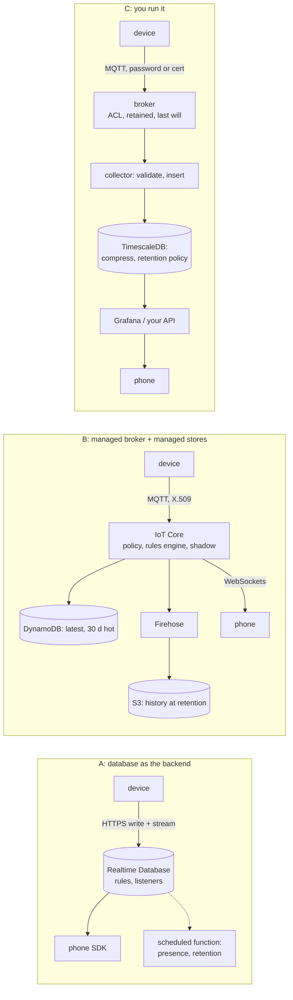

# Chapter 8 - The cloud side

*The cloud side is a list of jobs before it is a product; each platform bills a different unit, and the unit decides which part of your design costs money.*

Chapter 3 gave the farm monitor four streams, chapter 6 a link and a presence rule, chapter 7 an identity per device, and all of them point at a box the diagrams have labelled "cloud". This chapter opens it and compares three shapes: a database the device writes to directly (Firebase Realtime Database, which both real systems use), a managed broker with managed stores behind it (AWS IoT Core with DynamoDB, Firehose and S3), and a broker with a time-series database you run yourself (Mosquitto or EMQX with TimescaleDB). The method is chapters 2 and 6's: list what the box must do, see how each shape does it, price one design on each, apply rules in order. Every number below is printed by [`examples/ch08/cloud.py`](examples/ch08/cloud.py) from two JSON files, and every price in [`prices.json`](examples/ch08/prices.json) carries its source, its date and whether it was fetched or remembered.

## 1. Twelve jobs, three shapes

The earlier chapters already decided what the cloud side must do: ingest a write and fan it out; hold the latest state per device; append history, answer range queries and delete past retention; append events exactly once; hold settings desired and reported with a version; judge presence after N3's window; spend chapter 7's identity in rules; check the shape of what a device writes; serve a signed image (chapter 9); feed a phone app with an offline cache; back up; and have a known ceiling.

`python cloud.py fit requirements.json` reads [`requirements.json`](examples/ch08/requirements.json), where each job has, per shape, a level and one sentence: *native* (configuration does it), *add-on* (one more managed piece does it), *you build* (code you write and run does it). The counts:

| shape | native | add-on | you build | the `you build` rows |
|---|---|---|---|---|
| A Firebase RTDB | 7 | 3 | 2 | history retention and indexes; OTA signing and rollout |
| B AWS IoT Core + stores | 7 | 5 | 0 | none, but five add-ons (DynamoDB, Firehose, a Lambda for shape checks, Cognito or AppSync for the phone, the API) |
| C self-hosted | 2 | 4 | 6 | events once, shape checks, OTA, the phone's path, backups, the ceiling |

Three things to read off the full table. Shape A does the *phone* best: the SDK's listener, cache and reconnection are why both real systems chose it, and on the other shapes that row is an add-on or yours. Shape B does *devices* best: a certificate per thing, a policy bound to its name, a shadow that is exactly desired/reported/delta, jobs for OTA, last will and lifecycle events for presence. Shape C does nothing for you and forbids nothing: every row is possible and six are code, the right trade only when someone is paid to own that code.

## 2. What each shape bills

The shapes count different things, and the thing counted decides which part of a design costs money.

| shape | billed unit | not billed | ceiling before the design changes |
|---|---|---|---|
| A Firebase RTDB (Blaze plan) | GB stored a month; GB downloaded (to phones, to functions, to anything that reads) | writes from devices, connections (up to the cap) | 200 000 simultaneous connections per database instance; the free Spark plan stops at 100 connections, 1 GB stored and 10 GB downloaded a month |
| B AWS IoT Core | connection minutes; messages in 5 KB units, in and *out*, so each delivery to a subscriber counts; rules triggered and actions executed; shadow operations; then DynamoDB write and read units, Firehose GB (each record rounded up to 5 KB), S3 GB and PUTs | inbound bytes as such | soft account limits, raised on request |
| C self-hosted on a cloud instance | instance hours, provisioned disk, snapshots, data out after a free allowance; people | messages, rows, connections | whatever one broker and one database take before you cluster them, which you must measure |

The prices the chapter uses, with their provenance:

| unit | price | source |
|---|---|---|
| RTDB storage | $5 per GB-month | firebase.google.com/pricing, from memory on 2026-10-28; the page was unreachable from the sandbox, so `prices.json` marks it unverified |
| RTDB download | $1 per GB | same |
| IoT Core connection | $0.08 per million minutes | AWS Price List API, us-east-1, offer 20261003053120 |
| IoT Core message | $1.00 per million for the first billion a month, $0.80 to five billion, $0.70 beyond | same |
| IoT rule / action | $0.15 per million each | same |
| Device Shadow operation | $1.25 per million | same |
| DynamoDB on-demand | $0.625 per million writes, $0.125 per million reads, $0.25 per GB-month after 25 GB | Price List API, offer 20260911124422 |
| Firehose | $0.029 per GB, 5 KB minimum per record | Price List API, offer 20260911124446 |
| S3 Standard | $0.023 per GB-month, $0.005 per thousand PUTs | Price List API, offer 20261015173540 |
| EC2 on-demand Linux | t4g.small $0.0168, t4g.medium $0.0336, m6g.large $0.077 per hour; gp3 disk $0.08, snapshots $0.05 per GB-month | Price List API, EC2 us-east-1, read 2026-10-28 |
| data out | $0.09 per GB after 100 GB a month | from memory, unverified |

Two conventions: a gigabyte here is 10^9 bytes, so the AWS columns are about 7 % high against its 2^30-byte units; and the self-hosted column prints hours of operations as hours, because the handbook does not know your rate.

## 3. Worked example: the farm monitor at 10, 1 000 and 100 000 devices

[`fleet.json`](examples/ch08/fleet.json) is chapter 3's records on chapter 6's farm: two greenhouse nodes on Wi-Fi per plot node on LoRaWAN, a gateway per ten plot nodes, status every 60 s (every 10 min for the plot node), ten-minute history kept two years, ten events a day, a settings record, each row with its measured bytes plus the database key. The phones are assumptions the file states: one per ten devices, watching them two hours a day, opening a 24-hour chart twice a day, a quarter open at the peak. `python cloud.py cost fleet.json prices.json` prints every line; the summary is:

| devices | A Firebase RTDB | B AWS IoT Core + stores | C self-hosted |
|---|---|---|---|
| 10 (7 greenhouse, 3 plot, 1 gateway, 1 phone) | $1.07, and it fits the Spark plan: $0 | $0.81 | $13.75 + 2 h |
| 1 000 (100 phones) | $106.71 | $73.88 | $25.94 + 8 h |
| 100 000 (10 000 phones) | $10 671.43 | $6 887.69 | $147.05 + 40 h |

The lines behind the thousand-device row are where the design shows:

| line | A | B | C |
|---|---|---|---|
| history and events at steady state, 21.25 GB | $106.26 at $5/GB | $0.49 in S3 (+ $0.67 Firehose to get it there, + $0.00 for the 30-day hot copy under DynamoDB's free 25 GB) | inside a 20 GB disk at 10x compression, $1.60 |
| 34.8 million uplink messages a month | $0: writes are not billed | $37.35 messages (with 2.5 million deliveries to phones), $5.22 rules, $5.90 actions, $21.76 DynamoDB writes | $0: the instance takes them |
| 701 device sessions held open | $0, 726 of 200 000 at the peak | $2.42 connection minutes | $0 |
| phones: 0.30 GB of status changes, 0.15 GB of charts | $0.45 | inside the messages line; charts $0.00 in DynamoDB reads | inside the free 100 GB out |
| the machine | none | none | t4g.medium $24.19, snapshots $0.15 |

Read the three columns as three different bills for the same design. **Shape A bills the storage: the storage line is 99.6 % of its total, and history alone 93 %.** Chapter 3 chose to keep ten-minute aggregates for two years; at $5 per GB-month that choice is $99 a month at a thousand devices and $9 881 at a hundred thousand, while 34 million writes cost nothing. **Shape B bills the messages, and 82 % of its total follows the 60-second status.** Of 34.8 million uplink messages a month, 30.3 million are status writes, and each is a metered message, a rule, an action and a DynamoDB write unit: four meters on one record. At a hundred thousand devices the tiers apply (3.7 billion messages, the first billion at $1, the rest at $0.80) and $5 529 of the $6 888 is status. **Shape C bills the machine and the people.** The instance costs the same for one message or ten million, so the dollar column barely moves while the hours column does; at a hundred thousand devices it is two instances, 319 GB of disk and 40 hours a month, and the sizing is a judgement, not a benchmark.

Each column has one lever, and `cost` has a switch for each. `--status-period-s 300` leaves Firebase at $106.48 and takes AWS to $27.58 at a thousand devices and $2 758 at a hundred thousand; a five-minute status is also N3's detection delay (chapter 2), which is the trade. `--history-retention-days 30` leaves AWS at $73.44 and takes Firebase to $11.96 and $1 196: thirty days in the database and the rest exported to cheap storage, the `you build` row the fit table named. The plot nodes show the same from the other side: a third of the fleet sends a tenth of the status messages and costs shape B almost nothing, while costing shape A exactly as much history as a greenhouse node.

Two warnings the tool prints are part of the result. At ten devices shape A is free and shape B is 81 cents: at this size the bill is not the decision, section 6's other rules are. At a hundred thousand devices shape A holds 72 530 simultaneous connections, inside one instance's 200 000; the same design with a phone per device would not be.

## 4. The hidden multiplier: the phone, and where its listener is attached

Everything in section 3 is proportional to the fleet. The phone is not: it is proportional to how many people look, for how long, and to one decision in the app that no price page mentions. `python cloud.py fanout` prices one phone for one month, watching ten devices two hours a day and opening a 24-hour chart twice a day, under three placements of its listener:

| placement | downloaded a month | at $1/GB |
|---|---|---|
| A: a listener on `/devices/<id>/status`; the chart is `orderByKey().limitToLast(144)` on `/history` | 0.006 GB | $0.01 |
| B: a listener on `/devices/<id>`, to get status, settings and history in one go | 13.08 GB | $13.08 |
| C: as A, but the chart orders by a child field and `history` has no `.indexOn` | 1.19 GB | $1.19 |
| A on AWS IoT Core: 36 000 deliveries a month | - | $0.04 |
| A self-hosted: bytes out of the instance | 0.006 GB | $0.00 inside the free allowance |

A Realtime Database listener downloads the whole subtree under it once when it attaches, then only the changes. Placement B attaches at the device node, under which two years of history live, so every app open downloads 21.8 MB per device before the first live value arrives; a hundred phones doing that is $1 308 a month on a $107 fleet, and it is also why the app feels slow. Placement C is the other documented trap: a query ordered by a child field with no index at that path is filtered on the phone, so the whole node comes down first. Two rules follow. *Attach listeners to the leaf you display*, which is why chapter 3 gave status, history and settings separate paths. *Index every field a query orders by*, or order by key, which needs no index. The same phone costs four cents on shape B, where the broker delivers one 120-byte status per change and the chart is a query, and nothing on shape C inside the free allowance. Placement A is a cent on every shape; the lesson is that on a per-byte bill the app's structure is a cost input, and only the app's author controls it.

## 5. Chapter 7's rules in three dialects

Identity was designed once; each shape spends it differently. `python cloud.py rules map` prints the correspondence, and `rules firebase|aws|mosquitto` write the three artefacts:

| chapter 7 row | A Firebase rules | B AWS IoT policy | C Mosquitto ACL + collector |
|---|---|---|---|
| device writes exactly `ts temp hum heater` to its own status | `.write` with `auth.token.deviceId === $id`; `.validate` with `hasChildren` and `$other: false` | `iot:Publish` on `topic/farm/${iot:Connection.Thing.ThingName}/status`; the shape check moves to the rule's SQL or a Lambda | `pattern write farm/%u/status`; the shape check moves to the collector |
| history append-only | `!data.exists()` on `$ts` | a conditional put in the DynamoDB action | `INSERT ... ON CONFLICT DO NOTHING` |
| owner writes desired, device reads it | `.write` for owners, `.read` for both | the shadow: the app's identity may update it, the thing subscribes to `update/delta` | a retained topic; the owner's ACL line allows the write |
| owners and disabled written by the server only | no `.write` at those paths; the Admin SDK bypasses rules | owners live in the app's API; disabled is a deactivated certificate | the claim service edits the files and reloads |
| default deny | no rule at the root | a policy allows only what it names | an ACL denies what it does not name |

Two differences matter in practice. The *shape check* lives in the rules only on shape A; a broker authorises topics, not payloads, so on B and C a bad record is accepted and must be dropped one step later, by a piece that must exist and be tested. *Revocation* is a flag the rules read on A (chapter 7's `disabled`), a certificate state on B, and a file edit plus a reload on C; the first two act on the next request, the third on the next reconnect unless the session is killed. None of the three files has been run against its engine here: they are one table in three spellings, to be replayed in the Firebase emulator, the IoT policy simulator and a local broker before use.

## 6. Five rules, in order, and the farm monitor's answer

As in chapters 2 and 6, the rules exclude before they compare.

- **K1 Ceiling.** If the planned fleet, times ten, crosses a shape's ceiling, it is out: Spark's 100 connections beyond a handful of streaming units, one Realtime Database instance's 200 000 for a national fleet, and for shape C whatever you have measured, which at first is nothing.
- **K2 People.** If nobody is paid to be on call, shape C is out: a server nobody watches is chapter 7's *server* column with no operator.
- **K3 The `you build` count.** For the jobs you need, count the rows that are yours; each is code that must exist on day one, and a retention function you never wrote is a bill that grows forever.
- **K4 The bill at the planned fleet, with the lever applied.** Run `cost` at the fleet and at ten times it, after moving each shape's lever; a bill a reviewer cannot explain line by line has not been priced.
- **K5 Cost of leaving.** Chapter 2's R5 again: S3 and a Postgres dump are files; a Realtime Database export is one JSON tree, fine at 21 GB and a project at 2 TB.

For the farm monitor at ten devices the answer is shape A on the Spark plan with placement A listeners, chapter 7's custom tokens, and the two `you build` rows written before launch: a nightly export of history older than thirty days to a bucket, and a signed OTA image (chapter 9). It costs nothing, the phone app is the strongest part of the stack, and K3's two items are an evening each. At a thousand devices K1 forces Blaze, the bill is $107 against $74 and $26 + 8 h, and K2 decides: with an operator, shape C at a five-minute status; without one, shape B at a five-minute status ($28) or shape A with 30-day retention ($12), and the phone experience decides between them. At a hundred thousand devices the dollar column makes shape C look fifty times cheaper, and the hours column is the reply: 40 hours a month is a job, two instances are a cluster you have never run, six jobs are yours. The break-even against shape B is about $6 an hour at a thousand devices and $170 at a hundred thousand (exercise 5), which is why farms of ten run on shape A, utilities of a hundred thousand on shape C with a team, and the managed broker fills the long middle.

## 7. The two real systems

Both run shape A, and by K1 to K4 that was the right call for a handful of units. The poultry architecture document states the shape in one sentence: "There is no backend server and no Cloud Function: the ESP32 pushes its own notifications, the app records its own history." The incubator's firmware README states the plan: "this project stays on the free Spark plan", which is why its OTA image, "easily 1-2 MB as text", is base64 in the database under `/devices/<name>/ota/binData` rather than in Cloud Storage, which "requires the paid Blaze plan".

What this chapter adds is the three walls such a project meets first, in order. **Connections.** The poultry controller holds a server-sent-events stream for its `control` node (chapter 6), so each controller is one of Spark's 100 simultaneous connections and each open app is another; the incubator's firmware uses HTTPS requests, and its README does not say whether a stream is held. A few dozen units with their owners' phones is the first wall, and it is a refusal, not a cost. **Storage.** An image of 1 to 2 MB per device is 0.1 to 0.2 % of Spark's 1 GB per unit; five hundred to a thousand units' images fill the quota before a byte of history is counted. The fix is one shared image path per firmware version, or the paid plan's Storage. **Download.** The incubator's data contract reads `/status` for the live screen and `/history` for the charts, placement A's separation; it does not state whether the chart reads the node whole or with a limit. At one push a minute, a history row of chapter 3's size adds about 250 KB a day, 90 MB a year, so a chart that reads the node whole costs that per open, against 10 GB a month. The poultry schema's hour-bucketed history keys are the right shape for both a limited read and the retention delete the fit table lists as `you build`, and neither repo says the delete exists yet. Their READMEs already name the identity work (chapter 7); this chapter adds a listener-placement rule, a shared OTA path and a retention function, each an afternoon.

## 8. What to hand over at the end of this step

1. The fit table for the jobs you need, with the `you build` rows as a backlog that is empty before launch.
2. The bill at the planned fleet and at ten times it, line by line, with each price's source and date, the lever named, the unverified prices flagged.
3. The listener placement rule and the index list, checked against the app.
4. The rules file in the chosen dialect, replayed against its engine with chapter 7's scenarios.
5. The export path (K5) tried once, with the time it took.

## Exercises

1. **Twelve hours of watching.** Change `listen_hours_per_day` from 2 to 24 in `fleet.json` and re-run `cost --devices 1000`. Which line moves on which shape, by how much, and which shape does not notice?
2. **Thirty days in the database.** Run `cost --history-retention-days 30`. What must exist on shape A for that number to be an honest bill rather than data loss, and why does shape B's column hardly move?
3. **The device-node listener on the incubator.** List what comes down when an app attaches a listener at `/devices/<name>` of the incubator's tree, and estimate how many app opens a month Spark's 10 GB download allows if the OTA image alone is 1.5 MB.
4. **The 5 KB unit.** A history record is 178 bytes and an IoT Core message is metered in 5 KB units. If the comms task of chapter 6 drained ten history rows in one message, what would it save at a thousand devices, what could not be batched, and what breaks in the rule action?
5. **The hourly rate.** From section 3's table, at what hourly rate does shape C stop being the cheapest at a thousand devices, and at a hundred thousand? Which assumption in `fleet.json` would you check before quoting either number?

Answers

**1.** Shape A's status-download line goes from 0.30 GB to 3.63 GB ($3.63); shape B's deliveries go from 2.5 million to 30.3 million, about $28 more; shape C stays inside the free 100 GB out. Storage and the device-side lines do not move anywhere: watching costs bytes and deliveries, never rows.

**2.** Shape A falls to $11.96 at a thousand devices and $1 196 at a hundred thousand. To be honest, a scheduled function must copy each day's history to a bucket or a warehouse before the retention delete runs, and the chart must read the archive for anything older than a month: that is the `you build` row, and without it the saving is a deletion. Shape B barely moves because its history already lives in S3 at $0.023 per GB-month; the setting only shortens the hot copy, free under 25 GB anyway.

**3.** The status snapshot, the settings, the alarms with their 60-reading contexts, the whole history node and the OTA node including `binData`. With a 1.5 MB image under the node, 10 GB buys about 6 700 opens a month before any history is counted; with a year of minute-rate history at chapter 3's row size (about 90 MB), about a hundred. The fix is placement A: attach to `/status`, read `/history` with a limit, never attach above `/ota`.

**4.** Ten rows are 1 780 bytes, still one 5 KB unit, so history messages drop from 4.32 million to 432 000 a month at a thousand devices: about $3.89 in messages and $0.58 in rules, under five dollars, because history was never the expensive stream. Status cannot be batched: it is N3's heartbeat and 87 % of the messages, which is why the period is the lever. What breaks is the rule action: a rule's SQL acts on one payload, so the conditional put and the Firehose record must be split by a Lambda, a new line on the bill and a new piece to test.

**5.** At a thousand devices shape B costs $73.88 and shape C $25.94 plus 8 hours, so shape C is cheaper below ($73.88 - $25.94) / 8 = $5.99 an hour; at a hundred thousand, ($6 887.69 - $147.05) / 40 = $168.52. Both rest on the `ops_hours_per_month` guesses in `fleet.json`; the second also on two m6g.large instances carrying 100 000 sessions and 1 300 rows a second, which the chapter calls a judgement. Check the hours against a month's operations log before quoting either.

## What to read next

- **Chapter 9**: observability and OTA: what each shape shows you of a fleet (last will, lifecycle events, the status table's age), the signed image chapter 7 asked for, and a staged rollout with a rollback rule.
- Firebase documentation, "Understand Realtime Database billing" and "Optimize database performance": where the download meter runs, what a listener downloads on attach, and the index warning behind placement C.
- AWS IoT Core Developer Guide, "AWS IoT Core pricing" and "Rules for AWS IoT": the 5 KB unit, what counts as a message in each direction, and which actions need no Lambda.
- Timescale documentation, "Compression" and "Data retention": the two table settings behind shape C's disk line, with measured ratios to replace this chapter's assumption.
- AWS Price List API documentation ("Using the bulk API"): where the AWS prices came from and how to refresh `prices.json` from a script.
