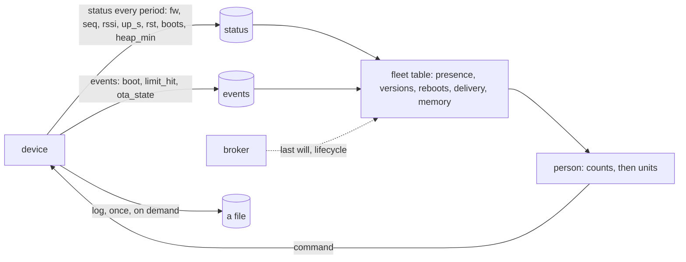

# Chapter 9 - Observability and OTA

*A fleet you cannot touch is known only through what each unit writes, what the broker notices and what an image is allowed to do to a unit; design all three before the first unit leaves the bench.*

Chapter 8 priced the box the diagrams call "cloud". This chapter is about living with it, in two directions. Outward: what the fleet shows you, which is only what you arranged for the devices to write and the broker to notice. Inward: what you may do to the fleet, which is one thing, replace its firmware, the most dangerous operation the system performs because it changes every layer of chapters 4 and 5 at once on a unit with a heater. Every number below is printed by [`examples/ch09/fleet.py`](examples/ch09/fleet.py); the snapshot in [`status_snapshot.json`](examples/ch09/status_snapshot.json) is synthetic, written by the tool from a seed with its faults planted at known devices, and says so.

## 1. Three questions about a unit you cannot touch

Is it alive? Is it running the code I think it is? What did it do, and why? Four carriers answer them, and the design decision is which carrier answers which. The *status record* (chapter 3) is pushed every period and is the place for counters. *Events* are the device's own story. *Presence* is judged where the silence is observed, never by the device (chapter 2). The *log* is read once by a person, after the fact, and is pulled on demand, never streamed: a thousand devices streaming serial output is chapter 8's download bill for text nobody reads, while a counter in a record that already exists costs a few bytes.



The farm monitor's status record gains four fields, about twenty bytes, and its schema number stays 2 because chapter 3's rule 4 says readers tolerate fields they do not know:

| field | meaning | what it answers without a log |
|---|---|---|
| `up_s` | seconds since boot | a reboot happened, and when |
| `rst` | reset reason, one of `power sw wdt panic brownout unknown` | why: a power cut, an OTA restart, a hung task, a crash, a weak supply |
| `boots` | boot counter kept in NVS | a loop (two hundred boots on a unit a month old) against a cold start |
| `heap_min` | the least free heap since boot | a leak, days before it becomes a watchdog reset |

With `seq`, `rssi` and `fw` from chapter 3 the record carries everything section 3 needs. `seq` is status writes since boot and `up_s` over the period is how many there should have been; the ratio is the link's delivery rate in one division, and `rssi` says whether the radio or the router is to blame.

## 2. Presence: four detectors of one silence

Chapter 2 placed N3 ("offline after ten missed status writes") in the cloud, and chapter 6 called the MQTT last will "the faster detector of the same silence, not a different truth". `python fleet.py presence` tests that sentence: a thousand devices, one day, three short Wi-Fi hiccups each (log-normal, median 40 s) and one long outage of 30 to 120 minutes per fifty device-days; status every 60 s, N3 window 600 s, keep-alive 300 s, so the will comes after 450 s of silence. One detail of MQTT decides the result: the will is published *once per lost session*, when the keep-alive runs out or, sooner, when the device reconnects with the same client id and the broker closes the old session (MQTT 3.1.1, section 3.1.4). A hiccup of 40 s produces a will at second 40.

| detector | notified | wanted | noise | missed | mean delay |
|---|---|---|---|---|---|
| status age > N3 window | 41 | 39 | 2 | 0 | 9 min |
| last will or lifecycle event, raw | 2 954 | 39 | 2 915 | 0 | 65 s |
| last will, 60 s hold-down | 47 | 39 | 8 | 0 | 8 min |
| last will, hold-down to N3's window | 41 | 39 | 2 | 0 | 9 min |
| the device's own `online: true` | 0 | 0 | 0 | 39 | never |

"Wanted" is an outage at least one window long; "noise" is a notification for a shorter one. Of 2 954 outages, 39 deserved a notification and the raw will sends 2 954: three a day per device, chapter 1's "power cuts must not spam the farmer" failed by a factor of twenty. Held down until N3's window has passed, the will reproduces the status-age row exactly, every outage and every delay; the tests assert that identity on two thousand random outages. The will is a faster clock, not a second opinion; its one use is to start N3's timer when the broker notices rather than at the next missed period. The last row is both real systems: a device cannot write `false` for the field that says it is connected, so the field detects nothing. Two rules: *presence is a count of missed periods, judged in the cloud, and the will may only start that count*; *1.5 keep-alives must fit inside the window*, or the will cannot see an outage before N3 does (exercise 2).

## 3. The fleet table

`python fleet.py health status_snapshot.json` turns one snapshot of sixty status records into the five lines a fleet dashboard needs. The snapshot is synthetic; its faults were planted so the chapter can point at them:

```
presence   online 57   offline 3   (window = 10 misses: gh 600 s, pl 6000 s, gw 600 s)
           gh07  silent    2.1 d  last status 2026-10-27 08:46:00Z  fw 1.4.0
           pl03  silent    2.2 h  last status 2026-10-29 09:50:00Z  fw 1.5.0
           gh12  silent   35 min  last status 2026-10-29 11:25:00Z  fw 1.5.0
firmware   1.5.0: 54   1.4.0: 6
           6 behind current 1.5.0: gh01 gh02 gh03 gh07* pl01 pl02  (* = offline, the rollout cannot reach it)
reboots    rebooted in the last 24 h: 4   by reason: wdt 1   panic 1   brownout 1   sw 1
           loop suspect gh20: up 140 s after wdt, boots 212
           loop suspect gh21: up 230 s after panic, boots 180
delivery   fleet 98.2 % of expected status writes since boot
           weak link gh36: 82 % delivered, rssi -88 dBm
           weak link gh34: 85 % delivered, rssi -86 dBm
           weak link gh35: 87 % delivered, rssi -87 dBm
           weak link gh33: 88 % delivered, rssi -84 dBm
memory     low heap_min gh40: 9.8 kB (floor 20 kB)
```

Read it line by line. *Presence* uses each class's own window: ten misses is 600 s for a greenhouse node and 6 000 s for a plot node that reports every ten minutes, so `pl05`, silent for 70 minutes, is online and `gh12`, silent for 35, is not. *Firmware* is the rollout's progress bar, and the asterisk its most useful character: `gh07` is behind and silent for two days, so the rollout's reach is 59 units and a stage that waits for 100 % waits forever. *Reboots* separates four restarts into a watchdog, a panic, a brownout and a software reset: the software reset is the unit the rollout updated an hour ago, the brownout is a power supply, and two units up for minutes after a watchdog and a panic with two hundred boots on the counter are loops, which a temperature chart never shows. *Delivery* says the fleet got 98.2 % of the status writes it expected and names four units below 90 %, all below -84 dBm: an antenna or a router, not firmware. *Memory* names one unit whose free heap touched 9.8 kB: next week's watchdog line.

Five lines, one snapshot, no log fetched. The rule: *alert on counts, then look at units*. Offline above 5 % of the fleet, any loop suspect, any unit under the heap floor are the three alerts; the rest is read by a person in the morning.

## 4. What each shape shows

`python fleet.py signals signals.json` reads [`signals.json`](examples/ch09/signals.json): nine things you want to know and, for each of chapter 8's shapes, whether configuration shows it (*native*), one more managed piece does (*add-on*) or your code does (*you build*):

| signal | A Firebase RTDB | B AWS IoT Core | C self-hosted |
|---|---|---|---|
| status age per device | add-on | add-on | you build |
| last will | you build | native | native |
| connect and disconnect events | you build | native | add-on |
| broker and database metrics | native | native | native |
| firmware version inventory | you build | add-on | you build |
| reboots and their reasons | you build | you build | you build |
| a device's log, on demand | you build | add-on | you build |
| OTA state per device and the rollout | you build | native | you build |
| alert on a fleet count | add-on | add-on | add-on |
| **counts** | 1 / 2 / 6 | 4 / 4 / 1 | 2 / 2 / 5 |

Three readings. On shape A the database knows nothing about a device except what the device writes, so section 1's four fields *are* its observability and the rollout is a script and a per-device record you design (section 6). Shape B sees sessions: the will, lifecycle events on `$aws/events/presence/…` with a disconnect reason, and IoT Jobs, which is section 6's staged rollout with a halt rule as a managed feature. The *reboots* row is "you build" everywhere: no platform sees inside the chip, which is why the fields go into the record the device already writes.

## 5. The image: eight checks before and after the flash

Chapter 7 left one question open for the incubator: who told the device to flash this? The answer is a *manifest*, a small JSON record signed by a key whose private half lives on one machine (a laptop, or the CI runner's secret store) and whose public half is compiled into every image. The device never holds the private key and the server that stores the image never needs it: database, bucket and HTTPS server become plumbing, chapter 7's rules a second layer. The image lives at one path per version (chapter 8), and the manifest names it:

```json
{"schema": 1, "product": "farm-monitor", "hw": "gh-rev-b", "version": "1.5.0", "min_fw": "1.3.0",
 "size": 300000, "sha256": "6a0b…", "url": "https://updates.example.net/farm-monitor/1.5.0/gh-rev-b.bin"}
```

The signature covers those eight fields serialised with sorted keys and no whitespace, so two machines agree on the bytes. The tool signs with Ed25519 as RFC 8032 writes it, in Python integers, and the tests check the RFC's vectors; a device uses its SDK's verifier (ESP-IDF's Secure Boot V2 checks an image's own signature in the bootloader; libsodium or mbedTLS check a manifest's in the application). `python fleet.py checks` runs eleven candidates through the eight checks a unit running 1.4.0 makes:

| candidate | outcome | decided by |
|---|---|---|
| 1.5.0, signed, intact, healthy after boot | FLASHED | all eight |
| same manifest; one byte of the download flipped | REFUSE | C7 digest |
| manifest edited to 1.6.0 after signing | REFUSE | C1 signature |
| 1.5.0 signed with a different key | REFUSE | C1 signature |
| 1.3.0 signed with the right key (an old image replayed) | REFUSE | C2 newer |
| `1.4.0-ota`, signed (a build tag in the version) | REFUSE | C2 newer |
| 1.5.0 built for hardware `pl-rev-a` | REFUSE | C3 hardware |
| 1.5.0 with `min_fw` 1.4.5; the unit runs 1.4.0 | REFUSE | C4 stepping stone |
| 1.5.0 of 1 800 000 bytes; the slot is 1 572 864 | REFUSE | C5 size |
| 1.5.0 after three failed attempts | REFUSE | C6 attempts |
| 1.5.0, intact, but the sensor never answers after boot | ROLLBACK | C8 health |

The order is the point. C1 to C6 run on the manifest alone, before a byte is downloaded: the signature first, so an edited manifest and a foreign one fail the same way; then a version that parses as `MAJOR.MINOR.PATCH` and is strictly newer (never sideways, never a downgrade, which stops a signed old image from being replayed), the hardware id, the stepping stone `min_fw`, the partition size, and the attempt counter in NVS that stops a fourth try and asks a person. C7 hashes the streamed bytes before the boot partition is switched. C8 cannot run before the reboot: the new image boots *pending*, marks itself valid only when the sensor answers and the safety task has ticked for the health window, and otherwise the bootloader returns to the previous slot (ESP-IDF's app rollback; the incubator's `healthTick()`). What C8 cannot catch is an image that is alive and wrong: a control loop with inverted hysteresis passes every health check, which is why section 6 exists.

## 6. The rollout and the halt rule

A rollout is a per-device *desired* record (`version`, manifest URL) that a script rewrites for a few units at a time, and a per-device *state* the unit writes back (`downloading`, `flashing`, `pending`, `valid 1.5.0`, `rolled back: …`). `python fleet.py rollout` plays stages of 1 %, 10 % and 100 % of a thousand units against an image that fails C8 on 15 % of one hardware revision, 30 % of the fleet, so 4.5 % of all units. Each unit polls every five minutes, boots and reports health within three minutes; a stage waits an hour of soak after its last report, then halts if the rolled-back share reaches 1 %:

```
stage  offered  flashed  healthy  rolled back  retried      took  decision
    1       10       10        8            2        0    68 min  HALT: 2 of 10 rolled back (20.0 % >= 1 %)

halted at stage 1: 2 units booted the bad image and rolled back, 8 run it; all at once would have hit about 45.0
the halt rewrote every desired record to the old version, so the affected units stop retrying
```

One run is one draw; `--trials 500` runs the same image five hundred times with consecutive seeds:

| stages | halted at stage 1 / 2 / 3 | completed | units that booted the bad image: mean, median, worst | all at once |
|---|---|---|---|---|
| 1, 10, 100 % | 38 % / 61 % / 1 % | 0 % | 3.3, 2, 56 | about 45 |
| 5, 25, 100 % | 89 % / 11 % / - | 0 % | 3.2, 2, 15 | about 45 |
| 100 % (no stages) | 100 % / - / - | 0 % | 45.0, 45, 64 | about 45 |

Four things to read. *A stage of ten units is a smoke test, not a statistic*: at a 4.5 % defect it passes 62 % of the time and the second stage does the catching; the mean exposure is still 3 units against 45. *The halt threshold must be below one over the first stage's size*: with ten units any failure is 10 %, so 1 % halts, while 11 % completes 92 % of the time and exposes 41.5 units (exercise 3). *The soak is the price of seeing a slow failure*: a good image completes in 3.5 hours with it and 29 minutes without, and the hour is what lets a leak or a stuck sensor show in the fleet table before the next stage. *The halt must withdraw the desired record*, not just stop offering: with `--no-withdraw` each affected unit retries until the attempt counter stops it, two more flash-reboot-rollback cycles, each a `SafeRestart` with the heater off and a three-minute health window, so a forgotten record costs each affected incubator three reheats. Between stages a person reads section 3's table *per version*: an image that passes C8 but raises more `limit_hit` events or lowers `heap_min` on the units running it is the alive-and-wrong case, and the fleet table is its only detector.

## 7. The two real systems

**queen-bee-incubator.** Its firmware README describes an OTA path with six of the eight checks. The device polls `/devices/<name>/ota/version` every five minutes and flashes only if the version "parses as MAJOR.MINOR.PATCH and is strictly newer than the running `FIRMWARE_VERSION` (never sideways, never a downgrade)" (C2) and "has failed fewer than `OTA_MAX_ATTEMPTS` times (counted in NVS across reboots)" (C6); the image "is streamed through SHA-256 while it is decoded and written, and a mismatch aborts before the boot partition is switched" (C7); the reboot "goes through `SafeRestart` (heater off, cycle checkpointed)" and the new image is "pending verification" until `healthTick()` has seen "the sensor answering and the Safety task ticking" for three minutes, "otherwise it is marked invalid and the bootloader rolls back" (C8). `/ota/state` and `/ota/running` are section 6's state record; `/status.reset` "carries the ESP reset reason of the current boot", section 1's `rst`; the SD-card alarm log with a Send Log button is section 1's rule exactly. Missing is what the README itself names: the `/ota` branch "is still only as protected as the Firebase rules", so C1 does not exist, and the image is a base64 copy per device (chapter 8). The dev app pushing one unit at a time is a staged rollout with a person as the script. `status.online: true` is section 2's last row; the data contract's "from `online` + stale `ts`" works because of its second half.

**smart-poultry-farm.** `meta/lastSeen`, patched every 10 s and judged stale by the app, is the status-age detector placed correctly; `meta/status: "online"` never becomes `"offline"`. `meta/firmware` and `meta/startupTime`, written at boot, give the version inventory and the reboot in one query, without the reason. `cloudReachable()` at 90 s is the device's view of the link, used only for the local lock, where chapter 2 allows it. OTA is a browser upload page on the LAN behind basic-auth with defaults in `config.h` (chapter 7's gap); the README states no version check, digest or rollback, and its version string `1.4.0-ota` would fail C2, the argument for a build tag in a separate field. The order of work for both: the four status fields and a `boot` event (an afternoon, no cloud change); a manifest signed on the laptop with the public key in the next image, so the image after that is the first protected one; then, for the poultry controller, the pending-valid boot the incubator already has.

## 8. What to hand over at the end of this step

1. The status record's health fields, the fleet table's five queries and the three alert thresholds.
2. The presence rule: the window per class, the keep-alive that fits inside it, "the will starts the timer".
3. The signing key's home and the public key's; the manifest schema; the eight checks as host-side tests.
4. The rollout plan: stage sizes, soak, a halt rate below one over the first stage, withdrawal, who reads the fleet table per version between stages.
5. The log-on-demand path, and the rule that no listener is attached to it.

## Exercises

1. **A short keep-alive.** Run `presence --keepalive-s 60`. Which rows change, which do not, and why would a team choose 60 s anyway?
2. **A tighter N3.** Run `presence --misses 3` (a 180 s window). Which detectors now miss real outages, how many, and what must change for the will to be useful at all? Give the keep-alive as a formula.
3. **The threshold.** Run `rollout --halt-rate 0.11 --trials 500`. Explain the completion rate from the first stage's size, and state the rule that relates the two.
4. **A rare defect.** Run `rollout --defect 0.015 --trials 500` (0.45 % of the fleet). How much do the stages buy, which detector is the right one for a defect this rare, and what in the tool's output protects the halt rule from being tripped by power cuts instead?
5. **Moving the incubator's image.** Design the move from `/devices/<name>/ota/binData` per device to one shared image per version with a signed manifest. What do the rules say the device may read and write, what does the dev app change, and what happens to Spark's 1 GB (chapter 8)?

<details>
<summary>Answers</summary>

**1.** The raw will stays at 2 954 with a mean delay of 37 s, the 60 s hold-down goes from 8 to 381 noise notifications, and the status-age and hold-down-to-N3 rows do not move: the will now fires at 90 s, every hiccup over a minute and a half crosses a 60 s hold-down, and the N3-based rows were never a function of keep-alive. A team chooses 60 s to free the broker's half-open sessions sooner, a broker argument that is fine as long as nothing notifies off the will directly.

**2.** With a 180 s window, 208 outages are wanted. The status-age detector reports them all with 82 noise; the two will-based rows report 47 and 53 and *miss* 161 and 155, because the will cannot fire before 1.5 × 300 = 450 s and the hold-down to N3 is max(0, 180 - 450) = 0. The will is useful only when 1.5 × keep-alive ≤ window, so keep-alive ≤ 120 s here. The device's flag misses all 208.

**3.** 92 % complete, 41.5 units exposed on average, 8 % halted at stage 1 (two or more failures among ten). A stage of n units cannot halt on one failure unless the threshold is at most 1/n; with n = 10 that is 10 %, so 11 % halts only on two. Rule: halt rate < 1 / (first stage size), or the first stage holds at least 1 / (halt rate) units.

**4.** 60 % complete, 3.0 units exposed on average against 4.5 all at once: the stages buy little because the defect rate (0.45 %) is below the halt rate (1 %), and stage 3 halts only at 9 of 900. For a defect this rare the fleet table per version (events, `heap_min`, reboot reasons on the new version against the old) is the detector, not the halt rule. The `retried` column protects the rule: a flash interrupted by a power cut keeps the old image and counts as a retry, never a rollback, so a stormy night cannot halt a good image.

**5.** One path `/firmware/<version>/{manifest, image}`, written only by the signer's account and readable by every authenticated device (`.read` for devices, no `.write`); per device, `/devices/<name>/ota/desired` written by the operator's account and `/ota/state` written only by that device, with chapter 7's `auth.token.deviceId === $name`. The dev app stops encoding the binary; it signs a manifest on the laptop and writes `desired` for the units of the current stage, and the firmware checks C1 before it reads the image path. Storage falls from one copy per unit (1 to 2 MB each, chapter 8 section 7) to one per version: a hundred units cost 2 MB instead of 200, and the Spark plan's 1 GB stops being the first wall.

</details>

## What to read next

- **Chapter 10**: the farm monitor end to end, where this chapter's fleet table, presence rule, manifest and rollout plan are assembled with the other eight artefacts.
- OASIS, *MQTT Version 3.1.1*, sections 3.1.2.5 (Will Flag) and 3.1.4 (the take-over of an existing client id): why the will is published once per lost session.
- AWS IoT Core Developer Guide, "Lifecycle events" and "Jobs" (rollout and abort configuration): shape B's managed form of sections 2 and 6.
- ESP-IDF Programming Guide, "Over The Air Updates" (app rollback, anti-rollback) and "Secure Boot V2": the two app slots, the pending-verify state behind C8, the bootloader's own image signature.
- RFC 8032, *Edwards-Curve Digital Signature Algorithm (EdDSA)*: the algorithm the tool implements, with the test vectors the tests check.
- The Update Framework specification (theupdateframework.io): manifests, key roles and rollback protection done in full; this chapter's eight checks are its small subset.
