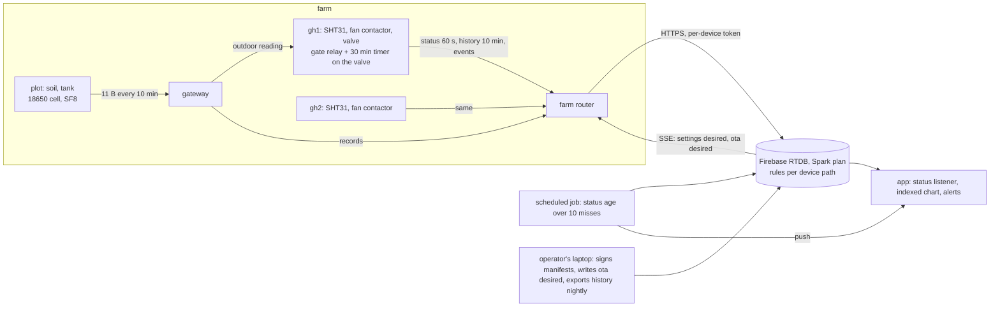

# Chapter 10 - Case study: the farm monitor end to end

*A design is finished when every decision in it points back to a row of the never-list or a line of the brief, and every artefact that proves it is in the repository.*

Nine chapters took one brief apart. This chapter puts it back together: the farm monitor as one design record, every artefact the earlier chapters handed over, plus two new ones, a bill of materials and a three-year cost, and one check that closes the loop, a traceability matrix from each decision back to chapter 1. Every number below is printed by [`examples/ch10/design.py`](examples/ch10/design.py), which re-runs the earlier chapters' tools on their own JSON files; `python design.py dossier` prints the whole record as one Markdown file. The prices in [`bom.json`](examples/ch10/bom.json) are assumptions and say so per line; nothing was bought, built or deployed.

## 1. The brief, and the shape of the answer

The brief is chapter 1's, unedited, numbered so that decisions can cite it:

| line | the farmer asked for |
|---|---|
| B1 | air temperature and humidity in each greenhouse, soil moisture in the plot, the level of the irrigation tank |
| B2 | one fan per greenhouse and one irrigation valve, switched automatically within limits the farmer sets, and manually from the phone |
| B3 | live values and a week of history in an app; an alert when something is wrong |
| B4 | mains at the greenhouses that cuts out several times a week; Wi-Fi covers the greenhouses; the plot is 200 m away |
| B5 | under 150 USD of hardware per greenhouse, no monthly bill that scares a smallholder |

Four nodes answer it, three from the brief and one the brief did not know it needed:

| node | class | power | link | senses | switches |
|---|---|---|---|---|---|
| gh1 | greenhouse node | mains | Wi-Fi: HTTPS on a kept TLS session, SSE on `settings/desired` | air temperature, humidity | fan (through a contactor), valve |
| gh2 | greenhouse node | mains | same | air temperature, humidity | fan |
| plot | plot node | one 18650 cell, 2 000 mAh | LoRaWAN class A at SF8, an 11-byte frame every 10 min | soil moisture, tank level | nothing |
| gw | gateway | mains at greenhouse 1 | LoRaWAN to the plot node, Wi-Fi to the router | nothing; translates frames into records and shares the outdoor reading by a local hop | nothing |



The gateway is the box the brief did not name: it is what 200 m costs (chapter 6), and section 8 shows it is the most expensive line on the farm.

## 2. What must never happen, and the numbers it sets (chapter 1)

The never-list is unchanged except that N7, left empty in chapter 1 on purpose, is now answered by chapter 7 ([`examples/ch01/never_list.json`](examples/ch01/never_list.json), in short form):

| row | severity | must never happen | answered by |
|---|---|---|---|
| N1 | critical | an actuator stays on until harm: the heater in chapter 1's wording, the valve on this farm | interlock, gate, max-on timer (ch4, ch5) |
| N2 | critical | a sensor fails and the controller keeps acting on its last value | three-period staleness, range, `null` (ch3, ch4) |
| N3 | major | the farmer believes the system is fine while it has been silent for an hour | status age in the cloud, push (ch2, ch9) |
| N4 | critical | a reboot after a power cut turns an actuator on before any reading exists | pull-downs, safe states first, watchdog (ch4, ch5) |
| N5 | major | a setting typed in the app is applied without limits | clamp on the device, report back (ch3) |
| N6 | minor | readings are lost during a network outage | outbox per stream, replay in order (ch4, ch6) |
| N7 | critical | anyone on the internet can change a device's settings | per-device token, rules, signed images (ch7, ch9) |

Chapter 1's two rules still decide everything below: a critical response may not depend on the network, the cloud or the app (Rule A), and a hazard may not be guarded only by the parts that cause it (Rule B). The numbers that follow from the rows are the design's constants:

| requirement | value | comes from |
|---|---|---|
| sensor period | 15 s | N2: three missed periods is a 45 s detection delay |
| status write | every 60 s (greenhouse), every 10 min (plot) | N3: ten misses before offline keeps false alarms rare |
| offline threshold | 10 misses: 600 s greenhouse, 6 000 s plot | N3 and B4 |
| temperature accuracy | ±0.5 °C | fan thresholds are whole degrees |
| local buffer | 2 h at 15 s = 480 readings | N6: outages are minutes, not days |
| history retention | 30 days hot in the database, 2 years in a bucket | B3 and chapter 8's storage line |
| hardware | under 150 USD per greenhouse | B5 |
| cloud bill | $0 at the brief's size | B5, chapter 8's K4 |

## 3. What runs where, and what crosses the link (chapters 2 and 3)

Chapter 2's tool places the fourteen computations: seven on the device, one on the gateway, five in the cloud, one in the app. Four streams cross the link, and chapter 9 added a fifth:

| stream | writer | mode | key | kept |
|---|---|---|---|---|
| status | device | overwrite every 60 s (plot: 10 min) | device | latest only |
| history | device | append every 10 min, `min`/`mean`/`max` | device + `ts` | 30 d in the database, 2 y in the bucket |
| events | device; the app acknowledges | append, `id` = `dev-ts-type` | `id` | forever |
| settings desired / reported | app / device | overwrite, `version` echoed, clamped on the device | device | latest only |
| ota desired / state | operator / device | overwrite: manifest URL and version / `downloading` … `valid`, `rolled back` | device | latest only |

The status record carries `schema dev ts t h soil tank fan valve rssi fw seq` from chapter 3 and `up_s rst boots heap_min` from chapter 9, about 120 bytes with its key; readers migrate on read and tolerate unknown fields, which is how four were added without a schema change. Chapter 3's growth tool sizes the rest: history 9.36 MB a year per device, 18.71 MB at steady state with two years' retention.

## 4. Inside the node (chapters 4 and 5)

Six tasks, one snapshot with one writer per field, one interlock called by one task:

| task | period | core | blocks | feeds the watchdog | writes | from |
|---|---|---|---|---|---|---|
| sensor | 15 s | 1 | no | no | readings, `sample_ts`, `seq` | N2 |
| safety | 100 ms | 1 | no | yes, 5 s | `fan`, `valve`, `fault`; pulses the gate; the only caller of the interlock | N1 N2 N4 |
| control | 1 s | 1 | no | no | `req_fan`, `req_valve` | B2 |
| display | 200 ms | 1 | no | no | nothing shared | ch2 R4 |
| datalog | 600 s | 1 | SD | no | history outbox | N6 |
| comms | 60 s | 0 | network | no | `link_ok`, `rssi`, `link_stage` | N3 N6 |

Safe states first: the fan's is *on* (a fan running for no reason costs electricity; a greenhouse without one overheats), the valve's is *closed* (a valve open for no reason floods a plot). The boot order follows: pull-downs, safe states before any sensor or radio is initialised, `ready` false until a real reading, the network last. The watchdog is fed by the safety task alone, 5 s, which with 2 s of boot and one sensor period fits inside N1's 30 s.

Chapter 5's worked example was the incubator's heater; this farm's hazard is the valve, and its layers are built the same way, each sensing something the layer below cannot and acting through a part the layer below does not share:

| layer | senses | acts through | catches | response |
|---|---|---|---|---|
| control + interlock (firmware) | the sensor; the tank level trend | firmware → relay | limits, a 30 min max on-time, a sensor that lies by range or staleness | 1 s |
| watchdog + pull-down | the safety task's silence | a reset; the pin held low | a hung MCU | 5 s + 2 s boot |
| heartbeat gate | silence, or a fault the firmware declared by ceasing to pulse | a second relay in series with the valve | a hung MCU; a shorted valve relay once the firmware sees the level fall | 3 s |
| hardware max-on timer | time, directly | the same series relay | a shorted valve relay the firmware never notices | 30 min |
| a person | the buzzer; the app's offline and fault alerts | hands | power loss (both safe states hold without firmware), a fan stuck off | minutes to an hour |

The gate is a retriggerable monostable the safety task pulses every 100 ms; stop pulsing, by hanging or by deciding to, and the series relay drops in 3 s. The timer is the valve's bimetal cutout: it drops the same relay 30 minutes after the valve opened unless the firmware re-arms it, so a relay welded shut under a healthy firmware still cannot flood past half an hour (Rule B). Two rows are accepted with a written reason: a fan stuck off is a repair call; power loss closes the valve with no firmware at all. Chapter 1's field 8, one bench test per row, is in [`trace.json`](examples/ch10/trace.json) as the acceptance list for the first unit.

## 5. The links and the comms contract (chapter 6)

Chapter 6's tool excludes before it chooses: Wi-Fi for the greenhouse nodes (LoRaWAN falls on X3, 281.8 s of airtime a day against a 30 s fair use), LoRaWAN class A at SF8 for the plot node (Wi-Fi falls on X1 at 200 m, cellular on X5; LoRaWAN gives 1.16 mAh a day, about 3.3 years). The pump-house node in that table is outside this brief; section 9 says what the traceability check does with it.

One decision had to be made where two chapters met. Chapter 6 preferred MQTT on a kept session (132 B a status against 542 B over kept HTTPS); chapter 8 chose shape A, a database the device writes to, which speaks HTTPS and SSE. On mains Wi-Fi the 410 extra bytes a minute cost nothing and shape A's $0 bill wins B5, so the greenhouse node writes status by HTTPS on a kept TLS session and holds one SSE stream on `settings/desired`. Chapter 6's comms contract does not change (stages, clock before TLS, jittered backoff, an outbox per append stream, presence judged by the cloud); a migration to shape B swaps the transport for MQTT and gains the last will as a faster clock, and the records and the contract stay. The gateway's power supply is on the never-list: when it dies the plot node is silent, and N3's 6 000 s window is what the farmer sees.

## 6. Identity and the cloud (chapters 7 and 8)

Chapter 7's inventory of the design has twelve values and no gaps: five identifiers in source or the image, the Wi-Fi password and a per-device token in NVS, the hotspot password per unit on the label, the user's session on the phone, and the two fleet secrets, the token-signing key and the OTA private key, on one server and nowhere else. The rules spend that identity: a device writes its own `status` with exactly the schema's fields, appends `history` only where no key exists, reads `settings/desired` and `ota/desired` and writes `ota/state`; the owner reads and writes settings; the server alone writes `owners` and `disabled`; nothing else at the root. The claim flow mints the token after the identity is known, with the owner's signed-in app as the authority, so one image serves every unit.

Chapter 8's five rules at the brief's size give shape A on the Spark plan, $0 a month, with its two `you build` rows written before launch: a nightly export of history older than 30 days to a bucket, and the signed OTA manifest with its rollout script. Listeners attach to `/devices/<id>/status` only; charts are an indexed `limitToLast` query. One job sits beside the free data path: N3's detector is a scheduled job that reads the status ages and pushes, which chapter 8 left uncosted at cents a month.

## 7. Living with it (chapter 9)

The four health fields give chapter 9's five-line fleet table with no log fetched. The three alerts are on counts: offline above 5 % of the fleet, which at three units means any unit; any loop suspect; any unit under the 20 kB heap floor. Presence is status age over ten misses per class, judged in the cloud; there is no last will on shape A and no device-written `online` flag anywhere.

The rollout is chapter 9's stages scaled to three units: the private key on the operator's laptop, the public key in every image, the manifest at one path per version; stage one is gh2 alone, the fleet table read per version through an hour's soak, then gh1 and the gateway. With a first stage of one unit the halt rule is one over one: any rollback halts and withdraws the desired record. The plot node gets no over-the-air update, since a 300 kB image does not travel over LoRaWAN within this handbook's scope; it is reflashed by cable at a site visit, which makes its image the most conservative in the fleet and the visit interval, 180 days, a design parameter.

## 8. Bill of materials and the three-year cost

`python design.py bom bom.json` prices each class; every unit price is an assumption, typical single-unit retail in 2026, labelled in the file, and the "why" column is the chapter that put the part there:

| part (greenhouse node) | qty | unit | why |
|---|---|---|---|
| ESP32-WROOM-32 DevKit, 4 MB, two app slots | 1 | $6.00 | six tasks (ch4), Wi-Fi (ch6), OTA slots (ch9) |
| SHT31 breakout, ±0.3 °C | 1 | $7.00 | ±0.5 °C (ch1); own I2C bus (ch4) |
| 2-channel relay module, opto-isolated, active-high | 1 | $3.00 | active-high so a pull-down means off (N4) |
| 10 kΩ pull-down resistors | 2 | $0.10 | off before the first instruction (N4) |
| heartbeat gate: CD4538 monostable + series relay on the valve | 1 | $4.00 | ch5 layer 3 |
| hardware max-on timer, 30 min | 1 | $2.00 | ch5 layer 4 |
| contactor sized to the fan (allowance) | 1 | $10.00 | the module switches a coil, not the fan |
| piezo buzzer | 1 | $1.00 | N1 and N2 respond without the network |
| 16x2 LCD, I2C | 1 | $4.00 | the display runs on the device (ch2 R4) |
| micro-SD module and card | 1 | $4.00 | N6 outbox; the log pulled once (ch9) |
| 5 V 2 A supply, fused inlet | 1 | $6.00 | B4; the fuse opens the energy path (ch5) |
| IP65 enclosure, glands | 1 | $8.00 | a greenhouse is wet |
| perfboard, terminals, wire, label | 1 | $5.00 | the label carries id and hotspot password (ch7 H5) |
| **total** | | **$60.20** | against $150.00: $89.80 left for the second sensor and spares |

| class | parts | total | budget line |
|---|---|---|---|
| plot node | ESP32 + SX1276 board with antenna, capacitive soil probe, waterproof ultrasonic level sensor, 18650 cell with protection, IP65 enclosure, label | $43.00 | none in the brief |
| gateway | 8-channel indoor LoRaWAN gateway with Wi-Fi backhaul, outdoor 868 MHz antenna, supply | $137.00 | none: it is the plot node's cost of reach |
| **the brief's farm** | 2 × gh + 1 × plot + 1 × gw | **$300.40** | once |

Two things to read before the cost table. The safety hardware of chapter 5, which is almost never in a first design, is $6.20 of the $60.20. And the gateway is 45.6 % of the farm's hardware: the most expensive line in the design is not a sensor, a board or a database, it is the 200 m between the greenhouse and the plot.

`python design.py cost bom.json` adds chapter 8's bill, times 36 months, and chapter 8's operations hours at an assumed $20 an hour:

| devices | shape | nodes gh / plot / gw | hardware once | cloud 36 mo | operations 36 mo | total | per device-month |
|---|---|---|---|---|---|---|---|
| 3 (the brief) | A Firebase RTDB | 2 / 1 / 1 | $300.40 | $0.00 (Spark) | $0.00 | $300.40 | $2.78 |
| 10 | A Firebase RTDB | 7 / 3 / 1 | $687.40 | $0.00 (Spark) | $0.00 | $687.40 | $1.91 |
| 10 | B AWS IoT Core + stores | 7 / 3 / 1 | $687.40 | $29.19 | $0.00 | $716.59 | $1.99 |
| 10 | C self-hosted MQTT + Timescale | 7 / 3 / 1 | $687.40 | $494.86 | $1 440.00 (2 h/mo) | $2 622.26 | $7.28 |
| 1 000 | A Firebase RTDB | 667 / 333 / 34 | $59 130.40 | $3 841.71 | $0.00 | $62 972.11 | $1.75 |
| 1 000 | B AWS IoT Core + stores | 667 / 333 / 34 | $59 130.40 | $2 659.63 | $0.00 | $61 790.03 | $1.72 |
| 1 000 | C self-hosted MQTT + Timescale | 667 / 333 / 34 | $59 130.40 | $933.91 | $5 760.00 (8 h/mo) | $65 824.31 | $1.83 |

Chapter 8 spent three thousand words on the cloud column, the one that can be wrong by a factor of fifty. But over three years the hardware is 94 to 96 % of the total on the managed shapes at a thousand devices, and the three shapes land within eleven cents of each other per device-month. "A bill that scares a smallholder" turns out to be the one-off: $300 of hardware, nearly half of it the gateway, against a cloud bill of zero. The exception is shape C at ten devices, where one instance and two hours a month are nearly three times the hardware: the shape a hobbyist reaches for first is the one a farm of ten can least afford. At a hundred thousand (exercise 4) the hours column is a job and the dollar column a rounding error, chapter 8's conclusion from the other side.

## 9. Traceability: the check that closes the course

Chapter 1 ended with a sentence this chapter turns into a test: *if a later chapter's decision cannot be traced back to a row here, either the row is missing or the decision is unjustified.* [`trace.json`](examples/ch10/trace.json) lists 23 decisions of chapters 2 to 10, each with the rows it answers and the file that holds the artefact; `python design.py trace trace.json` reads the hazards from chapter 1's own file and checks that every citation is a real row, every row is answered, every critical row has a device-side response and a bench test, and every artefact exists; it exits 1 on a gap and runs in `make check`:

```
row  severity  ch1  ch2  ch3  ch4  ch5  ch6  ch7  ch8  ch9  ch10  decisions  bench test
N1   critical  .    1    .    3    2    .    .    .    1    .     7          yes
N2   critical  1    1    1    1    .    .    .    .    .    .     4          yes
N3   major     1    2    .    .    1    1    .    .    2    .     7          yes
N4   critical  .    1    .    3    1    .    .    .    1    .     6          yes
N5   major     .    1    2    .    .    .    1    .    .    .     4          yes
N6   minor     1    1    1    1    .    1    .    .    .    .     5          yes
N7   critical  .    .    .    .    .    .    2    .    1    .     3          yes
B1   brief     .    .    1    .    .    .    .    .    .    1     2          -
B2   brief     .    .    1    .    .    .    .    .    .    .     1          -
B3   brief     1    1    1    .    1    .    .    2    1    .     7          -
B4   brief     .    1    .    .    .    2    .    .    .    .     3          -
B5   brief     .    1    .    .    .    1    .    2    .    1     5          -

23 decisions, 0 gaps
```

The first run of this file did not print zero. It printed `B1: no decision answers this brief line`: nine chapters had designed around the measurements without one of them deciding what was measured, in what unit, with what range. The fix was chapter 3's field table, which existed all along and had never been claimed as a decision. That is what the matrix is for: not to prove the design right, but to find the row everybody assumed somebody else owned. Read the columns the same way: N1 is answered seven times, N7 three times and only from chapter 7 on, B2 once, so the thing the farmer actually asked for has the thinnest trace, normal for a safety-led design and worth saying to whoever wrote the brief. A decision with no row cannot enter: the pump-house node added as a decision prints `traces to nothing` (exercise 3). The dossier ends with the hand-over checklist, twelve artefacts with the file that holds each; today it prints `12 artefacts, 0 missing`.

## 10. The two real systems, read as design records

Both repositories hold most of the dossier's sections under other names; what follows is what each lacks as a *record*, not as a product.

**queen-bee-incubator.** The README's "Hardware" table is a bill of materials by part and pin (an ESP32 DevKit V1, two SHT31, the heater's solid-state relay on GPIO12, the fan relay, a door switch, a 20x4 LCD, an SD card, a buzzer, four buttons) without prices, so its own budget line cannot be checked from the repo. Its task table is the README's "five FreeRTOS tasks at fixed rates"; its stream table is `docs/DATA_CONTRACT.md`; its never-list is the safety paragraph ("40 °C thermal cutoff (latched until acknowledged *and* cooled) … maximum heater-on time … door-open actuator cutoff, hardware task watchdog"). Missing as a record: a machine-readable never-list, a bench-test list, a rules file ("the database rules are yours to set", says its security note), and a layer below the firmware for a stuck SSR, which chapter 5 put at 68.4 °C on its fitted chamber.

**smart-poultry-farm.** It has the better bill of materials: `docs/HARDWARE.md` lists quantities and notes per part, "ESP32 Dev Module (WROOM-32, 4 MB)", an AM2302 with its pull-up, an MQ135 that "needs a divider to 3.3 V for the ESP32 ADC", a "4-channel relay module, active-LOW, opto-isolated", a "5 V / 2 A power supply" with a "separate supply for actuators", again without prices. The active-low module deserves a paragraph in any N4 review: such a board energises its relay when the pin is *low*, where an ESP32 output can sit during reset, so chapter 1's pull-down becomes a pull-up on that design. Its stream table is `docs/FIREBASE_SCHEMA.md`, and its security notes are the N7 row in its own words: "the firmware authenticates with a legacy database secret and skips TLS certificate verification (`setInsecure()`)", with rules that "for this prototype are open". Run through `trace`, both systems would print the same first gap, N7 answered by nothing on the device, and the same empty column, the bench tests.

## 11. What to hand over at the end of the course

1. The dossier, generated, not written: `python design.py dossier design.json > DESIGN.md`, committed beside the code.
2. The traceability matrix at zero gaps, in CI, so a new feature must name its row before it merges.
3. The bill of materials with a source per price and the budget line it answers.
4. The three-year cost table, and the sentence that says which column is the design's cost.
5. The acceptance list for unit one, in order: N4, N2, N1 on the bench; N3 with the router; N7 in the emulator; then the first hour of soak with the fleet table open.

## Exercises

1. **The second sensor.** Add chapter 5's second SHT31 to `bom.json` and run `bom`. Does the greenhouse node still meet B5, and which chapter-5 layer could the money otherwise buy?
2. **The gateway's share.** From `cost --sizes 10,1000` and `bom`, what share of the hardware is the gateway at a thousand devices, which class dominates there, and where does a design week go at each size?
3. **Scope.** Add chapter 6's pump-house node to `trace.json` as a decision with the rows you think it answers, and run `trace`. What does the tool print, and what are the two ways to make it pass?
4. **A hundred thousand.** Run `cost --sizes 100000`. Which column dominates on each shape, how far apart are the three per device-month, and why does chapter 8's conclusion (shape C needs a team) survive a table in which shape C is cheapest?
5. **A stage of one.** State chapter 9's halt rule for a first stage of one unit, what the hour's soak buys that the halt rule cannot, and why the plot node's image, which the rollout never touches, is still a row in the rollout plan.

<details>
<summary>Answers</summary>

**1.** The node goes from $60.20 to $67.20, still $82.80 under B5. The same $7 would buy a second series relay for the fan path if the accepted "fan stuck off" row were ever promoted; the chapter kept that row accepted because a stopped fan is a repair call, while the sensor buys an N2 detector the firmware cannot build from one reading.

**2.** At a thousand devices there are 34 gateways, $4 658 of $59 130, 7.9 %; the greenhouse nodes are 67.9 %. At the brief's size the week goes to reach (a directional antenna and a second access point, which chapter 6's X1 refused at 50 m), because removing the gateway halves the farm's bill; at a thousand it goes to the $60.20 node, where a dollar saved is $667. Neither week goes to the cloud column.

**3.** With `traces_to: []` the tool prints `ch6: 'pump-house node on LoRaWAN class C at SF9…' traces to nothing` and exits 1. Either the brief gains a line (B6: a pump house 1.8 km away that must take a command within 60 s), after which the decision cites B6 and the N-row it creates (a pump stuck on), or the node leaves the design and stays an exercise. Citing an existing row it does not answer would pass the tool and fail the reviewer: the tool checks bookkeeping, not truth.

**4.** Hardware on every shape: $5.90 M against $384 k (A), $248 k (B) and $34 k (C, of which $28 800 is 40 hours a month). Per device-month: $1.75, $1.71, $1.65. Shape C is cheapest in dollars and still needs the team: the 40 hours are a job that must exist and its `you build` rows are code that must exist on day one; the table cannot price nobody being on call, chapter 8's K2.

**5.** The halt rate must be below one over the stage size; with one unit that is any rollback, and the halt must withdraw the desired record so gh2 does not retry up to its attempt counter. The soak hour is for the alive-and-wrong image that passes C8: an hour of the fleet table per version shows more `limit_hit` events, a lower `heap_min` or a reboot the old version did not have, which no halt rule sees. The plot node is in the plan because it will run the oldest firmware in the fleet, so `min_fw` in every manifest must keep it a valid stepping stone, and the version line must list it as unreachable rather than behind.

</details>

## What to read next

- The two repositories this handbook quoted, as design records to compare against sections 2 to 9: [queen-bee-incubator](https://github.com/Mariam-zeqred/queen-bee-incubator) (`README.md`, `docs/DATA_CONTRACT.md`, the firmware README) and [smart-poultry-farm](https://github.com/Mariam-zeqred/smart-poultry-farm) (`docs/HARDWARE.md`, `docs/ARCHITECTURE.md`, `docs/FIREBASE_SCHEMA.md`).
- Nancy Leveson, *Engineering a Safer World* (MIT Press, 2011): hazards, constraints and the control structure that chapter 1's never-list and this chapter's matrix are a small, mechanical subset of.
- NASA, *Systems Engineering Handbook* (SP-2016-6105), the requirements and verification chapters: the traceability matrix as the industry writes it, from need to requirement to test.
- The AWS Well-Architected Framework, *IoT Lens*: the same questions in the vocabulary of a cloud review; useful for the shape-B migration of section 5.
- This repository's `TODO.md`: every assumption the ten chapters made, with the measurement that would replace it.
